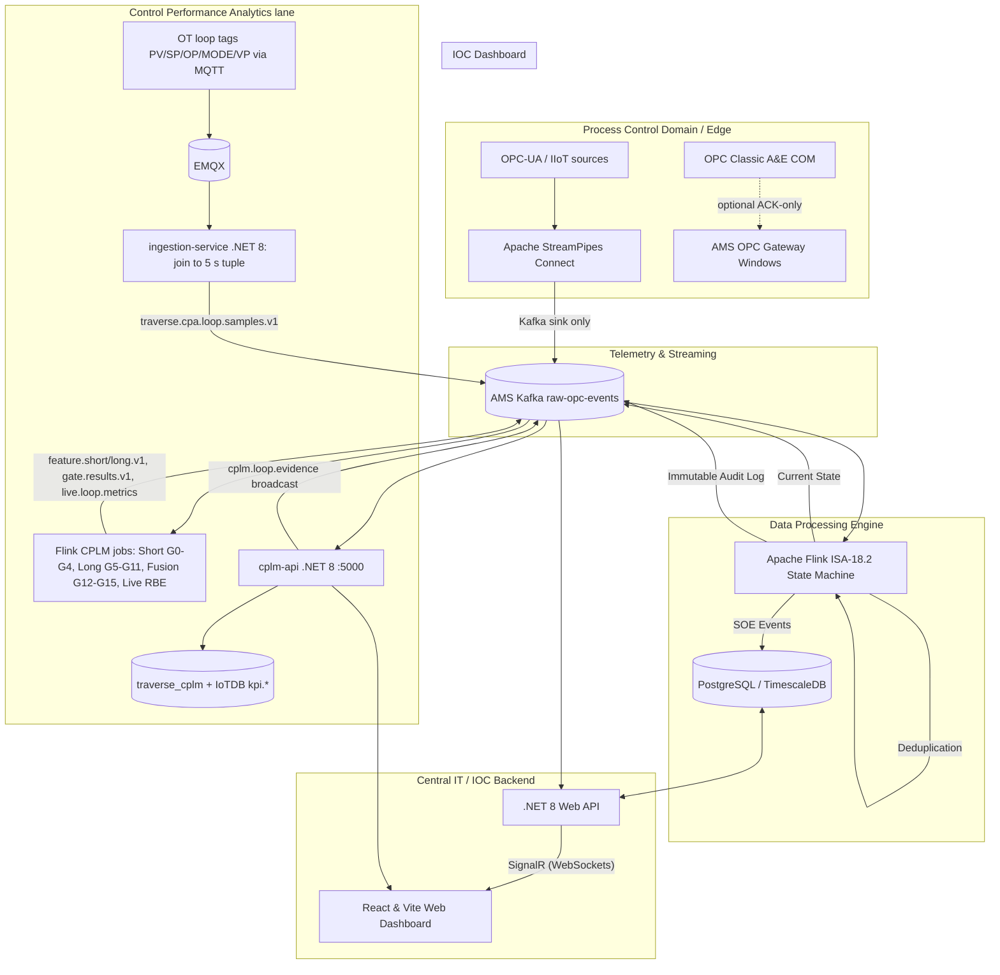

# Consolidated Alarm Solution (CAS) - Enterprise Architecture Document

## 1. Executive Summary
The Consolidated Alarm Solution (CAS) is an enterprise-grade, ISA-18.2 compliant industrial alarm management platform. It is engineered to aggregate, normalize, and manage real-time alarms from disparate, multi-vendor DCS/OPC servers across 74 distributed sites. By explicitly rejecting legacy DCOM architecture and third-party OPC tunnelers, the platform establishes a modern, highly secure edge-to-broker telemetry pattern. It provides a unified, high-performance web dashboard for operators and engineers at the Integrated Operations Centre (IOC).

## 2. High-Level Architecture

Two independent lanes share one Kafka, one Postgres cluster, one IoTDB and one gateway: the **alarm lane** (top) and the **CPA lane** (bottom). They never join in SQL; they meet only over Kafka topics and HTTP. The CPA lane is described component-by-component in §3.6–3.8 and in detail in [docs/cpa-system-and-application-architecture.md](docs/cpa-system-and-application-architecture.md).

## 3. Core System Components

### 3.1 Edge Connectivity (StreamPipes → Kafka, single ingest path)

**Target architecture (preferred):**

- **Role:** Industrial connectivity via **Apache StreamPipes** as a Docker microservice on the AMS network (`docker-compose.streampipes.yml`).
- **Path:** OPC-UA (and other IIoT adapters) → StreamPipes pipeline → **Kafka sink** → `ams-kafka:29092` / `raw-opc-events` only.
- **Docs:** `docs/streampipes-connectivity.md`
- **Sole telemetry authority:** Apache StreamPipes (OPC UA) → `raw-opc-events` (schema v2). Zero QuickOPC/OpcLabs/COM/DCOM runtime dependencies.

**ACK control plane (optional Windows service):**

- **Role:** Consume `traverse.alarm.ack-writeback`, publish `traverse.alarm.ack-results` / lifecycle (no telemetry publish).
- **Implementation:** `AMS.OpcGateway` ACK-only; OPC UA DCS writeback is the planned replacement for Classic A&E ACK.
- Python simulators (`storm_generator.py`) remain for load testing only, not production.

**Responsibilities (StreamPipes path):**

- Adapter configuration and harmonization in StreamPipes UI.
- Publish AMS-schema JSON to `raw-opc-events` (see `docs/streampipes-connectivity.md`).
- Suppression/filtering via StreamPipes processors where needed.

### 3.2 Message Broker (Apache Kafka)
- **Role:** The high-throughput, fault-tolerant telemetry backbone bridging the PCD and the IOC.
- **Key Topics:** 
  - `raw-opc-events`: High-velocity ingestion of raw alarms from the edge.
  - `traverse.alarm.current-alarm-state`: An upsert topic maintaining the precise, real-time state of all active alarms.
  - `traverse.cpa.audit-events`: An append-only log recording every state transition, operator acknowledgment, and system configuration change.
  - **CPA lane:** `traverse.cpa.loop.samples.v1` (merged loop tuples, keyed by `loop_id`) → `traverse.cpa.clpm.feature.short.v1` / `feature.long.v1` (window features) → `traverse.cpa.clpm.gate.results.v1` (diagnoses; `source = flink | replay:<id>`); `traverse.cpa.live.loop.metrics` (RBE live values); `traverse.cpa.ams.metadata.updates` + `traverse.cpa.context.parameter-set.v1` (broadcast evidence & thresholds into Flink); `traverse.ingestion.ot-dlq` (ingestion dead letters).

### 3.3 Stream Processing Engine (Apache Flink)
- **Role:** The core stateful correlation and alarm lifecycle engine designed to process events exactly-once.
- **Job:** `AMS - Event-Sourced Alarm State Machine` (`OpcEventStreamJob.java`) with per-stage parallelism (ingest, dedup, ACK, traverse.alarm.ack-results, sinks).
- **Ingest:** `raw-opc-events` → normalize → dedupe → `traverse.alarm.current-alarm-state`
- **ACK commands:** `traverse.alarm.operator-actions` → Flink ACK Orchestrator → `traverse.alarm.ack-writeback` + `traverse.alarm.lifecycle-events` + `traverse.alarm.current-alarm-state` → OPC Gateway → DCS → `traverse.alarm.ack-results` reconciliation
- **.NET fallback:** When `Kafka:UseFlinkOrchestration` is `false`, `AlarmStreamProcessorService` performs the same orchestration.

### 3.4 Central Backend (.NET 8 Web API)
- **Role:** Serves as the API gateway, business logic executor, and real-time distribution node for the operator clients.
- **Stack:** ASP.NET Core Web API, Entity Framework (EF) Core, Npgsql (PostgreSQL driver), Serilog.
- **Features:** 
  - **Real-Time Distribution:** Utilizes `SignalR` hubs (`NotificationHub`, `AlarmHub`) to push state changes instantaneously to connected browsers via WebSockets.
  - **Background Workers:** Hosts automated services like the `ShelveExpiryService`, which polls the database to automatically unshelve alarms that exceed their operator-defined maximum shelving duration.
  - **RESTful Endpoints:** Provides queries for Historical SOE (Sequence of Events), Analytics KPIs, and OPC server configurations.

### 3.5 Storage Layer (PostgreSQL / TimescaleDB)
- **Role:** The authoritative persistent data store handling both relational configuration data and time-series event data.
- **Schema & Integration:** Managed strictly via EF Core Migrations (`AmsDbContext.cs`). Maps complex entities, manages standard naming conventions, and handles structured JSON payloads for rapid querying.

### 3.6 CPA Ingestion (`ingestion-service`, .NET 8)
- **Role:** The only producer of the CPA engine's input. Subscribes to EMQX per configured OT data source, parses `{site}/{fcs}/{class}/{loop}/{param}` topics, maps parameters to roles (`PV/SP/OP/MODE/VP`, overlayable `param_roles`), translates DCS mode enums via `mode_value_map` (CENTUM: `1=AUT 2=MAN 3=CAS 4=IMAN`), and joins per-loop last-known values into one tuple on a 5 s grid (`LoopJoiner.Tick`).
- **Contract:** `traverse.cpa.loop.samples.v1` — `loop_id, event_ts_ms (OT process time), ingest_ts_ms, pv, sp, op, vp?, mode, quality (worst-of pv/sp/op)`. A tick where no member advanced is skipped (never re-stamped); unmapped parameters are parked (`UNKNOWN_PARAMETER`), malformed messages dead-letter to `traverse.ingestion.ot-dlq`.
- **State:** joiner state persisted in `traverse_cplm.ingestion.loop_state`; monitored-loop list polled from cplm-api registry. Gateway route `/api/ingestion/**` (Admin-only) for data-source config, stats, parking inventory.

### 3.7 CPA Compute (Flink `com.ams.flink.cplm`, same Flink cluster as the alarm job)
- **Jobs (supervised by `infra/docker/flink-job-supervisor.sh`):** `CplmShortFeatureStreamJob` (G0–G4/G2r, IAE/ISE/ITAE/OCE/effort/saturation on 1m tumbling + 5/10/15/30/60m sliding windows) → `feature.short.v1`; `CplmLongDiagnosticsStreamJob` (G5–G11 oscillation/shape/Horch/geometry/saturation/freeze on 4h/12h/24h slices, 15-min event-time timer, ≥ 32 samples) → `feature.long.v1`; `CplmGateFusionStreamJob` (G12–G15, family scores, argmax, VP confidence cap 0.89, 2-of-3 persistence; 12h/24h only) → `gate.results.v1`; `LoopLiveRbeJob` (per-metric report-by-exception, deadband 0.05 EU, heartbeat 300 s) → `live.loop.metrics`. `CplmHistoricalReplayJob` runs on demand (bounded BATCH re-read of the samples topic) for recompute.
- **Engine:** all gate mathematics live in two static classes, `CplmGateEngine` (G0–G11) and `CplmGateFusionEngine` (G12–G15); thresholds per loop class from `loop-dynamics-profiles.yaml` (pack 2.0.0), overridable via the broadcast parameter-set spine (`traverse.cpa.context.parameter-set.v1`) and evidence broadcast (`traverse.cpa.ams.metadata.updates`: VP, peer links, step test, `opEng/pvEng` ranges).
- **Flink-only compute rule:** no service recomputes a KPI or gate; cplm-api stores Flink JSON verbatim. Formulas: [docs/cpm-ot-validation-logic.md](docs/cpm-ot-validation-logic.md).

### 3.8 Control Loop Performance Service (`cplm-api`, .NET 8)
- **Role:** Owns control-loop performance monitoring end to end — a separate deploy unit from the alarm backend so loop analytics can scale and release independently. Listens on **5000** inside the compose network; the API gateway (:8081) routes `/api/v1/cpm/*` to it.
- **Boundary:** Its own logical database, `traverse_cplm` (schemas `analytics.*`, `cpm.*`), in the shared Postgres cluster. **No query joins CPLM data to alarm-core tables** — the two systems meet over Kafka and HTTP, never in SQL.
- **Kafka (async data plane):** consumes `traverse.cpa.clpm.gate.results.v1`, `traverse.cpa.clpm.feature.short.v1`, `traverse.cpa.clpm.feature.long.v1`; produces `traverse.cpa.ams.metadata.updates` (loop evidence that makes G13 evaluable) and `traverse.cpa.audit-events`. It owns the consumer groups `traverse-cpa-cplm-results` and `ams-api-cplm-results-frames` — **exactly one member process, ever** (see `docs/cplm-consumer-cutover-runbook.md`).
- **HTTP (sync control plane):** asset-model for peer-link projection, Flink REST for A8 batch recompute and pipeline metrics, binding-resolver for readiness provenance.
- **Dual persistence:** gate/feature results into Postgres (idempotent upsert on `loop_id, window_kind, window_end, source`), KPI series into IoTDB at `root.site1.cpm.<loop>.kpi.<family>`.
- **Not here:** `RawLoopIotDbConsumer` (raw loop samples → IoTDB historian) stays in the alarm backend with its own consumer group.

### 3.9 IOC Dashboard (React & Vite)
- **Role:** The single pane of glass providing total situational awareness to plant operators.
- **Stack:** React 18, Vite, TypeScript, and a highly customized Glassmorphism CSS design system.
- **Features:**
  - **Live Event Stream:** A dynamic, color-coded feed showing alarms as they occur in real-time, grouped by priority and severity.
  - **Administration & Rationalization:** dedicated panels (`AlarmRulesConfig.tsx`, `OpcServerConfig.tsx`) for managing flood detection thresholds, chattering time windows, and remote OPC connections.
  - **Performance:** Optimized rendering using efficient state management (Zustand) to handle thousands of simultaneous UI updates without freezing the browser thread.
  - **Loop Performance (CPA):** twelve `/cpm/*` screens (`src/frontend-ob/src/components/cpm`) — Overview, Performance gate matrix, Loop Explorer, Historical, Window Inspector, Evidence Replay, Investigation, Calculations, Loop Registry, Loop Events, Pipeline Health, Governance — all reading `cplm-api` through `src/api/cpmApi.ts`; live loop values from the RBE topic, alarms from SignalR.

## 4. End-to-End Data Lifecycle
1. **Trigger:** A field sensor exceeds a parameter limit, generating a hardware event in the local DCS.
2. **Extraction:** The Edge Agent captures the COM event locally, translates it to JSON, applies initial diagnostic suppression rules, and publishes it securely to Kafka.
3. **Correlation:** Flink consumes the raw event from Kafka, normalizes it, enriches it with asset data, and advances its internal ISA-18.2 state machine to `ACTIVE-UNACKNOWLEDGED`.
4. **Persistence & Routing:** Flink routes the confirmed state transition to the PostgreSQL database and pushes a notification back to Kafka.
5. **Distribution:** The .NET 8 Web API detects the change and immediately broadcasts the payload via SignalR WebSockets.
6. **Visualization:** The React dashboard instantly receives the WebSocket frame, rendering the new alarm with a flashing neon indicator in the live event sidebar.

### 4.1 Control-loop lifecycle (CPA lane)
1. **Publish:** the DCS gateway publishes each loop parameter (PV, SP, OP, MODE, VP) as its own MQTT message to EMQX.
2. **Join:** `ingestion-service` maps parameter → role, translates the MODE enum, and emits one merged tuple per loop on a 5 s grid to `traverse.cpa.loop.samples.v1` (skipping ticks where nothing advanced).
3. **Short features:** the Flink short job evaluates data quality, mode, SP stability, operating region, control error and effort (G0–G4) on six window kinds and publishes `feature.short.v1`.
4. **Long diagnostics:** every 15 min the long job slices the last 4 h / 12 h / 24 h, runs oscillation, shape, Horch, phase-plane, saturation and freeze gates (G5–G11), and publishes `feature.long.v1` with the aligned short features embedded.
5. **Fusion:** the fusion job applies blocking rules (data quality, mode, region, sensor), scores fault families, selects one, caps confidence by VP availability, enforces 2-of-3 persistence and publishes a diagnosis to `gate.results.v1`.
6. **Persist & frame:** `cplm-api` upserts results into `traverse_cplm.analytics.*`, dual-writes KPIs to IoTDB, and opens/extends/closes event frames per `(loop, window, family)`.
7. **Visualise & act:** the dashboard shows the gate matrix, KPIs and episodes; an engineer investigates, recomputes from history if needed, and acknowledges or shelves the episode — every action audited to `traverse.cpa.audit-events`.

## 5. Security & Compliance Mandates
- **Zero DCOM Exposure:** Fully complies with strict PCD cybersecurity policies by isolating all vulnerable COM traffic to the local edge machine, transmitting only secured, outbound telemetry.
- **Standardized Processing:** The entire data path strictly adheres to EEMUA 191 and ISA-18.2 standards, ensuring that alarm rationalization, prioritization, and lifecycle management meet global industrial safety benchmarks.
