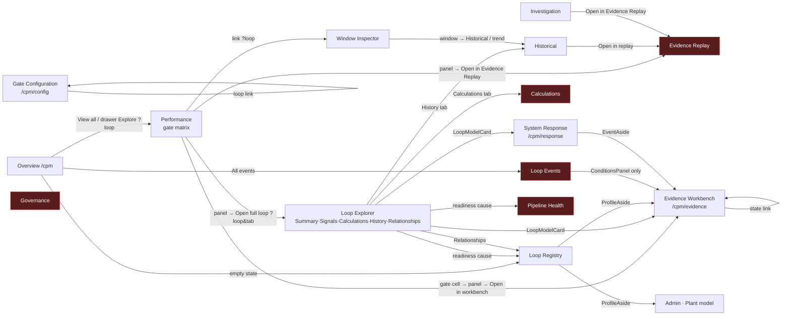
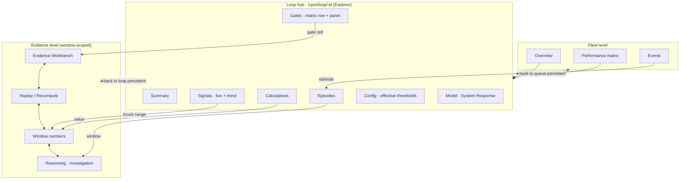
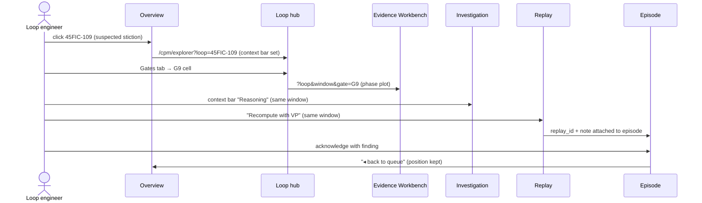

# CPA Application-Flow Audit — Control / Instrument Engineer Persona

**Question audited:** when an engineer lands on a CPA screen and clicks a loop, a gate, an event or a
number — does the application hand them a *route* to go deeper, or does the trail stop?
**Method:** every `/cpm/*` route, every outbound `navigate()` / `<Link>` and every URL parameter each page
consumes were extracted from `src/frontend-ob/src/components/cpm/**` (branch state 2026-09-19).
Nothing below is inferred from screenshots; each edge cites the file that creates it.
**Persona:** plant control-system / loop engineer. Knows the loops, tuning and valves; does not know
Flink, Kafka or gate numbering. Arrives with one of four intents (§3).

---

## 1. Current navigation graph (as coded)

Red nodes have **no outbound route to any other analysis page** for the selected loop
(`CpmReplay.tsx`, `CpmCalculations.tsx`, `CpmPipeline.tsx`, `CpmGovernance.tsx`; `CpmEvents.tsx` only exits via the
side `ConditionsPanel`, not from the episode itself).

### 1.1 Context carried between pages

| Mechanism | Present? | Evidence |
|---|---|---|
| `?loop=` in URL | yes, 12 of 15 pages read it | `useSearchParams` in each page; `CpmEvents`, `CpmPipeline`, `CpmGovernance` do **not** |
| Window / time range carried | partial | `window` read by Performance, Historical, Windows, Replay, Investigation; `from/to` only Historical; `kind` only Evidence Workbench |
| Gate carried | partial | `gate` read by Performance, Replay, Calculations, Evidence, Config |
| Global "current loop" store | **no** | no store/localStorage for loop; each page owns a `LoopCombobox` |
| Sidebar keeps loop | **no** | `App.tsx:903 navigate(item.path)` — bare route, context dropped |
| Breadcrumb back to origin | no | only Explorer has `cpm-crumbs` (plant location, not journey) |

---

## 2. Page-by-page audit

Legend: ✅ route exists · ⚠️ exists but weak (hidden, loses context, or wrong destination) · ❌ dead end

| # | Page | Engineer arrives to… | What is clickable | Where it leads | Verdict |
|---|---|---|---|---|---|
| 1 | **Overview** `/cpm` | "What needs me today?" | attention row → focused drawer (verdict + gate chips) · drawer *Explore* · *View all* · *All events* · gate chip on row | drawer → `Performance?loop` · Performance · Events · `onOpenGate` (drawer) | ⚠️ drawer explains *what*, but *Explore* lands on the fleet matrix, not the loop workspace; no path from a counter (e.g. "3 without VP") to the loops behind it |
| 2 | **Performance** | "Which gates fired, on which loops?" | loop row · gate cell → `GateEvidencePanel` · panel actions · *Window Inspector* link · gate filter chips | workbench (only if `methodRunId`) · Replay · Explorer(Calculations tab) · Windows | ✅ best-connected page; ⚠️ *Open in workbench* disabled for pre-v2.5 rows with no fallback route |
| 3 | **Loop Explorer** | "Tell me everything about this loop" | 5 tabs · readiness causes (routed) · LoopModelCard links · Signals trend link | Registry, Pipeline, Calculations, Historical, Evidence, Response | ✅ hub page; ⚠️ not the default landing from Overview; no link *to* Investigation or Events for this loop |
| 4 | **Historical** | "Show me the trend and when it went bad" | range toolbar · KPI overlay · selected window panel → *Open in replay* | Replay | ⚠️ one exit only; clicking a verdict-ribbon segment does not open that window's gates; no jump to Evidence Workbench or Investigation |
| 5 | **Window Inspector** | "Give me the numbers for this window" | short/long tab · window row → detail → *Historical* / trend | Historical | ⚠️ cannot open the same window in Evidence Workbench or Replay; no link to the formula (Calculations/CalcDrawer) |
| 6 | **Evidence Replay** | "Prove it from raw data" | stage stepper, cursor, recompute, note, CSV download | **none** | ❌ dead end — after recompute the engineer must use the sidebar and re-pick the loop |
| 7 | **Evidence Workbench** | "Show me the artefact behind gate Gx" | gate chip strip · window select · state links | itself (other window kinds) | ⚠️ good depth, but no *back to loop* / *open Investigation* / *raise case* exits |
| 8 | **System Response** | "Model the loop from a bump/step" | event list · model review · EventAside → workbench G12 | Evidence Workbench | ⚠️ no return to loop hub; no hand-off to a tuning note or Investigation |
| 9 | **Investigation** | "Why did the engine say this?" | case triage · window browser · *Open in Evidence Replay* · note/ack | Replay | ⚠️ single exit; family/detector score cards not clickable to the gate that produced them |
| 10 | **Calculations** | "What formula, what value?" | loop pick · row → `CalcDrawer` | **none** | ❌ dead end — a value cannot be opened in the window it came from, nor in the trend |
| 11 | **Loop Registry** | "Is my loop set up right?" | row → `ProfileAside` (readiness, republish) → Evidence, Plant model · wizard | Evidence Workbench, Admin plant model | ⚠️ no *Open loop analysis* (Explorer) after commissioning; Add-loop wizard ends without "what next" |
| 12 | **Loop Events** | "What episodes are open?" | row → episode aside (peak, ack/shelve, note) · ConditionsPanel links | Evidence (`?kind=15m`) from conditions only | ❌ the **episode itself has no link to its loop** (`CpmEvents.tsx:31` prints `loop_id` as text); acknowledging without being able to look is the biggest persona break |
| 13 | **Gate Configuration** | "What thresholds apply and why?" | overview links, effective/bundles/editor | itself | ⚠️ cannot jump from a threshold to the gate result it affected, or to the loop's Performance row |
| 14 | **Pipeline Health** | "Is the engine alive?" | round trip, job rows | **none** | ❌ a failed/late job is not linked to the loops whose verdicts are stale |
| 15 | **Governance** | "Who changed what?" | audit search | **none** | ❌ an audit row (ack, republish, config change) does not open the loop/event it refers to |

---

## 3. Persona journeys traced against the current flow

### J1 — Morning triage (15 min, 160 loops)

| Step | Engineer wants | Current flow | Result |
|---|---|---|---|
| 1 | see the worst loops | Overview → *Loops requiring review* | ✅ |
| 2 | why is 45FIC-109 top? | click row → focused drawer: diagnosis, confidence, gate chips | ✅ |
| 3 | look at its trend now | drawer has no trend; *Explore* → Performance matrix (fleet view) | ⚠️ 2 extra hops to Explorer › History |
| 4 | see if it is already an open episode | no link; sidebar → Events → filter by hand | ❌ context lost |
| 5 | acknowledge it | Events aside → Acknowledge | ✅ |
| 6 | back to the queue | sidebar → Overview (queue position lost) | ⚠️ |

### J2 — Suspected sticky valve

| Step | Engineer wants | Current flow | Result |
|---|---|---|---|
| 1 | which gates say stiction? | Performance → row → G7/G8/G9 cells → panel | ✅ |
| 2 | see the actual waveform / phase plot | panel → *Open in workbench* (G9 artefact) | ✅ if `methodRunId` present; ❌ disabled otherwise, no alternative offered |
| 3 | how did fusion weigh it? | Workbench has no link to Investigation; sidebar → Investigation → re-pick loop | ⚠️ |
| 4 | check PV/OP raw over the same 24 h | Investigation → *Open in Evidence Replay* | ✅ |
| 5 | recompute with VP now mapped | Replay → Recompute | ✅ |
| 6 | compare new vs old verdict | Replay shows result; no link back to Performance/Investigation | ❌ |
| 7 | record finding against the episode | Replay note is stored, but the **episode** (Events) is not linked | ⚠️ two separate notes (Investigation note, Replay note, Events note) — no single case record |

### J3 — Loop just commissioned: "is it producing verdicts, and if not why?"

| Step | Engineer wants | Current flow | Result |
|---|---|---|---|
| 1 | confirm tags & ranges | Registry → ProfileAside readiness | ✅ |
| 2 | see first data arriving | no link to Explorer › Signals from Registry | ❌ |
| 3 | understand `EXCLUDED_MODE` | Performance → G1 cell → panel explains autoPct | ✅ |
| 4 | fix the MODE map | panel gives no route to the data-source config (`/api/ingestion` UI) | ❌ |
| 5 | check the job is running | Explorer readiness cause → Pipeline Health | ✅ |
| 6 | know when the next verdict will arrive | nothing shows "next long-window fire in N min" | ⚠️ |

### J4 — "Why did a threshold change flip this loop?"

| Step | Engineer wants | Current flow | Result |
|---|---|---|---|
| 1 | see the config change | Governance audit row | ✅ |
| 2 | open the affected loop/gate | audit row not clickable | ❌ |
| 3 | see effective thresholds | Gate Configuration ?loop | ✅ |
| 4 | see the gate result it produced | no link from threshold → Performance cell / Evidence | ❌ |

---

## 4. Findings

| ID | Finding | Severity | Where |
|---|---|---|---|
| F1 | **Episode → loop is not navigable.** Events aside prints `loop_id` as text; ack/shelve happens blind | High | `CpmEvents.tsx:31`, `280–352` |
| F2 | **Loop context is dropped by the sidebar** — every nav click resets to "Select a loop" | High | `App.tsx:903` |
| F3 | **Five dead-end pages** (Replay, Calculations, Pipeline, Governance, Events-episode) | High | §2 rows 6,10,12,14,15 |
| F4 | Overview drawer's *Explore* lands on the fleet matrix, not the loop workspace | Medium | `CpmOverview.tsx:203` |
| F5 | Three unlinked note fields (Investigation, Replay, Events) for the same problem | Medium | `CpmInvestigation.tsx:327`, `CpmReplay.tsx` "Record your finding", `CpmEvents.tsx:358` |
| F6 | Workbench button disabled for pre-v2.5 rows with no fallback (Replay/Windows) | Medium | `GateEvidencePanel.tsx:154–160` |
| F7 | Chart surfaces are not click-through: verdict ribbon (Historical), family score cards (Investigation), KPI rows (Calculations), window rows (Windows) do not open their source | Medium | `CpmHistorical`, `CpmInvestigation`, `CpmCalculations`, `windows/WindowDetail` |
| F8 | Pipeline failure not mapped to affected loops / stale verdicts (`verdictAge.ts` exists but only decorates) | Medium | `CpmPipeline.tsx` |
| F9 | Registry / wizard completion has no "start analysis" exit; MODE-map fix (`/api/ingestion`) unreachable from any gate explanation | Medium | `LoopRegistry.tsx`, `AddLoopWizard.tsx`, `GateEvidencePanel` |
| F10 | Engineer vocabulary gap — pages are organised by *engine stage* (Windows, Replay, Workbench, Investigation) not by *engineer question* (trend, valve, tuning, episode); the sidebar has 12 loop-performance entries | Medium | `App.tsx:796–808` |
| F11 | No time-range hand-off except Historical→Replay; Windows→Historical passes `from/to` but Historical→Workbench does not exist | Low | §1.1 |
| F12 | No loop-level "next evaluation at …" or freshness indicator on drawer/matrix | Low | `verdictAge.ts` usage |

---

## 5. Recommendations

### 5.1 Target navigation model — hub-and-spoke around the loop

Principles: **every deep page is window-scoped and carries `loop + window + gate`**; every loop page carries `loop`; the loop hub is the default landing from any fleet-level click; the sidebar preserves `?loop=` when a loop is selected.

### 5.2 Concrete changes (ordered by persona value / effort)

| # | Change | Fixes | Effort |
|---|---|---|---|
| R1 | **Loop context bar** (sticky, all `/cpm/*`): loop id · type · verdict pill · age · buttons *Hub · Trend · Gates · Episodes · Evidence*. Selection stored in URL and a small Zustand slice; sidebar appends `?loop=` when set | F2, F3, F10 | S |
| R2 | **Events episode → loop**: make `loop_id` a link to the hub; add *Open evaluated window* (→ Investigation `?loop&window`) and *Show evidence* (→ Workbench G15) | F1 | S |
| R3 | **Overview drawer → hub** (`/cpm/explorer?loop=`), keep *Fleet matrix* as secondary; add trend sparkline (last 8 h PV/SP/OP via `/api/hist/trend`) inside the drawer | F4 | S |
| R4 | **Dead-end exits**: Replay → *Back to gates* / *Compare verdicts* (Performance with `?window=`), Calculations row → *Open window* (Windows `?loop&window&profile`) and *Show in trend* (Historical `?from&to&kpi`), Pipeline job row → *Loops affected* (Performance filtered `health=stale`), Governance row → entity link (loop/event/config) | F3, F7, F8 | M |
| R5 | **One case record**: episode is the case; Investigation and Replay notes post to the episode thread (`/events/{id}` note API) and show its history; Replay recompute attaches `replay_id` to the episode | F5 | M |
| R6 | **Workbench fallback**: when no `methodRunId`, enable *Open in Evidence Replay* as primary and label why | F6 | S |
| R7 | **Click-through charts**: Historical verdict-ribbon segment → Investigation for that window; family/detector score card → gate cell panel; Windows row → Workbench `?kind&window`; brushing a range on the trend → *Open windows in range* | F7, F11 | M |
| R8 | **Commissioning exit**: wizard success → *Start monitoring: open loop hub*; ProfileAside → *Open analysis*; G1 panel (`EXCLUDED_MODE`) → *Fix mode map* (data-source config, Admin) with the raw enum values seen | F9 | S |
| R9 | **Freshness on every verdict**: "evaluated 14 min ago · next long window ≈ 06:45" using `verdictAge` + 15-min timer cadence; stale (> 45 min) turns the pill grey and links to Pipeline Health | F12, F8 | S |
| R10 | **Sidebar by question, not stage** — group: *Fleet* (Overview, Performance, Events) · *Loop* (Explorer) · *Evidence* (Workbench, Replay, Windows, Investigation) · *Engineering* (Response, Calculations, Config, Registry) · *System* (Pipeline, Governance). Same routes, fewer top-level entries | F10 | S |

### 5.3 Persona-specific interactivity to add

| Need of a loop engineer | Today | Proposed |
|---|---|---|
| Valve signature (OP vs PV / VP vs OP plot) on demand | only as G9 artefact in Workbench | *Valve* tab in hub: phase plot for any range, VP overlay, deadband/stiction estimate from G7/G8/G9 |
| Tuning context | no PID params shown | show P/I/D/GW from ingestion extras (`LoopParameterMapper`) on Summary; link to System Response model |
| "Compare to yesterday / to twin loop" | none | Historical: *Compare* selector (previous window kind, or peer from `loop_link`) |
| Bump test workflow | System Response exists but detached | from hub: *Plan bump test* → checklist → Response event → G12 evidence auto-set (`stepTestApproved`) |
| Shelving with reason & review date | Events shelve hours | shelve until *date* + reason code (maintenance / known disturbance / awaiting VP) surfaced on Overview |
| Export for shift report | CSV in Replay only | *Loop report* (PDF/MD) from hub: verdict, gates, trend, notes |
| Fleet by area/unit I own | plant scope filter exists (`plantScope.tsx`) | persist scope per user; Overview counters clickable → filtered Performance |
| Explain a gate in plant terms | Performance guide toggle | gate panel: one-line plant meaning + *what to check on the loop* (from `gateFacts.ts`) |

### 5.4 Proposed journey after R1–R10 (J2 revisited)

---

## 6. Acceptance criteria for the flow (testable)

| # | Criterion |
|---|---|
| A1 | From any `/cpm/*` page with a loop selected, every other loop-scoped page is reachable in **one click** with the loop preserved |
| A2 | From an episode, the evaluated window's gates, evidence and trend are each reachable in one click |
| A3 | No `/cpm/*` page has zero outbound routes (Replay, Calculations, Pipeline, Governance, Events fixed) |
| A4 | A numeric value on Calculations / Windows opens the window and trend it was computed from |
| A5 | A verdict shows its age and next expected evaluation; stale verdicts link to Pipeline Health |
| A6 | Notes written in Investigation, Replay and Events appear in one episode thread |
| A7 | Browser back returns to the previous page **with** its loop/window/gate selection |

---

## 7. Source map for this audit

| Evidence | File |
|---|---|
| Routes & sidebar | `src/frontend-ob/src/App.tsx:451–466, 796–829, 903` |
| Overview drawer / links | `components/cpm/CpmOverview.tsx:103–203`, `overview/FocusedLoopDrawer.tsx`, `AttentionList.tsx` |
| Gate panel actions | `components/cpm/GateEvidencePanel.tsx:150–175` |
| Explorer routing | `explorer/LoopWorkspace.tsx:172–176`, `explorer/readinessCauses.ts`, `explorer/LoopModelCard.tsx`, `explorer/*Tab.tsx` |
| Events | `CpmEvents.tsx:31, 225, 280–366`, `events/ConditionsPanel.tsx:79` |
| Dead ends | `CpmReplay.tsx`, `CpmCalculations.tsx`, `CpmPipeline.tsx`, `CpmGovernance.tsx` (no `navigate`/`Link`) |
| Window/Historical hand-off | `windows/WindowDetail.tsx:205–212`, `CpmHistorical.tsx:298, 404` |
| Workbench / Response / Config | `evidence/GateEvidenceWorkspace.tsx:76`, `evidence/GateResultState.tsx:65,103`, `response/EventAside.tsx:45`, `config/*` |
