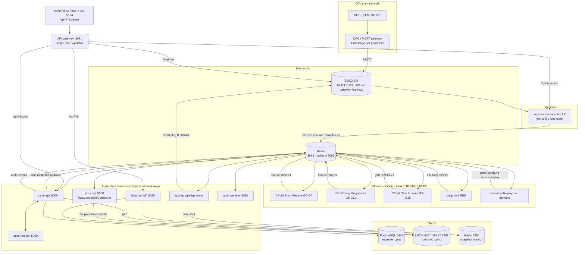
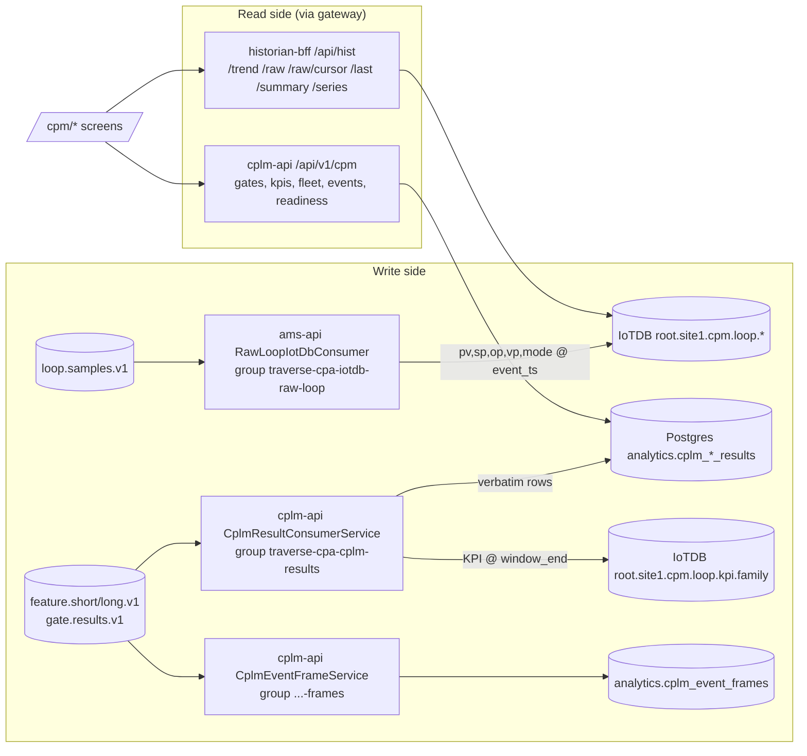
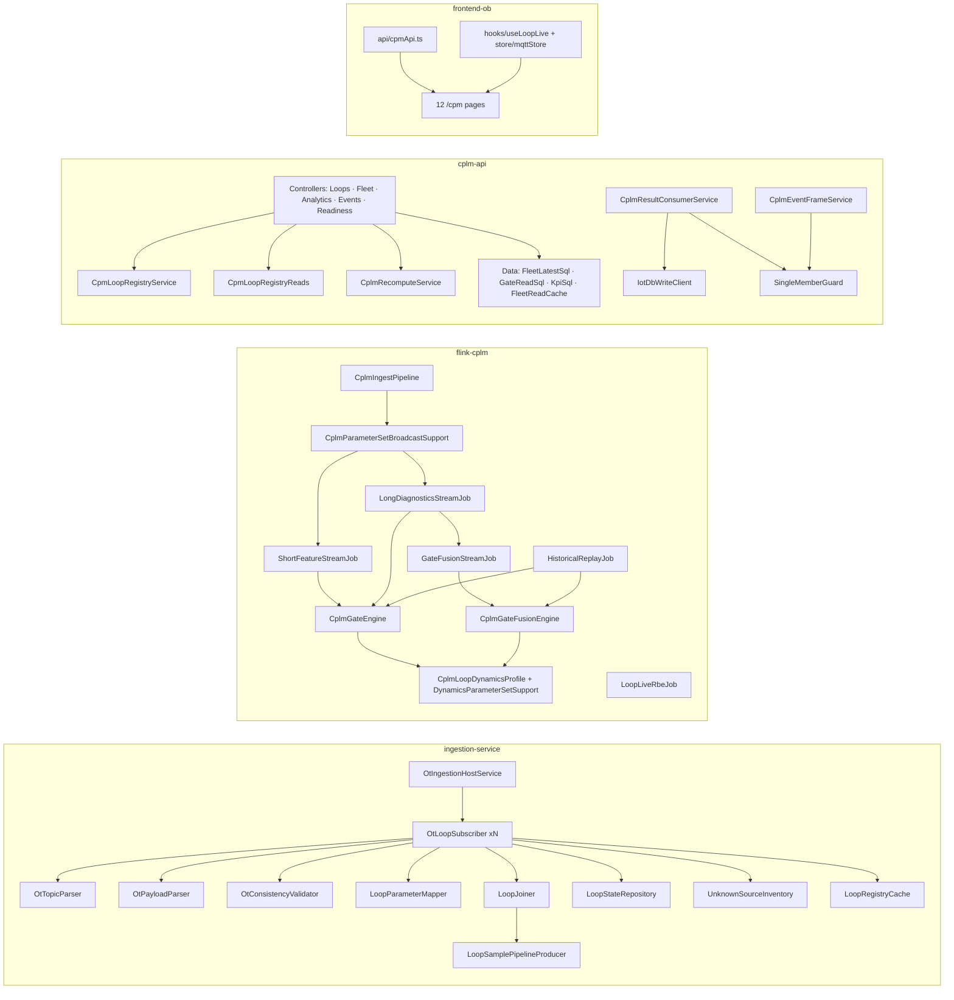
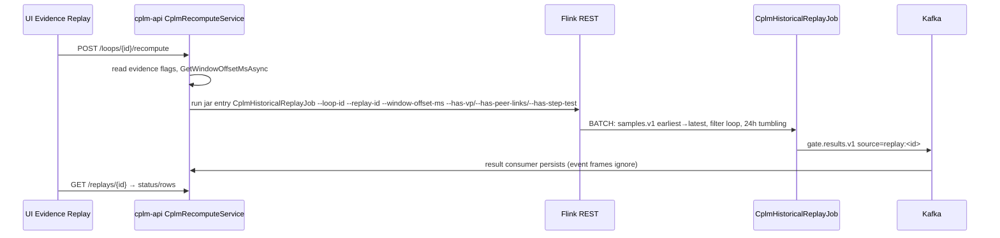

# CPA — System & Application Architecture (as-built)

**Scope:** Control Performance Analytics (CPA / CPM / CPLM) — the loop-performance product inside the
AMS/Traverse monorepo. Part A is the **system architecture** (infrastructure, the two data routes,
stores, deployment). Part B is the **application architecture** (services, modules, functions,
sequences). Everything is taken from the current branch; calc 3.0.0, dynamics pack 2.0.0.
Companion docs: [formulas](cpm-ot-validation-logic.md) · [gate reference](cpm-gate-reference.md) ·
[testing guide](cpm-ot-validation-testing-guide.md) · platform-wide: [architecture_document.md](../architecture_document.md).

---

# Part A — System architecture

## A1. What CPA is and how it attaches to the platform

| Aspect | Decision |
|---|---|
| Product | Continuous control-loop performance monitoring: KPIs (IAE/ISE/ITAE, OCE, effort, saturation), oscillation/stiction diagnostics (gates G0–G15), fused verdicts, episodes, recompute |
| Inputs | Per-parameter OT tags (PV, SP, OP, MODE, VP) over MQTT from the DCS gateway |
| Two read routes | **Live route** — report-by-exception values pushed to the browser in ~1–2 s. **Historical route** — raw samples + KPIs + verdicts persisted and pulled on demand |
| One compute route | Kafka → Flink (all mathematics) → Kafka; no service recomputes a KPI |
| Shared platform | One Kafka, one EMQX, one Redis, one IoTDB, one Postgres cluster, one API gateway — shared with the alarm system; CPA has its **own logical DB** `traverse_cplm` and its own topics. No SQL join to alarm tables, ever |
| Deploy unit | `ingestion-service`, `cplm-api`, four supervised Flink jobs, the `/cpm/*` UI; plus three shared services carrying loop data (`sparkplug-edge-node`, `historian-bff`, `ams-api` raw-loop writer) |

## A2. System landscape



## A3. Infrastructure components — role in CPA

| Component | Image / runtime | Host port | Role in CPA | CPA data held | Retention |
|---|---|---|---|---|---|
| EMQX | `emqx/emqx:5.6.0` | 1883 MQTT, 18083 dash (WS only via gateway `/mqtt-ws`) | **Inbound** OT tags → ingestion-service; **outbound** Sparkplug B live loop values → browser | in-flight only | — |
| Kafka | Confluent/Apache Kafka | 9093, kafka-ui 8085 | backbone for every hop between ingestion, Flink, cplm-api, edge node | 9 CPA topics (§A7.3) | topic retention (replay depends on it) |
| Flink | `flink:1.18.1` JM + TM | 8082 UI, 9249 metrics | all KPI/gate mathematics; RBE filter; on-demand replay | keyed state, RocksDB checkpoints | 24 h 10 m buffer in long job |
| PostgreSQL | shared cluster | 5433→5432 | `traverse_cplm`: results, event frames, loop registry, ingestion state | `analytics.*`, `cpm.*`, `ingestion.*` | permanent (no hypertable on CPA tables) |
| IoTDB | `apache/iotdb:1.3.2` | 6667 session, 8181 REST | historian for raw loop samples and KPI series | `root.site1.cpm.<loop>.{pv,sp,op,vp,mode}` and `.kpi.<family>` | raw **90 d**, `**.kpi.**` **730 d** (`iotdb-init-ttl.sh`) |
| Redis | `redis:7.2` contract tier (noeviction) | 6380→6379 | snapshot-on-open for live loop values + Sparkplug alias registry | `snapshot:metric:<group>:<edge>:<device>:<metric>` = `{v,q,ts}`, `snapshot:devices`, `alias:*` | TTL per key |
| API gateway | YARP .NET | **8081** (8443 TLS) | only entry to the API; validates JWT; injects `X-Auth-*` | — | — |
| Prometheus / Grafana | | 9090 / 3001 | ingestion + consumer + Flink metrics | — | — |

## A4. Route 1 — Live (real-time) route

Purpose: paint current PV/SP/OP/VP/MODE on faceplates and the Explorer within ~1–2 s, survive page reloads, never fabricate a value.

```mermaid
sequenceDiagram
  participant K as Kafka loop.samples.v1
  participant R as Flink LoopLiveRbeJob
  participant L as Kafka live.loop.metrics
  participant E as sparkplug-edge-node
  participant X as EMQX
  participant D as Redis
  participant B as Browser (mqttStore / useLoopLive)
  K->>R: tuple {pv,sp,op,vp,mode,quality}
  R->>R: explode to per-metric points; keyed RBE: emit iff first, |Δ|>0.05, or string change
  R-->>L: {loopId, metric, value, dataType, quality, ts}
  Note over R: heartbeat timer 300 s re-emits last value per key
  L->>E: consume (with live.alarms, live.metrics)
  E->>X: spBv1.0/<group>/DDATA/<edge>/<device=loopId sanitized> metrics pv/sp/op/vp/mode
  E->>D: snapshot:metric:<group>:<edge>:<device>:<metric> = {v,q,ts}
  B->>X: WSS via gateway /mqtt-ws, subscribe exact device topic
  B->>D: snapshot-on-open via historian-bff /snapshot (paint last known)
  X-->>B: DDATA deltas → faceplate
```

| Hop | Component | Contract | Semantics that matter |
|---|---|---|---|
| 1 | `LoopLiveRbeJob` (`--deadband 0.05`, `--heartbeat-seconds 300`, offsets **latest**) | `traverse.cpa.live.loop.metrics` | one record per changed metric; absolute deadband shared by all roles; heartbeat keeps snapshot TTL alive and gives a fresh `ts` |
| 2 | `sparkplug-edge-node` `processLoopMetricRecord` | Sparkplug B DDATA, device = `loopId` with non-`[A-Za-z0-9_-]` → `_` | one Sparkplug device per loop, so a faceplate subscribes once and receives the whole loop |
| 3 | Redis snapshot | `snapshot:metric:…` JSON `{v,q,ts}` | paint-on-open; browser shows **age**, not "live" |
| 4 | Browser `useLoopLive(loopId)` over `mqttStore.subscribeScreen` | group `ams_site1`, edge `ams_edge1` (env) | no data ⇒ render `—`, never 0 |
| Fallback | `historian-bff /last` (`GET /api/hist/last?series&measurements`) | last IoTDB value with per-measurement `ts` | used by `getLastValues` when RBE has nothing (steady loop before first heartbeat) |

**Not on the live route:** KPIs and verdicts. They arrive via the historical route (Postgres) and are refreshed by react-query polling; the RBE topic carries only raw signals.

## A5. Route 2 — Historical route

Two write-side streams and two read-side services.



| Data | Written by | Store / path | Read by | UI screen |
|---|---|---|---|---|
| Raw samples | `RawLoopIotDbConsumer` (ams-api) | IoTDB `root.site1.cpm.<loop>.{pv,sp,op,vp,mode}` at `event_ts_ms` | `historian-bff /trend` (decimated, envelope min/max/avg), `/raw/cursor` (paged), `/last` | Historical, Investigation, Evidence Replay, Explorer Signals |
| Short/long features | `CplmResultConsumerService.PersistFeatureAsync` | `analytics.cplm_short_feature_results`, `cplm_long_feature_results` (+ `payload` JSONB) | `cplm-api /loops/{id}/kpis`, `/kpis/latest`, `/resolutions` | Window Inspector, Calculations, Historical overlay |
| KPI series | same consumer (dual-write) | IoTDB `…<loop>.kpi.<family>` at `window_end` (nulls dropped) | historian-bff (trend overlays) | Historical |
| Gate results / verdicts | `PersistGateAsync` | `analytics.cplm_gate_results` (17 gates in `payload->'gates'`) | `/loops/{id}/gates[/latest]`, `/fleet/summary|rankings|heatmap` | Performance, Overview, Investigation |
| Episodes | `CplmEventFrameService.ApplyAsync` | `analytics.cplm_event_frames` keyed `(loop_id, window_kind, family)` | `/events`, ack/shelve | Loop Events, Overview trail |
| Recompute | `CplmHistoricalReplayJob` (BATCH) | gate results with `source=replay:<id>` | `/replays/{id}` | Evidence Replay |

Upsert key everywhere on results: `(loop_id, window_kind, window_end, source)` guarded by `sample_count ≥ existing`. Event frames ignore `source ≠ flink`, so a recompute never rewrites the operational timeline.

**Historical replay boundary:** live Flink drops samples older than the 2-min watermark. Anything later must be recomputed, and recompute re-reads **Kafka** `loop.samples.v1` (earliest→latest, filtered to one loop) — so the replayable horizon is Kafka retention, not IoTDB's 90 days.

## A6. Compute route — Kafka → Flink → Kafka

| Job | In | Windows | Out | Emits when |
|---|---|---|---|---|
| Short Feature | samples.v1 | 1m tumbling; 5/10/15/30/60m sliding | feature.short.v1 | each window close (lateness 30 s–3 m) |
| Long Diagnostics | samples.v1 | keyed buffer, 15-min event-time timer → 4h/12h/24h slices | feature.long.v1 (+ `alignedShort`) | every 15 min, slice ≥ 32 samples |
| Gate Fusion | feature.long.v1 | 12h/24h only | gate.results.v1 | per long record; persistence needs 2-of-3 |
| Live RBE | samples.v1 (latest) | none | live.loop.metrics | per changed metric + 300 s heartbeat |
| Historical Replay | samples.v1 bounded | 24h tumbling, offset to data start | gate.results.v1 | on `POST /loops/{id}/recompute` |

Broadcast side-inputs into Short/Long/Fusion: `traverse.cpa.ams.metadata.updates` (`cplm.loop.evidence`: VP/peers/step-test; `cplm.loop.engineering`: `opEng/pvEng`) and `traverse.cpa.context.parameter-set.v1` (per-loop/class threshold overrides). Formulas: [cpm-ot-validation-logic.md](cpm-ot-validation-logic.md).

## A7. Data stores & ownership

### A7.1 PostgreSQL `traverse_cplm`

| Schema.table | Script | Owner (writes) | Content |
|---|---|---|---|
| `analytics.cplm_gate_results` | 30 | cplm-api result consumer | diagnosis, confidence, family, `payload` JSONB (all gates), `source` |
| `analytics.cplm_short_feature_results` / `cplm_long_feature_results` | 30 | result consumer | KPI columns copied from Flink JSON + payload |
| `analytics.cplm_event_frames` | 34, 42 | event-frame consumer + events controller | open/closed episodes, `peak_confidence`, ack/shelve |
| `cpm.loop_registry`, `loop_tag_map`, `loop_tag_catalog`, `loop_link`, `loop_group*`, `threshold_profile` | 32 | `CpmLoopRegistryService` | which loops are monitored, tag→role map, peer links, per-loop thresholds |
| `cpm.loop_signal_asset` | 44 | registry service | ledger of signal assets projected into asset-model (Option C) |
| `ingestion.loop_state` | 51 | ingestion-service | joiner last-known members per loop |
| indexes | 52 | — | `(loop_id, window_kind, window_end DESC)` for DISTINCT-ON fleet reads |

### A7.2 IoTDB tree & TTL

| Path | Writer | TTL |
|---|---|---|
| `root.site1.cpm.<loop>.pv|sp|op|vp|mode` | ams-api `RawLoopIotDbConsumer` | 90 d (database TTL) |
| `root.site1.cpm.<loop>.kpi.<family>` | cplm-api result consumer | 730 d (`**.kpi.**`) |

### A7.3 Kafka topics

| Topic | Producer | Consumers (group) | Key |
|---|---|---|---|
| `traverse.cpa.loop.samples.v1` | ingestion-service | Short/Long/RBE (`traverse-cpa-flink-cplm`), Replay (`ams-cplm-historical-<id>`), ams-api (`traverse-cpa-iotdb-raw-loop`) | `loop_id` |
| `traverse.cpa.clpm.feature.short.v1` | Short job | cplm-api (`traverse-cpa-cplm-results`) | loop |
| `traverse.cpa.clpm.feature.long.v1` | Long job | Fusion job, cplm-api result consumer | loop |
| `traverse.cpa.clpm.gate.results.v1` | Fusion, Replay | cplm-api result consumer **and** `…-frames` | loop |
| `traverse.cpa.live.loop.metrics` | RBE job | sparkplug-edge-node | loop |
| `traverse.cpa.ams.metadata.updates` | cplm-api | Flink broadcast | loop (tombstone on delete) |
| `traverse.cpa.context.parameter-set.v1` | parameter-set spine | Flink broadcast | loop/class |
| `traverse.cpa.audit-events` | cplm-api, ingestion-service | audit-service | — |
| `traverse.ingestion.ot-dlq` | ingestion-service | ops | — |

**Rule:** `traverse-cpa-cplm-results` and `ams-api-cplm-results-frames` must have **exactly one member** (`SingleMemberGuard` fails loud); two members silently split partitions.

## A8. Deployment view (docker-compose)

| Service | Exposed | Startup dependency | Notes |
|---|---|---|---|
| `emqx`, `kafka`, `redis`, `iotdb` (+ `iotdb-init-ttl`), `postgres` | see §A3 | — | shared infra |
| `flink-jobmanager` / `taskmanager` + `flink-job-supervisor.sh` | 8082 | Kafka | supervisor submits 4 CPLM jobs (+ alarm jobs) with `CPLM_ARGS`, `--window-hours 24`, `CPLM_LIVE_DEADBAND` |
| `ingestion-service` | none (gateway `/api/ingestion`) | EMQX, Kafka, Postgres, cplm-api registry | one `OtLoopSubscriber` per active data-source row |
| `cplm-api` | none (gateway `/api/v1/cpm`) | Postgres, Kafka, IoTDB, Flink REST, asset-model | hosts both result consumers |
| `ams-api` | none (gateway `/api/**`, `/hubs`) | Kafka, IoTDB | carries `RawLoopIotDbConsumer` only for CPA |
| `sparkplug-edge-node` | none | Kafka, EMQX, Redis | bridges `live.loop.metrics` + alarm live topics |
| `historian-bff` | none (gateway `/api/hist`) | IoTDB, Redis | read-only |
| `gateway` | **8081** | auth-service JWKS | route map in `docs/api-gateway.md` |
| `ams-frontend` | 3000 | gateway | static SPA; dev Vite 5174 |

Start everything: `.\run-all.ps1`. E2E: `scripts/e2e-full-system-test.ps1`, `scripts/test-full-pipeline-e2e.ps1`, `scripts/production-acceptance-test.ps1`.

## A9. Security

| Concern | Implementation |
|---|---|
| AuthN | edge-only: gateway validates RS256 JWT (auth-service JWKS); services trust `X-Auth-*` via shared `TraverseAuth.cs` — no service parses JWTs |
| AuthZ | `analytics.view` for all `/cpm/*` pages and `/api/v1/cpm` reads; `ingestion.view/manage` (Admin) for data sources; `admin.audit.view` for Governance audit; `rbac.manage` for role matrix |
| MQTT | EMQX authenticated; browsers reach it only through gateway `/mqtt-ws`; direct WS 8083 not published |
| Secrets | data-source credentials encrypted at rest (`CredentialCipher`, AES + PBKDF2 master key) |
| Audit | every registry write, ack/shelve, recompute → `traverse.cpa.audit-events` → audit-service hash chain (Governance shows CHAIN OK) |

## A10. Invariants

1. Flink-only compute — cplm-api stores results verbatim, never derives a KPI.
2. Live route carries raw signals only; KPIs/verdicts always come from Postgres.
3. Current values are never read from IoTDB for live paint; snapshot comes from Redis; `/api/hist/last` is an explicit "last known + age" fallback.
4. One member per CPLM consumer group.
5. Displays/templates are configuration only (CQRS) — loop values bind through UNS path+role at runtime.
6. UI is OpenBridge-only; gate STRONG/WARN/FAIL render with alert tokens.

---

# Part B — Application architecture

## B1. Component map



## B2. ingestion-service (`src/services/ingestion-service`)

**Message pipeline (per MQTT message, `OtLoopSubscriber.ProcessAsync`):**
`OtTopicParser.TryParse` → `OtPayloadParser` → `OtConsistencyValidator.Validate` → `LoopParameterMapper` (role) / `ResolveMode` (`mode_value_map`) → `LoopJoiner` member upsert. On the grid (`GridLoopAsync`, default 5 s): `LoopJoiner.Tick` → `LoopSamplePipelineProducer.PublishTupleAsync`. Failures → `traverse.ingestion.ot-dlq` (`TOPIC_SHAPE_MISMATCH`, `MISSING_FIELD`, `BAD_TIMESTAMP`, `FUTURE_TIMESTAMP`) or parking (`UNKNOWN_PARAMETER`).

| File | Key functions | Responsibility |
|---|---|---|
| `Pipeline/OtIngestionHostService.cs` | `ExecuteAsync`, `ReconcileAsync`, `StartOneAsync`, `StopOneAsync`, `Fingerprint` | one subscriber per active data-source row; restart on config change |
| `Pipeline/OtLoopSubscriber.cs` (475) | `StartAsync`, `ConsumeLoopAsync`, `ProcessAsync`, `GridLoopAsync`, `RegistryLoopAsync`, `SeedFromStateStoreAsync`, `SaveStateAsync`, `FlushLoopAsync`, `PublishLoopHealth` | MQTT session + per-message pipeline + grid timer + state + health |
| `Pipeline/OtTopicParser.cs` | `TryParse(template, topic, out identity, out error)` | `{ns}/{site}/{fcs}/{class}/{loop}/{group}/{param}` capture |
| `Pipeline/OtPayloadParser.cs` | static parse | value number/bool/numeric-string; ts epoch-ms/ISO; quality only when string |
| `Pipeline/OtConsistencyValidator.cs` | `Validate`, `Contradicts` | topic vs payload class/unit |
| `Pipeline/LoopParameterMapper.cs` | `TupleMembers`, `ResolveMode(payload, map)` | built-ins `PV SP OP MODE VP SV MV P I D GW`; `param_roles` overlay |
| `Pipeline/ModeVocabulary.cs` | `IsRecognised`, `IsAuto` | same token sets as Flink |
| `Pipeline/LoopJoiner.cs` (341) | `Tick(nowMs, cfg)`, `NextGridBoundary`, `StateSnapshot`, `HealthSnapshot`, `IsGood` | last-known per role; emit only when newest `ts` advanced; quality worst-of pv/sp/op |
| `Pipeline/LoopSamplePipelineProducer.cs` | `PublishTupleAsync`, `LoopTuple.ToJson` | Kafka producer (`Kafka:LoopSamplesTopic`, `Kafka:OtDlqTopic`) |
| `Pipeline/LoopRegistryCache.cs` | `CplmRegistryClient.FetchLoopsAsync/ParseLoops`, `TryResolve`, `RefreshAsync` | monitored loops + tag map from cplm-api |
| `Pipeline/LoopHealth.cs`, `IngestionMetrics.cs` | `LoopHealthSummary.From`, `MessagesReceived/DeadLettered/Parked`, `TuplesEmitted`, `TicksSkipped`, `ModeUnrecognised`, `SourceLatency` | health + Prometheus |
| `Pipeline/UnknownSourceInventory.cs`, `SubscriberStatusRegistry.cs`, `PipelineEndpoints.cs` | `Record/DrainPending/FlushAsync`, `Upsert/List/Snapshot/RequestReload`, `MapPipelineEndpoints` | parking inventory, status, REST |
| `Services/DataSourceRepository.cs`, `DataSourceValidation.cs` | `ListAsync/GetAsync/DeleteAsync/SetActiveAsync/StoreTestResultAsync`, `ValidateCreate/ValidateLoopIngest/IsValidTopicFilter` | data-source CRUD; refuses `param_roles` that unmap pv/sp/op/mode |
| `Services/LoopStateRepository.cs` | `LoadAsync`, `SaveAsync` | `ingestion.loop_state` |
| `Services/MqttClientOptionsFactory.cs`, `MqttConnectionTester.cs`, `CredentialCipher.cs`, `AuditEmitter.cs`, `ProfileRegistry.cs`, `UnknownSourceRepository.cs` | `IsTlsUrl`, `TestAsync`, `Encrypt/Decrypt`, `Emit`, `Exists`, `UpsertBatchAsync/ListAsync` | supporting |

## B3. Flink CPLM (`src/flink/src/main/java/com/ams/flink/cplm`, 21 classes, 6 041 lines)

**Engine — `CplmGateEngine` (1 341, static)**

| Function | Line | Computes |
|---|---|---|
| `computeShortFeatures(samples,start,end,windowKind,profile)` | 50 | G0–G4, G2r, IAE/ISE/ITAE, MAE/RMSE, OCE, effort, saturation, travel, reversals |
| `computeLongDiagnostics(...)` | 296 | G5–G11 + `alignedShort` |
| `compute(...)` | 37 | short + long + fuse for one slice (replay/CLI) |
| `evaluateGate9`, `resolveValidPeriod` | 488, 519 | G9 ladder; ACF-first period validation |
| `computeAcfPeriod`, `computeFftBandLimited`, `computeTriangularity`, `computeHorch`, `computeGeometry` | 744, 805, 927, 1003, 1040 | G5, G6, G7, G8, G9 |
| `computeSaturationStats`, `computeFreezeRunSamples/Index`, `computePvDriftPerDay`, `computeSpikeCount`, `countUniqueRounded` | 710, 1152, 1178, 1206, 1169 | G10, G11, drift, spikes, quantisation |
| `inferSamplePeriodSec`, `computeSamplingJitter`, `filterHalfOpen`, `linearDetrend`, `ewma` | 622, 632, 608, 573, 596 | preprocessing |
| `computeOpTravel/TravelPerDay/ReversalCount/ReversalsPerHour`, `computeModeChangesPerHour`, `computeSpChangesPerHour` | 666–696, 647, 657 | rates |
| `mean/meanAbs/meanSq/min/max/popStd/median/subtractMean` | 1221–1271 | numerics |

**Fusion — `CplmGateFusionEngine` (694)**

| Function | Line | Role |
|---|---|---|
| `fuse(shortF, longD, profile, hasVp, hasStepTest, hasPeerLinks)` | 36 | blocking → scores → qualification → argmax → `min(score, g14Cap)` → bands |
| `applyPersistence(result, priorFamilies, 3, 2)` | 435 | 2-of-3 rule, demotion cap 0.54 |
| `blockDiagnosis`, `evaluateGeometryEvidence`, `isQualified`, `applyDiagnosisBands`, `buildInsufficientEvidenceReason`, `fuseFromSamples` | 505, 530, 568, 590, 622, 646 | helpers |

**Model / config / jobs**

| Class | Key functions | Role |
|---|---|---|
| `CplmNormalizedSample` | `fromJson`, `isGoodQuality`, `isAutoMode` | tuple contract; drops non-numeric pv/sp/op |
| `CplmShortFeatureResult`, `CplmLongDiagnosticsResult`, `CplmGateResult` | `toJson/fromJson` | wire records |
| `CplmLoopDynamicsProfile` (581) | `resolve`, `forClass`, `inferFromTag`, `parseClass`, `goodErrorBand`, `normalizeOp`, `isPeriodInBand`, `classifyPhaseArea`, `loadYamlResource`, `applyBlock` | per-class thresholds (YAML pack + embedded fallback) |
| `CplmDynamicsParameterSetSupport` (285) | `applyParameterSetJson`, `resolveFromSpine`, `applyEngineering`, `parseProfileJson` | overrides + engineering ranges |
| `CplmParameterSetBroadcastSupport` (402) | `wireParameterSetHydration`, `connectSampleProfiles`, `connectLongProfiles`, `applyLoopEvidence`, `applyBroadcastPayload`, `applyLegacyMetadataEnvelope` | broadcast state |
| `CplmIngestPipeline`, `CplmKafkaSink`, `CplmJobConfig` | `build`, `attach/attachKeyed`, `fromArgs` | Kafka in/out (watermark 2 min, idle 1 min; keyed sinks) |
| `CplmShortFeatureStreamJob` (158) | `main`, `ShortWindowFn.process` | 6 window branches |
| `CplmLongDiagnosticsStreamJob` (203) | `main`, `open`, `processElement`, `onTimer` | ListState buffer, 15-min timer, 3 slices |
| `CplmGateFusionStreamJob` (175) | `main`, `processElement`, `elevatedFamilyForHistory` | fuse 12h/24h; family history in keyed state |
| `LoopLiveRbeJob` (332) | `Exploder.processElement`, `RbeFilter(deadband, heartbeatSeconds)`, `scheduleHeartbeat`, `onTimer`, `render` | live route producer |
| `CplmHistoricalReplayJob` (279) | `main`, `computeWindow`, `medianPeriodMs`, `materializeEvaluationSamples`, `withReplayLineage` | BATCH recompute |
| `CplmWindowCertificationCli`, `SynTic001*` | `main` | offline certification vectors |

## B4. cplm-api (`src/services/cplm-api`)

**REST (`/api/v1/cpm`, via gateway)**

| Controller | Endpoints | Backing code |
|---|---|---|
| `CpmLoopsController` (`/loops`) | `GET /`, `GET /{id}`, `POST /activate`, `/bulk-activate`, `DELETE /{id}`, `/bulk-delete`, `POST /{id}/republish-evidence`, `/bulk-republish-evidence`, `POST /{id}/recompute`, `GET /api/v1/cpm/replays/{id}`, `GET /referencing`, `GET /api/v1/cpm/registry-contract` | `CpmLoopRegistryReads.LoadAllAsync/LoadOneAsync`; `CpmLoopRegistryService.ActivateAsync/DeleteAsync/BulkDeleteAsync/PublishEvidenceAsync/ProjectSignalAssetsAsync/ProjectLinksAsync/CountReferencingLoopsAsync`; `CplmRecomputeService.StartAsync/GetStatusAsync` |
| `CpmFleetController` (`/fleet`) | `GET /summary`, `/rankings?orderBy&windowKind&limit`, `/heatmap` | `FleetLatestSql` (DISTINCT ON latest per loop), `FleetReadCache`; summary excludes `INSUFFICIENT_DATA`; whitelisted `orderBy` |
| `CpmAnalyticsController` | `GET /loops/{id}/gates/latest`, `/gates?from&to`, `/kpis?resolution&limit&before`, `/kpis/latest?resolutions`, `/resolutions` | `BuildGateMatrix` from `payload->'gates'`; `KpiSql`/`KpiReads` projection |
| `CpmEventsController` | `GET /events` (rows carry `shelf_state` + shelf columns, envelope carries `shelvePolicy`), `GET /calculations` | `analytics.cplm_event_frames` |
| `CpmEventActionsController` (CHG-032) | `POST /events/{id}/acknowledge`, `/shelve`, `/unshelve`, `GET /events/{id}/actions`, `GET /events/shelving-policy` | `EventShelvingRules` (pure) → `EventActionStore` (frame + `analytics.cplm_event_actions` in one transaction); `CplmAuditEmitter.Emit`; `CplmShelfExpirySweeper` flips SHELVED → EXPIRED once a minute. Design: [cpa-event-shelving.md](cpa-event-shelving.md) |
| `CpmReadinessController` | `GET /loops/{id}/readiness`, `/pipeline-status`, `/pipeline-metrics` | registry row + tags + Flink job states (`FetchJobStatesAsync`) + `BindingProvenanceProbe`; `FlinkPipelineMetricsCollector` |

**Background & services**

| File | Functions | Role |
|---|---|---|
| `CplmResultConsumerService` (566) | `ExecuteAsync`, `PersistGateAsync`, `PersistFeatureAsync(json,isLong)`, `EnsureSchemaAsync` | 3 topics → `analytics.*`; IoTDB KPI dual-write; JSON null → SQL NULL |
| `CplmEventFrameService` (270) | `ExecuteAsync`, `ApplyAsync`, `IsFault`, `FamilyOf` | episodes; ratcheting `peak_confidence`; ignores `source≠flink` |
| `SingleMemberGuard`, `ConsumerHeartbeat` | `VerifySoleMembership`, `Report/Get` | group safety, liveness |
| `CpmLoopRegistryService` (1 864) | see REST table + `PublishEvidenceBatchAsync`, `BulkRepublishEvidenceAsync`, `TombstoneEnvelope`, `Validate` | registry write path, asset-model projection, evidence broadcast |
| `CplmRecomputeService` (301) | `StartAsync`, `GetStatusAsync`, `GetWindowOffsetMsAsync`, `EnsureJarUploadedAsync` | Flink REST submit of replay job with evidence flags |
| `IotDbWriteClient` (204) | `EnsureTimeseriesAsync`, `NonQueryAsync`, `SafeNode` | IoTDB REST writes |
| `FlinkPipelineMetricsCollector`, `BulkRepublish`, `BindingProvenanceProbe`, `CplmAuditEmitter` | `PickLiveInstancePerName/ReadVertexMetricAsync`, `RunAsync`, probe, `Emit` | supporting |
| `Data/*` | `FleetLatestSql.Rankings`, `GateReadSql`, `KpiSql`, `KpiReads`, `FleetReadCache.RunAndStoreAsync`, `CplmReadIndexes` | SQL builders, cache, index DDL |

## B5. Shared services carrying CPA data

| Service | CPA module | Function | Contract |
|---|---|---|---|
| `ams-api` | `BackgroundServices/RawLoopIotDbConsumer.cs` | consume `loop.samples.v1` (group `traverse-cpa-iotdb-raw-loop`), buffer, write `root.site1.cpm.<loop>.{pv,sp,op,vp,mode}` | historical route write side (raw) |
| `sparkplug-edge-node` | `AlarmMetricPublisher.processLoopMetricRecord` (+ `MetricAliasRegistry`) | `live.loop.metrics` → Sparkplug DDATA device `<loopId>`; Redis `snapshot:metric:*`, `snapshot:devices` | live route bridge |
| `historian-bff` | `/trend`, `/raw`, `/raw/cursor`, `/last`, `/summary`, `/series`, `/snapshot` | IoTDB REST reads (decimation + envelope), Redis snapshot | historical read + live paint-on-open |
| `asset-model` | signal-asset projection target | loop signals become UNS assets (Option C) so binding-resolver can resolve path+role | UNS identity |
| `audit-service` | `traverse.cpa.audit-events` consumer | hash-chained trail | governance |

## B6. Frontend (`src/frontend-ob`)

| Layer | Files |
|---|---|
| Data access | `src/api/cpmApi.ts` — registry (`getLoops, getLoop, activateLoop, bulkActivateLoops, deleteLoop, republishEvidence, getRegistryContract, getReadiness`), results (`getLatestGates, getGateHistory, getKpis, getKpisByResolution, getResolutions, getCalculations`), fleet (`getFleetSummary, getFleetRankings, getFleetHeatmap`), events (`getEvents, acknowledgeEvent, shelveEvent`), history via `/api/hist` (`getLastValues, getTrend, getRawCursor`), ops (`getPipelineStatus, getPipelineMetrics, recomputeLoop, getReplayStatus`) |
| Live | `hooks/useLoopLive.ts` over `store/mqttStore.ts` (`subscribeScreen`, snapshot-on-open), Sparkplug decode |
| Pages (`components/cpm`) | `CpmOverview`, `CpmPerformance`, `CpmExplorer`, `CpmHistorical`, `CpmWindows`, `CpmReplay`, `CpmInvestigation`, `CpmCalculations`, `LoopRegistry`, `CpmEvents`, `CpmPipeline`, `CpmGovernance` — routes `/cpm/*`, permission `analytics.view` |
| Shared | `GateMatrix`, `GateRollup`, `GateEvidencePanel`, `gateStatus.ts`, `calcCatalogue.ts`, `CalcDrawer`, `LoopCombobox`, `plantScope`, `plantLocation`, `AddLoopWizard`, `BulkImportDialog`/`csvImport.ts`, `ProfileAside`; folders `explorer/`, `historical/`, `overview/`, `windows/` |

## B7. Key sequences

**Verdict (compute + historical route)**
```mermaid
sequenceDiagram
  participant I as ingestion-service
  participant K as Kafka
  participant S as Short job
  participant L as Long job
  participant F as Fusion job
  participant C as cplm-api consumers
  participant P as Postgres/IoTDB
  I->>K: loop.samples.v1 (5 s)
  K->>S: window close → computeShortFeatures
  S->>K: feature.short.v1
  K->>L: buffer; 15-min timer → 4h/12h/24h computeLongDiagnostics (+alignedShort)
  L->>K: feature.long.v1
  K->>F: 12h/24h → fuse → applyPersistence
  F->>K: gate.results.v1
  K->>C: result consumer + event-frame consumer
  C->>P: upsert results, KPI dual-write, open/close episode
```

**Recompute**


## B8. Configuration surface

| Item | Where |
|---|---|
| Data source (`topic_template`, `grid_seconds`, `param_roles`, `mode_value_map`, `future_skew_max_seconds`, credentials) | ingestion-service data-source rows via `/api/ingestion/data-sources` (Admin) |
| Loop registry (tags → roles, loop type, engineering ranges, monitoring, evidence) | `/api/v1/cpm/loops/activate` (UI Add-loop wizard / bulk CSV) |
| Dynamics thresholds | `src/flink/src/main/resources/cplm/loop-dynamics-profiles.yaml` + parameter-set spine overrides |
| Flink args | `infra/docker/flink-job-supervisor.sh` (`CPLM_ARGS`, `--window-hours`, `CPLM_LIVE_DEADBAND`, `--heartbeat-seconds`) |
| Kafka/IoTDB for cplm-api | `Cplm` + `IotDb` sections (`ConsumerGroupId`, topics, `LoopRootPrefix`) |
| Sparkplug group/edge | edge node env; UI `VITE_SPARKPLUG_GROUP` / `VITE_SPARKPLUG_EDGE` (`ams_site1` / `ams_edge1`) |
| IoTDB TTL | `infra/docker/iotdb-init-ttl.sh` (`LOOP_DB`, `LOOP_CPM_PREFIX`) |

## B9. Corrections to older documents (verified in code)

| Older statement | As-built |
|---|---|
| "RBE has no heartbeat" (`cpm-calculation-reference.md` §5, flag 9) | `RbeFilter(deadband, heartbeatSeconds)`, default 300 s |
| "Replay reads the loop's history from IoTDB" (`cpm-calculation-reference.md` §10) | bounded BATCH re-read of Kafka `loop.samples.v1` |
| `cplm-api` "port 5006 / nginx" (older `architecture_document.md`) | `:5000` behind the API gateway `:8081` |
| `docs/loop-performance-cpa-architecture.md` | pre-build **blueprint** (2025); this document is the as-built successor |
