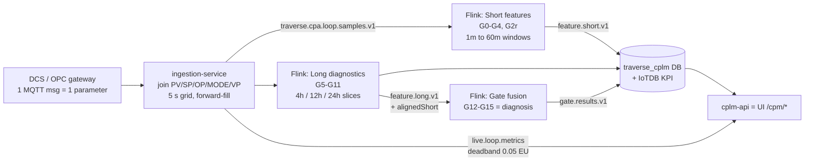
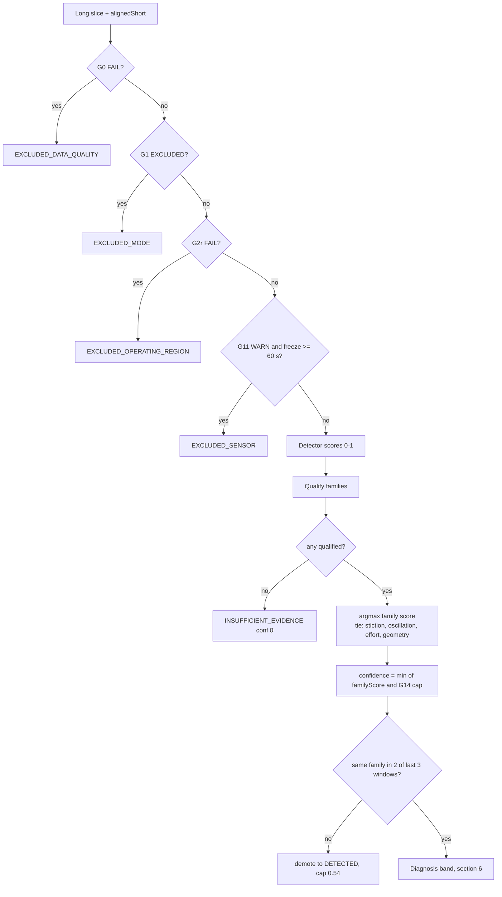

# CPM / CPA Calculation Logic — OT Validation Sheet

**Audience:** OT / control-loop engineers validating what the system computes.
**Basis:** as-implemented code (calc 3.0.0, dynamics pack 2.0.0). Detail refs:
[cpm-calculation-reference.md](cpm-calculation-reference.md), [cpm-gate-reference.md](cpm-gate-reference.md).
**Convention used everywhere:** `err = SP − PV`. OP normalised to 0–100 % before any gate. PV/SP stay in raw EU.

---

## 1. Where a sample becomes a verdict

| Stage | Owns | Does NOT do |
|---|---|---|
| ingestion-service | tuple assembly, MODE enum → text, quality worst-of | any KPI |
| Short job | G0–G4, G2r, IAE/ISE/ITAE, OCE, effort, saturation | oscillation |
| Long job | G5–G11 on 4/12/24 h slices (≥ 32 samples) | verdict |
| Fusion job | G12–G15, family scores, diagnosis, persistence (12h/24h only) | recompute any gate |
| cplm-api | store verbatim, rank, event frames, readiness | recompute any KPI |

---

## 2. Input contract

| Item | Rule | Consequence if violated |
|---|---|---|
| Roles | `PV→pv, SP→sp, OP→op, MODE→mode, VP→vp` (+ `SV→sp, MV→op`), overlayable per source | unmapped parameter parked, never guessed |
| Tuple emission | 5 s grid; only after pv, sp, op each seen once; tick with no change **skipped** | quiet gateway ⇒ gap, not flat line |
| `event_ts_ms` | newest OT `ts` in tuple (process time) | — |
| Quality | worst-of pv/sp/op; GOOD iff null, `g*`, or OPC int ≥ 192 | UNCERTAIN = not good |
| MODE | `mode_value_map` int → token. Auto = `AUT,AUTO,A,CAS,CASC,RSP,DDC,SUP,NORMAL…`; Manual = `MAN,M,IMAN,ROUT,LO,LOCAL,OFF,TRACK` | **unmapped enum ⇒ autoPct 0 ⇒ G1 EXCLUDED** |
| CENTUM enum (SME-confirmed) | `1=AUT, 2=MAN, 3=CAS, 4=IMAN` — 3 must map to auto | wrong map inverts the fleet |
| OP normalisation | `opN = (op − opEngMin)/(opEngMax − opEngMin) × 100`; identity when 0–100 | 0–1 OP without ranges ⇒ saturation & region meaningless |
| Sample period `Δt` | upper-median of consecutive gaps; 5.0 s if < 2 samples | — |
| Minimum n | short: `n ≥ 10`; long: `n ≥ 32` per slice | metrics `null`, `INSUFFICIENT_DATA` |

---

## 3. Analysis windows

| Kind | Type | Slide | Late allowed | Tier |
|---|---|---|---|---|
| 1m | tumbling | — | 30 s | short |
| 5m | sliding | 1 m | 60 s | short |
| 10m | sliding | 2 m | 90 s | short |
| 15m / 30m | sliding | 5 m | 2 m | short |
| 60m | sliding | 5 m | 3 m | short |
| 4h | slice, fires every 15 min | — | — | long (KPI only, not fused) |
| 12h / 24h | slice, fires every 15 min | — | — | long + **fused verdict** |

Watermark: 2 min out-of-order. Older data ⇒ dropped from stream ⇒ use **Recompute** (batch replay of the Kafka samples topic, gate results only).

---

## 4. Gate formulas — master table

Status legend: **PASS** healthy · **WARN** evidence · **STRONG** strong fault evidence (not good) · **FAIL / EXCLUDED** blocks verdict · NOT_EVALUATED prerequisite missing.

### 4.1 Short tier (per 1m…60m window; also re-run over each long slice as `alignedShort`)

| Gate | Formula | Thresholds → status | Blocks? |
|---|---|---|---|
| **G0** data quality | `completeness = n / round(windowSec/Δt)` · `badPct = n_bad/n` · `dupTs` | `badPct ≥ 0.50`→FAIL; `compl ≥ 0.98 ∧ badPct < 0.05 ∧ dup=0`→PASS; `compl ≥ 0.95`→WARN; else FAIL | **yes** |
| **G1** mode | `autoPct = n_auto/n` | `≥ 0.90` PASS · `≥ 0.70` WARN · else **EXCLUDED** | **yes** |
| **G2** SP stability | `spRange = max(sp) − min(sp)` (raw EU) | `< spRangePassMax` PASS else WARN | no |
| **G2r** region | `outPct = #(pv∉[pvMin,pvMax] ∨ opN∉[opMin,opMax]) / n` | `≤ 0.05` PASS · `≤ 0.20` WARN · else **FAIL** | **yes** |
| **G3** control error | `band = 0.005 × (pvEngMax − pvEngMin)` (default 0.5) · `goodErrorPct = #(|err| ≤ band)/n` | `≥ goodErrorPctPassMin` (0.5 TIGHT / 0.3 AVERAGING) PASS else WARN | no |
| **G4** effort | `effortRatio = σ(opN)/σ(pv)` (population σ) | `> 8` STRONG · `> 3` WARN · else PASS | no |

Supporting KPIs (same window):

| KPI | Formula | Unit |
|---|---|---|
| IAE | `Σ |err_i| · Δt_i` (zero-order hold, last Δt = median) | EU·s |
| ISE | `Σ err_i² · Δt_i` | EU²·s |
| ITAE | `Σ t_i · |err_i| · Δt_i`, `t` from window start | EU·s² |
| MAE / RMSE | `mean|err|` / `√mean(err²)` (per sample, not time-weighted) | EU |
| OCE | `autoPct × goodErrorPct × (1 − saturationPct)` | 0–1 |
| saturationPct | `#(opN ≤ 5 ∨ opN ≥ 95)/n` | 0–1 |
| opTravel / travelPerDay | `Σ|ΔopN|` · `× 24/windowHours` | % · %/day |
| reversals | sign changes of `ΔopN` with `|ΔopN| > 1e-9` | count |

### 4.2 Long tier (4h/12h/24h slices, `n ≥ 32`)

Shape signal `x` = **PV** for integrating classes (LIC, PIC_GAS), else **OP**; linear-detrended, mean-removed.

| Gate | Formula | Thresholds → status |
|---|---|---|
| **G5** ACF oscillation | `ρ_k = (Σx_i x_{i+k}/(n−k)) / (Σx²/n)`; zero-crossing spacings `s_j`; `period = median(2·s_j·Δt)`; `regularity = min(1, period/(3·σ(periods)))` | period found → WARN, else PASS |
| **G6** FFT oscillation | `amp_k = 2√(re²+im²)/n`; band `[tauMin,tauMax]`; `peakToMedian = peak/median_band`; `peakRatio = peak²/Σ_all amp²` | `peakRatio > 0.5` → WARN |
| Period validation | ACF valid iff in band ∧ `regularity ≥ 0.10` ∧ `samples/period ≥ 8`; FFT valid iff in band ∧ `peakToMedian ≥ 3`; harmonic fold accepts ratio `≈ k∈[2,5] ± 0.15k` | `periodStatus = VALID / INVALID` |
| **G7** triangularity | per cycle normalise to [−1,1]; `score = SSE_sine/(SSE_sine+SSE_triangle)` averaged | needs VALID; `> 0.8` STRONG |
| **G8** Horch oddness | standardised OP `u`, PV `y`; lags `k ≤ min(200,n/4)`: `φ⁺=mean(u_i y_{i+k})`, `φ⁻=mean(u_{i+k} y_i)`; `odd = Σ|φ⁺−φ⁻| / (Σ|φ⁺−φ⁻| + Σ|φ⁺+φ⁻|)` | `> 0.7` STRONG |
| **G9** phase-plane | per cycle shoelace area on (PV,OP) ÷ bounding box → `areaPerCycle`; corner score = angle-mass at vertices ≥ `cornerAngleDeg` | ladder §4.3; `areaPerCycle > 0.30` STRONG |
| **G10** saturation | `occupancy = #(opN≤5 ∨ opN≥95)/n`; `maxDwell` consecutive; `cycling = exits ≥ 3 ∧ occ ≥ 0.02` | `occ ≥ 0.05 ∨ maxDwell ≥ 30 ∨ cycling` → WARN |
| **G11** sensor freeze | `freezeRun` = longest run `|Δpv| ≤ 1e-9`; `freezeIndexS = run×Δt`; `freezeFraction = run/n` | `freezeIndexS ≥ 60 ∧ fraction ≥ 0.10` → WARN (**blocks** in fusion) |

Also emitted: PV quantisation (distinct `round(pv·1000)`), drift/day (OLS slope × 86400), spike count (`|Δpv − mean| > 3σ`).

### 4.3 G9 ladder (first match wins)

| # | Condition | Result |
|---|---|---|
| 1 | period not VALID | NOT_EVALUATED `NO_VALID_CYCLE` |
| 2 | `completedCycles < minValidCycles` | NOT_EVALUATED `NO_VALID_CYCLE` |
| 3 | `areaPerCycle > Hi` | NOT_EVALUATED `AREA_OUT_OF_BAND` |
| 4 | `areaPerCycle < Lo (0.05)` | PASS `AREA_BELOW_BAND` |
| 5 | `effortRatio < effortRatioFloor` | NOT_EVALUATED `EFFORT_BELOW_FLOOR` |
| 6 | `opRange% < opTravelFloorPct` | NOT_EVALUATED `OP_TRAVEL_BELOW_FLOOR` |
| 7 | `areaPerCycle > 0.30` | **STRONG** |
| 8 | else | PASS |

### 4.4 Fusion tier (12h / 24h only)

| Gate | Input | Result | Effect |
|---|---|---|---|
| **G12** step test | registry `stepTestApproved` | PASS / NOT_EVALUATED | **none numerically** (flag only) |
| **G13** peer links | `cpm.loop_link` rows | PASS / NOT_EVALUATED | with links: `oscillation ∧ ¬actuatorStress` ⇒ stiction **disqualified** (disturbance victim) |
| **G14** VP | `vp` present | CONFIRMED_CAPABLE / INSUFFICIENT_EVIDENCE | confidence cap **1.00 / 0.89** |
| **G15** verdict | fused confidence | band → diagnosis (§6) | — |

---

## 5. Fusion logic

**Detector scores** (clamped 0–1)

| Score | Source |
|---|---|
| `osc` | ACF regularity |
| `fft` | fftPeakRatio |
| `effort` | effortRatio / 8 |
| `stiction` | triangularity (G7) |
| `horch` | oddness (G8) |
| `geometry` | cornerScoreQualified (G9) |

`isQualified(score, gates) = score ≥ 0.55 ∨ any gate STRONG/WARN`

**Evidence & family qualification**

| Evidence | True when |
|---|---|
| oscillation | `isQualified(max(osc,fft), G5, G6)` |
| harmonicOrShape | (G6 STRONG/WARN ∧ harmonicAmpRatio > 0.15) ∨ G7/G8 STRONG/WARN ∨ `stiction ≥ 0.55` ∨ `horch ≥ 0.55` |
| actuatorStress | G4/G10 STRONG/WARN ∨ `effort ≥ 2×floor` ∨ `opRange ≥ opTravelFloor` ∨ satCycling ∨ `reversals ≥ 3` |

| Family | Qualified iff | Family score (when qualified) |
|---|---|---|
| stiction | oscillation ∧ harmonicOrShape ∧ actuatorStress ∧ ≥ 2 evidences ∧ (G7/G8 STRONG/WARN ∨ stiction/horch ≥ 0.55) ∧ ¬(peers ∧ osc ∧ ¬stress) | `max(stiction, horch) × prior(1.0)` |
| oscillation | oscillation evidence | `max(osc, fft) × prior(1.0)` |
| effort | `isQualified(effort, G4, G10)` | `effort × prior(1.0)` |
| geometry | G9 evidence ok ∧ family enabled ∧ role ≠ DISPLAY_ONLY ∧ (role PRIMARY ∨ all three evidences) | `cornerQualified × priorGeometry` (FIC/PIC 0.5, LIC/PIC_GAS 0.3, TIC/PIC_VAPOUR 1.0, UNKNOWN off) |

---

## 6. Diagnosis bands & persistence

| Confidence | Diagnosis | G15 | Severity |
|---|---|---|---|
| `< 0.35` | NO_CALL | INSUFFICIENT_EVIDENCE | LOW |
| `0.35–0.55` | DETECTED_FINAL_ELEMENT_NONLINEARITY | SUSPECTED | LOW |
| `0.55–0.75` | CLASSIFIED_… | SUSPECTED | MEDIUM |
| `0.75–0.90` | SUSPECTED_… | SUSPECTED | HIGH |
| `≥ 0.90` ∧ VP | **CONFIRMED_…** | CONFIRMED | HIGH |
| `≥ 0.90` ∧ no VP | SUSPECTED_…, confidence clamped 0.89 | SUSPECTED | HIGH |

Persistence: same `selectedFamily` in ≥ 2 of the last 3 windows (per window kind) required; otherwise DETECTED / LOW / confidence ≤ 0.54.
Event frame (UI "Episode"): opens on any `*_FINAL_ELEMENT_NONLINEARITY`, closes on EXCLUDED*/INSUFFICIENT*/NO_CALL; `peak_confidence` only ratchets up.

---

## 7. Worked example — FIC loop, 5-minute window

Loop `45FIC-109`, class FIC (TIGHT), `pvEng 0–200 t/h`, `opEng 0–100 %`, Δt = 5 s, window 300 s.

| Step | Numbers | Result |
|---|---|---|
| G0 | n = 58, expected = 300/5 = 60 → completeness 0.967; bad = 1 → 0.017; dup = 0 | 0.967 < 0.98, ≥ 0.95 → **WARN** |
| G1 | 55 AUT + 2 CAS + 1 MAN → autoPct 57/58 = 0.983 | **PASS** |
| G2 | SP 120.0 … 120.4 → range 0.4 < 1.0 | **PASS** |
| G2r | region PV ±∞, OP 0–100, nothing outside → 0 | **PASS** |
| G3 | band = 0.005 × 200 = **1.0 t/h**; 42 of 58 have `|err| ≤ 1.0` → 0.724 ≥ 0.5 | **PASS** |
| G4 | σ(op) = 6.2, σ(pv) = 1.5 → 4.13 | > 3 → **WARN** |
| saturation | 4 samples at op ≥ 95 → 0.069 | — |
| OCE | 0.983 × 0.724 × (1 − 0.069) | **0.663** |

Integral KPIs on the first 4 samples only (illustration), err = 0.5, −1.0, 0.8, 0.2; Δt = 5 s:

| KPI | Calc | Value |
|---|---|---|
| IAE | (0.5+1.0+0.8+0.2)×5 | 12.5 EU·s |
| ISE | (0.25+1.0+0.64+0.04)×5 | 9.65 EU²·s |
| ITAE | (0×0.5 + 5×1.0 + 10×0.8 + 15×0.2)×5 | 80 EU·s² |
| MAE | 2.5/4 | 0.625 EU |
| RMSE | √(1.93/4) | 0.695 EU |

**Same loop as a TIC (0–500 °C, SP 350→352 °C):** G2 range 2.0 ≥ 1.0 → permanent **WARN** although 2 °C is 0.4 % of span — see §10 item 1.

---

## 8. Worked example — 24 h slice → verdict

Same FIC, 24 h slice, n = 17 280, shape signal = OP (non-integrating).

| Gate | Numbers | Result |
|---|---|---|
| G5 | zero-crossing spacings 24, 24, 25, 23 samples → periods 240, 240, 250, 230 s → median **240 s**; σ = 7.1 → regularity = min(1, 240/21.3) = **1.0**; in band 10–900 ✓; samples/period 48 ≥ 8 ✓ | WARN, period **VALID** |
| G6 | peak amp 3.0, median in-band 0.6 → peakToMedian 5.0 ≥ 3 ✓; `peakRatio = 9/25 = 0.36` | 0.36 ≤ 0.5 → PASS |
| G7 | SSE_sine 0.9, SSE_tri 0.1 → 0.90 | > 0.8 → **STRONG** |
| G8 | oddSum 3.2, evenSum 1.0 → 0.762 | > 0.7 → **STRONG** |
| G9 | cycles 360 ≥ 5; areaPerCycle 0.42 (0.05 < 0.42 < 1.5); effort 4.13 ≥ 0.05; opRange 12 % ≥ 2 → 0.42 > 0.30 | **STRONG**, cornerQualified 0.60 |
| G10 | occupancy 0.069 ≥ 0.05 | WARN |
| G11 | longest flat PV run 6 samples = 30 s | PASS |

Fusion:

| Item | Value |
|---|---|
| Blocking checks | none (G0 WARN, G1 PASS, G2r PASS, G11 PASS) |
| Scores | osc 1.00 · fft 0.36 · effort 0.52 · stiction 0.90 · horch 0.76 · geometry 0.60 |
| Evidence | oscillation ✓ (1.00 ≥ 0.55) · harmonicOrShape ✓ (G7 STRONG) · actuatorStress ✓ (G4 WARN) |
| Family scores | stiction `max(0.90,0.76)×1.0 = 0.90` · oscillation `max(1.00,0.36)×1.0 = 1.00` · effort 0.52 · geometry `0.60×0.5 = 0.30` |
| Selected | **oscillation** (1.00 > 0.90; strict argmax — stiction wins only on an exact tie) |
| G14 | no VP → cap 0.89 → confidence **0.89** |
| Persistence | family `oscillation` also selected in 2 of last 3 → kept |
| Diagnosis | 0.89 < 0.90 → **SUSPECTED_FINAL_ELEMENT_NONLINEARITY**, HIGH, G15 SUSPECTED |
| With VP mapped | cap 1.0 → confidence 1.00 → **CONFIRMED** |

Note: the diagnosis label is always `*_FINAL_ELEMENT_NONLINEARITY`; the **family** (stiction / oscillation / effort / geometry) is a separate field shown in Investigation → "Selected family".

---

## 9. Per-class thresholds (pack 2.0.0)

| Key | FIC | PIC | PIC_GAS | PIC_VAPOUR | LIC | TIC | UNKNOWN |
|---|---|---|---|---|---|---|---|
| objective | TIGHT | TIGHT | AVERAGING | TIGHT | AVERAGING | TIGHT | TIGHT |
| shape signal | OP | OP | **PV** | OP | **PV** | OP | OP |
| spRangePassMax (G2, EU) | 1.0 | 1.0 | 5.0 | 1.0 | 5.0 | 1.0 | 1.0 |
| goodErrorPctPassMin (G3) | 0.5 | 0.5 | 0.30 | 0.5 | 0.30 | 0.5 | 0.5 |
| tauMin / tauMax s | 10/900 | 5/1800 | 120/14400 | 300/28800 | 120/14400 | 300/28800 | 5/86400 |
| minValidCycles | 5 | 5 | 3 | 3 | 3 | 3 | 5 |
| cornerAngleDeg | 65 | 60 | 50 | 45 | 50 | 45 | 65 |
| effortRatioFloor | 0.05 | 0.05 | 0.04 | 0.03 | 0.04 | 0.03 | 0.05 |
| opTravelFloorPct | 2.0 | 2.0 | 1.5 | 1.0 | 1.5 | 1.0 | 2.0 |
| phaseArea Lo/Hi | .05/1.5 | .05/1.5 | .05/2.0 | .05/2.0 | .05/2.0 | .05/2.0 | .05/1.5 |
| geometry prior / role | 0.5 SUPPORT | 0.5 SUPPORT | 0.3 DISPLAY | 1.0 PRIMARY | 0.3 DISPLAY | 1.0 PRIMARY | off |

Global: sat 5/95 %, satWarnOccupancy 0.05, dwell 30 samples, goodErrorBandPctOfSpan 0.005, minSamplesPerPeriod 8, persistence 2-of-3, G4 3/8 hardcoded. Class chosen by: override → loopType → tag prefix F/P/L/T → UNKNOWN. All overridable per loop/class.

---

## 10. Items OT should validate deliberately (known as-built behaviour)

| # | Behaviour | Impact | Validate by |
|---|---|---|---|
| 1 | **G2 compares raw-EU SP range to `spRangePassMax`** — no span normalisation | permanent WARN on wide-EU loops (TIC, FIC in t/h) | check G2 on a TIC with steady SP |
| 2 | ACF uses `γ0/n` but `γk/(n−k)` | ρ can exceed 1 at long lags; period bias | compare G5 period vs trend eyeball |
| 3 | `fftPeakRatio` denominator = whole spectrum | G6 rarely WARNs even on clear oscillation | oscillating loop with G5 WARN, G6 PASS is expected |
| 4 | G12 step-test has **no numeric effect** | evidence flag only | — |
| 5 | Unmapped MODE enum ⇒ EXCLUDED_MODE fleet-wide while G0 PASS | "data healthy, no verdict" | Window Inspector G1 = 0 % auto |
| 6 | Numeric `"quality": 0` treated as GOOD | bad data scored | only if gateway sends OPC ints |
| 7 | `travelPerDay` on 1m window = 1440× extrapolation | noisy on short windows | use ≥ 60m for travel |
| 8 | Live RBE: 0.05 EU absolute deadband shared by all roles; heartbeat marker every 300 s | steady loop value only refreshes on heartbeat | not a calc defect |
| 9 | Recompute (replay) re-reads Kafka samples (earliest→latest), writes gate results only — no KPIs, no episodes; data already expired from Kafka retention cannot be replayed | `/kpis` empty for replay-only loop | expected |
| 10 | Confidence cap 0.89 without VP | CONFIRMED impossible on loops without VP tag | expected |
