# CPM / CPA End-to-End Testing & Validation Guide (UI persona flow)

**Persona:** control-loop engineer (OT). Knows the plant loops, not the software.
**Goal:** prove — from the UI only, with API/DB cross-checks where a number must be trusted — that
what the screens show equals what [cpm-ot-validation-logic.md](cpm-ot-validation-logic.md) says is computed.
**Login:** any account with `analytics.view` (Governance audit tab additionally needs `admin.audit.view`).
**Entry:** `http://<host>:3000` → left nav group **Loop Performance**.

---

## 1. Page map — what each screen proves

| # | Nav label | Route | Validates |
|---|---|---|---|
| 1 | Pipeline Health *(System)* | `/cpm/pipeline` | all 4 Flink jobs RUNNING, checkpoints, live round trip |
| 2 | Loop Registry | `/cpm/registry` | loop exists, tags mapped, readiness, evidence republish |
| 3 | Overview | `/cpm` | fleet counts, loops requiring review, event trail |
| 4 | Performance | `/cpm/performance` | gate matrix per loop (G0–G15), fused window 12h/24h |
| 5 | Loop Explorer | `/cpm/explorer` | loop list, filters, live PV/SP/OP/mode |
| 6 | Window Inspector | `/cpm/windows` | short (G0–G4) and long (G5–G11) rows per window kind |
| 7 | Calculations | `/cpm/calculations` | every KPI value with formula & assessment |
| 8 | Historical | `/cpm/historical` | trend + KPI overlay + mode + verdict over time |
| 9 | Investigation | `/cpm/investigation` | family scores, disqualifiers, reason codes, note |
| 10 | Evidence Replay | `/cpm/replay` | raw IoTDB slice → normalised → gate tier → verdict; recompute |
| 11 | Loop Events | `/cpm/events` | episodes, peak confidence, acknowledge/shelve |
| 12 | Governance *(System)* | `/cpm/governance` | calc/profile versions, audit trail, RBAC |

---

## 2. Persona flow

```mermaid
flowchart LR
  P[1 Pipeline Health<br/>is the engine alive?] --> R[2 Registry<br/>is my loop ready?]
  R --> O[3 Overview<br/>what needs attention?]
  O --> PF[4 Performance<br/>which gates fired?]
  PF --> W[6 Window Inspector<br/>raw gate numbers]
  W --> C[7 Calculations<br/>check formula values]
  C --> H[8 Historical<br/>does the trend agree?]
  H --> I[9 Investigation<br/>why this family?]
  I --> RP[10 Evidence Replay<br/>trace raw to verdict]
  RP --> E[11 Events<br/>acknowledge episode]
  E --> G[12 Governance<br/>versions and audit]
```

---

## 3. Pre-conditions

| Check | How | Must be |
|---|---|---|
| Stack up | `http://<host>:8081/gw/upstreams/cplm-api/health` | 200 |
| Flink jobs | Pipeline Health → "One row per supervised job" | 4 rows RUNNING: Short, Long, Fusion, LiveRbe |
| MODE map | Registry → source settings `mode_value_map` | CENTUM: `1→AUT, 2→MAN, 3→CAS, 4→IMAN` |
| Test loops chosen | pick **5 real loops**: healthy FIC · oscillating/sticky valve · loop in MAN · TIC with wide EU · LIC (integrating) | tags PV/SP/OP/MODE mapped; one with VP |
| Data age | loop publishing ≥ 24 h (for fused verdict) or ≥ 10 min (short gates only) | — |

---

## 4. Test cases

Format: **Steps → Expected → Pass if**. Record the result column in §6.

### TC-01 Pipeline is alive (`/cpm/pipeline`)

| Steps | Expected |
|---|---|
| Open page; read "One row per supervised job" | Status RUNNING for all 4; `Ckpts ok/failed` failed = 0; `Last ckpt age` < 5 min |
| Read "Where a sample becomes a verdict" | `Source → Compute → Store` cards all green; "Last fused verdict" within last 15 min |
| Press **Round trip** | a probe sample travels Kafka → Flink → DB; round-trip time shown, no error |

**Pass if:** no job RESTARTING/FAILED; round trip completes.

### TC-02 Loop is registered and ready (`/cpm/registry`)

| Steps | Expected |
|---|---|
| Search the healthy FIC in "Find by loop, service…" | row appears with Profile = FIC, State = monitored |
| Select → right aside **Readiness** | `ready = true`; blockers empty; warnings list (e.g. NO_VP, NO_PEER_LINKS) match reality |
| Aside → **Engineering ranges** | pvEng / opEng equal the DCS range sheet |
| Press **Republish evidence** | toast "Republished"; Governance later shows the audit row |
| Select the MAN loop | still `ready = true` (readiness is config, not mode) |
| Add loop → wizard tabs *Service · Signals · Type/criticality · Engineering ranges · Monitoring* | required tags PV/SP/OP/MODE enforced; VP optional |

**Pass if:** readiness blockers only appear when a tag or job is genuinely missing.
**API cross-check:** `GET /api/v1/cpm/loops/{loopId}/readiness`.

### TC-03 Fleet overview (`/cpm`)

| Steps | Expected |
|---|---|
| Read "Operations overview" counters | `total ≥ monitored`; `withVp` = number of loops with a VP tag; `withPeerLinks` matches loop_link rows |
| "Loops requiring review" | ranked by confidence desc; `INSUFFICIENT_DATA` loops **not** counted in histogram |
| "Event trail" | newest episode first; clicking opens the loop |

**Pass if:** counts reconcile with Registry filters. **API:** `GET /api/v1/cpm/fleet/summary`, `/fleet/rankings`.

### TC-04 Gate matrix (`/cpm/performance`)

| Steps | Expected |
|---|---|
| "Fused evaluation window" = **24h** | one row per monitored loop; columns G0…G15 |
| Healthy FIC | G0/G1/G2/G3 PASS, G5 PASS (no period), verdict NO_CALL or INSUFFICIENT_EVIDENCE |
| MAN loop | G1 **EXCLUDED** → verdict `EXCLUDED_MODE`; all other gates blank/not fused |
| TIC with steady SP (2 °C drift) | G2 **WARN** (raw-EU rule — expected, logic §10-1) |
| Oscillating valve loop | G5 WARN, G7/G8/G9 STRONG, verdict `*_FINAL_ELEMENT_NONLINEARITY` |
| Switch to **12h** | statuses may differ; `4h` is **not** offered (KPI-only) |
| Filter chips *Attention / Failed / Not evaluated* | row counts sum to total |

**Pass if:** "STRONG" cells are rendered as fault evidence (alert token), never as good.

### TC-05 Window inspector — the raw numbers (`/cpm/windows`)

| Steps | Expected |
|---|---|
| Select the healthy FIC; tab **Short features (G0–G4)**; window 5m | rows every 1 min (sliding); each row: n, completeness, badPct, autoPct, spRange, goodErrorPct, effortRatio, IAE/ISE/ITAE, OCE |
| Recompute by hand for one row | `completeness = n / round(300/Δt)`; `OCE = autoPct × goodErrorPct × (1 − satPct)` — match to 3 dp |
| Window 1m | rows every 1 min (tumbling); `travelPerDay` ≈ 1440 × opTravel (known extrapolation) |
| Tab **Long diagnostics (G5–G11)**; 24h | a row every 15 min; period_s, regularity, fftPeakRatio, triangularity, horch, areaPerCycle, occupancy, freezeIndexS |
| MAN loop, Short 5m | autoPct ≈ 0 → G1 EXCLUDED; metrics still present (sufficientData true) |
| Loop with < 10 samples in window | metrics **null** (not 0), status DECLINED |

**Pass if:** at least 3 hand-recomputed values match. **API:** `GET /api/v1/cpm/loops/{id}/kpis?resolution=5m`.

### TC-06 Calculations catalogue (`/cpm/calculations`)

| Steps | Expected |
|---|---|
| Select loop → table "Calculation / parameter · Latest value · Previous · Window · Assessment" | every KPI in logic §4 present with unit |
| Open a row's CalcDrawer | formula text equals logic sheet; threshold and class shown |
| Loop with no verdict | banner **VERDICT UNAVAILABLE** but KPIs still listed |

**Pass if:** no KPI shows a value the drawer's formula cannot reproduce from Window Inspector inputs.

### TC-07 Historical agreement (`/cpm/historical`)

| Steps | Expected |
|---|---|
| Oscillating loop, last 24 h, overlay = `acf_period_s` | trend shows visible cycles; overlay period ≈ cycle length read from chart (±15 %) |
| Overlay = `good_error_pct` on healthy FIC | ≥ 0.5 during AUT periods |
| Mode ribbon | MAN segments align with G1 EXCLUDED windows |
| Verdict ribbon | changes only at 15-min boundaries (long-job timer) |
| Range older than 2 min watermark with a known outage | gap shown, **not** forward-filled |

**Pass if:** every gate change has a visible cause in the trend.

### TC-08 Investigation — why this verdict (`/cpm/investigation`)

| Steps | Expected |
|---|---|
| Select oscillating loop | "Engine recommendation", Diagnosis, Confidence, Severity, Selected family |
| "Family and detector scores" | osc/fft/effort/stiction/horch/geometry ∈ [0,1]; family score = detector × prior (geometry prior 0.5 FIC) |
| "Disqualifiers" | e.g. `geometry:GEOMETRY_ALONE_FORBIDDEN`, `stiction:DISTURBANCE_CONTEXT` when peers configured |
| Confidence vs bands | 0.35/0.55/0.75/0.90 boundaries produce the right label; **no VP ⇒ ≤ 0.89**, never CONFIRMED |
| Machine reason code | `selected_family=…, family_score=…, confidence=…, G14_cap=…` — numbers equal the score cards |
| Type note in "Investigation note" → save | **SAVED** badge; note visible in Events → Episode |

**Pass if:** `confidence = min(familyScore, G14cap)` holds and persistence demotion (cap 0.54) is shown when family flipped.

### TC-09 Evidence replay & recompute (`/cpm/replay`)

| Steps | Expected |
|---|---|
| Select loop; "Transformation stages": **IoTDB raw → Normalize → Gate tier → Fused verdict** (page reads raw slice from IoTDB; recompute itself replays the Kafka samples topic) | raw PV/SP/OP samples; normalised OP in 0–100; gate statuses; verdict card |
| Drag "Replay cursor" | sample count and gate values update for the slice |
| **Recompute this loop from history** | replay id returned; result rows tagged `source ≠ flink`; verdict appears |
| Check Events afterwards | **no new episode** (replay never opens/closes frames) |
| Check Window Inspector afterwards | **no new KPI rows** from replay (gate results only) |
| "Record your finding" → save | SAVED |

**Pass if:** recompute reproduces the live verdict for the same 24 h slice (± persistence effect).
**API:** `POST /api/v1/cpm/loops/{id}/recompute`, `GET /api/v1/cpm/replays/{replayId}`.

### TC-10 Events lifecycle (`/cpm/events`)

| Steps | Expected |
|---|---|
| Filter oscillating loop | one open episode per (loop, window, family); Opened, Peak confidence, State |
| Peak confidence | never decreases across the episode |
| **Acknowledge** with note | State → ACKNOWLEDGED; "Handled by" = you; note stored |
| **Shelve** with "Shelved until" | disappears from default view until then |
| Force a non-fault verdict (loop to MAN ≥ 1 window) | episode **closes** (EXCLUDED_MODE closes frames) |

**Pass if:** every state change is visible in Governance audit.

### TC-11 Governance (`/cpm/governance`)

| Steps | Expected |
|---|---|
| "What is producing today" | Calculation engine **3.0.0**, Dynamics profile **2.0.0**, Registered loops = Registry count, Threshold profiles in use |
| "Governance events" search your user | republish, acknowledge, shelve, recompute rows; hash chain **CHAIN OK** |
| RBAC panel | needs `rbac.manage`; otherwise clear message, not a blank page |

---

## 5. Scenario matrix (run each on a real loop)

| Scenario | Set up | Expect on screens |
|---|---|---|
| S1 Healthy | FIC in AUT, SP steady, error in band | G0–G4 PASS, no period, verdict NO_CALL / INSUFFICIENT_EVIDENCE, no episode |
| S2 Mode exclusion | loop in MAN > 1 h | G1 EXCLUDED, `EXCLUDED_MODE`, Explorer mode = manual, no episode; back to AUT → recovers after next 15-min fire |
| S3 Bad MODE map | temporarily remove `3→CAS` | all cascade slaves flip to EXCLUDED_MODE while G0 PASS — restore map afterwards |
| S4 Sticky valve | known stiction loop | G5 WARN, G7/G8 STRONG, family stiction *or* oscillation (argmax), episode open |
| S5 No VP cap | S4 loop without VP tag | confidence ≤ 0.89, G14 INSUFFICIENT_EVIDENCE, `NO_VP` flag; map VP → cap lifts |
| S6 Frozen sensor | PV flat > 60 s and > 10 % of window | G11 WARN, `EXCLUDED_SENSOR`, episode closes |
| S7 Saturation | OP pinned ≥ 95 % | G10 WARN, OCE drops, actuatorStress true |
| S8 Wide-EU G2 | TIC SP ramp 2 °C | G2 WARN even though 0.4 % of span (documented as-built) |
| S9 Integrating class | LIC | shape signal = PV; G3 threshold 0.30; geometry DISPLAY only (never selected) |
| S10 Late data | stop gateway 10 min, restart | gap in Historical; short windows null; recompute fills gate results only |

---

## 6. Sign-off sheet

| TC | Loop used | Result (P/F) | Evidence (screenshot / value) | Tester | Date |
|---|---|---|---|---|---|
| TC-01 | — | | | | |
| TC-02 | | | | | |
| TC-03 | — | | | | |
| TC-04 | | | | | |
| TC-05 | | | | | |
| TC-06 | | | | | |
| TC-07 | | | | | |
| TC-08 | | | | | |
| TC-09 | | | | | |
| TC-10 | | | | | |
| TC-11 | — | | | | |
| S1–S10 | | | | | |

**Exit criteria:** TC-01…TC-11 pass; S1, S2, S4, S5 pass; S3/S8 behave as documented; any mismatch between a screen value and a hand recomputation is logged as a defect with loop id, window_end and window_kind.

---

## 7. Cross-check commands (when a screen number must be verified)

| What | Command (via gateway :8081, JWT cookie/bearer) |
|---|---|
| Loop readiness | `GET /api/v1/cpm/loops/{loopId}/readiness` |
| Latest gates | `GET /api/v1/cpm/loops/{loopId}/gates/latest?windowKind=24h` |
| KPI rows | `GET /api/v1/cpm/loops/{loopId}/kpis?resolution=5m&limit=50` |
| Fleet summary / rankings | `GET /api/v1/cpm/fleet/summary` · `GET /api/v1/cpm/fleet/rankings?orderBy=confidence&windowKind=24h` |
| Events | `GET /api/v1/cpm/events?loopId=…` |
| Recompute | `POST /api/v1/cpm/loops/{loopId}/recompute` → `GET /api/v1/cpm/replays/{replayId}` |
| Pipeline | `GET /api/v1/cpm/pipeline-status` · `/pipeline-metrics` |
| DB (read-only) | `psql -h <host> -p 5433 -d traverse_cplm -c "select window_kind, window_end, source, diagnosis, confidence, payload->'gates'->>'G1' as g1 from analytics.cplm_gate_results where loop_id='…' order by window_end desc limit 5"` (all 17 gate statuses live in `payload` JSONB) |
| Consumer groups | must have **one** member each: `traverse-cpa-cplm-results`, `ams-api-cplm-results-frames` |
