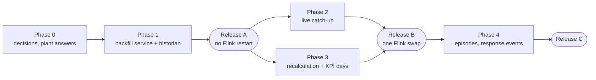

# OT data-gap backfill: implementation plan

> **For agentic workers:** REQUIRED SUB-SKILL: Use superpowers:subagent-driven-development (recommended) or
> superpowers:executing-plans to implement this plan task-by-task. Steps use checkbox (`- [ ]`) syntax for tracking.

**Goal:** Load missing OT hours from the plant's OT IoTDB into our historian and engine. The live 12 h / 24 h
results become complete at the next 15-minute mark, and every window and KPI day the gap left incomplete is recalculated.

**Architecture:**
- **Backfill service (ingestion-service):** reads a chosen range from the OT IoTDB and builds samples with the live
  joiner's own rules. It publishes them to a separate backfill topic, marked `historical`.
- **Readers of that topic:** the historian writer and the Long job (buffer only). No other live job reads it.
- **Recalculation:** a bounded Flink job recalculates the affected windows on the live 15-minute grid, from our
  historian.
- **Storage (cplm-api):** stores the recalculated rows in place of the incomplete ones, keeps the old version, and
  stores the touched KPI days again.

**Tech stack:**
- .NET 8: ingestion-service, ams-api, cplm-api; xUnit 2.7 + FluentAssertions.
- Flink 1.18.1, Java 11; JUnit 4.13; Maven in Docker.
- Kafka (Confluent.Kafka 2.3), IoTDB 1.3 over REST v2, PostgreSQL.
- React 18 + OpenBridge.

**Spec:** [data-gap-backfill.md](data-gap-backfill.md): the research and design of 27 Nov 2026. Read both.

**Code base:** release v2.10.0 (`76bfe55a`; worktree `AMS-open-sr-mine` at `94386d1e`). Paths are relative to the
repository root.

**Status:** plan for owner review, 28 Nov 2026. Nothing is built.

**Assumption (owner, 28 Nov):** the OT IoTDB holds the same signals as the MQTT feed: per loop PV, SP, OP, MODE, VP,
each with a timestamp and quality. The layout is read through one class (`OtIotDbLayout`), so a different layout
changes that class only. Phase 0 confirms the layout.

---

## A. Decisions for the owner (the plan is written on the recommended answers)

| # | Question | Recommended | Other choice |
|---|---|---|---|
| 1 | What a recalculation changes | **Fill gaps only:** rows that are missing or "Not enough data" | Recalculate every window in the range (offered to SuperAdmin as a switch in Phase 3) |
| 2 | Replaced "Not enough data" rows | **Keep the old version** in a revision table for 90 days | Overwrite with no record |
| 3 | Limits | **Raw data up to 90 days old; recalculation up to 13 days; at most 7 days per run; one run at a time** | Other values (all are settings) |
| 4 | Who may run a backfill | **SuperAdmin**: the existing `ingestion.manage` permission is already SuperAdmin-only, so no new permission | Admin too |
| 5 | Data quality in the historian | **Store quality from Phase 1** (moved forward from Phase 4 of the spec, so recalculations never treat bad data as good) | Treat backfilled data as GOOD |
| 6 | Same timestamp in our historian and in the OT IoTDB | **Keep ours** | OT value wins |
| 7 | One clock | **Plant confirms** that the OT IoTDB and the gateway share one NTP clock before the first backfill (gateway measured +132 s) | — |
| 8 | Episodes and System Response events inside a gap | **Phase 4, after Phase 3 is proven at the plant**; until then the gap stays visible in episodes | Never rebuild them |
| 9 | Start of recalculation | **Automatically** when a backfill has loaded | By hand |
| 10 | Releases | **A = Phase 1** (no Flink restart); **B = Phases 2 + 3** together (one Flink swap, from a savepoint); **C = Phase 4** | One release per phase (two Flink swaps) |
| 11 | Old messages arriving on the live MQTT feed (gateway store-and-forward) | **Refuse them** from the live path, send them to the dead-letter topic and count them; load them with a backfill | Route them to the backfill topic automatically |
| 12 | How we reach the OT IoTDB | **A read-only user on its REST interface**, the way all our services already talk to IoTDB | Native session port (adds a new client library) |
| 13 | Loop parameters in a recalculation | **The gate configuration in force at each window, with today's loop parameters** (they rarely change; the engine has no parameter history) | Build a parameter history first |

## B. Phases and releases

| Phase | Effort | Services | After it ships |
|---|---|---|---|
| 0 | owner + plant, alongside Phase 1 | — | Layout, access and clock confirmed |
| 1 | 1-2 weeks | ingestion-service, ams-api, ams-frontend | Gap hours in trends, Redraw, on-demand evaluations and shadow runs; results not changed yet |
| 2 | 2-4 days | Flink jar (Long job) | Scenario 1 and the 24 h part of scenario 2: live results complete at the next mark |
| 3 | 1-2 weeks | Flink jar (new job), cplm-api, ams-frontend | Both scenarios fully: past windows and KPI days corrected |
| 4 | 1-2 weeks | Flink jar, cplm-api | Episodes and System Response events of the gap |

Each phase ends with a lab rehearsal on a simulated gap. Every write to the shared lab needs the owner's approval each
time. No deployment bundle is built without the owner's explicit yes.

## C. Global constraints

- **No old data on the live path:** nothing older than the live-door limit (300 s) enters `traverse.cpa.loop.samples.v1`.
  Backfill uses `traverse.cpa.loop.samples.backfill.v1` only.
- **Readers of the backfill topic:** only the historian writer and the Long job.
- **Compute runs in Flink:** the recalculation is a Flink job, never cplm-api code.
- **Auth is edge-only:** services authorize from the `X-Auth-*` headers through `Auth/TraverseAuth.cs`. No JWT parsing.
- **One database per service:** ingestion tables go in `traverse_ingestion` (schema `ingestion`), engine tables in
  the cplm database (schema `analytics`).
- **Schema changes in two forms:** `database/scripts/NN_*.sql` (next: 71, 72), plus a plant pack
  `scripts/cpm-NN-*.sql` with a `.rollback.sql` (next: cpm-23, cpm-24).
  - The pack header follows cpm-22: CHG, why, cost, online or stopped, before or after the swap, run line,
    idempotency, rollback.
- **Kafka topics:** declared in `migration/kafka/topics.txt` and created by `migration/04-create-kafka-topics.sh`. The
  lab uses `scripts/kafka-reset-lab-topics.ps1`.
- **Compacted topics need keyed records:** every new topic here uses `delete` and keyed records.
- **CPLM consumer groups:** a new cplm-api consumer group must only ever have one member process.
- **File size:** each file stays at 400-500 lines or fewer. Split rather than grow.
- **UI rules:**
  - OpenBridge React wrappers only, imported per path; tokens only; `obi-*` icons.
  - UI text is minimal and non-technical; detail goes in tooltips.
  - Pages keep their layout: only the elements named here are added.
- **Tests:** run only the tests covering the changed code.
  - .NET: `dotnet test <project> --filter`.
  - Flink: Maven in Docker with `-Dtest=A,B`. Surefire 2.12.4 ignores `-Dtest=!X`, so read the "Tests run" line.
  - Frontend: `npx vitest run <changed files>`.
- **CHG numbers:** reserved by message at the start of each phase. The highest used today is CHG-227.
- **Commits:** one per task, only after the owner's OK. The message ends with
  `Co-Authored-By: Claude Opus 5.5 <noreply@anthropic.com>`.
- **Release records:** each release updates `changes_tracker.md` (services, scripts in run order) and `prod_decision.md`
  (settings and why).

**Task cycle (every task):** write the listed tests → run them and watch them fail → implement → run them and watch
them pass → show the diff → commit after the owner's OK.

## D. Review focus (inputs no spec line covers but that would hurt first)

1. **OT timestamps in another precision or zone** (ns/µs, or local time written as UTC) shift every window by hours.
   The reader converts to UTC epoch ms, and the preview shows the first and last time per loop.
   Tests: Task 1.2 (`ReadAsync_converts_ns_precision_to_ms`), Task 1.5 (`Preview_shows_first_and_last_time_per_loop`).
2. **Holes in the OT data too:** nothing may bridge them. Windows below 95 % stay "Not enough data".
   Tests: Task 1.3 (`No_tuples_inside_a_hole_in_the_OT_data`), Task 3.2 (`no_value_held_across_hole`).
3. **A range touching "now", or overlapping data we already hold:** this would duplicate or overwrite.
   The end must be at least 10 minutes in the past, and timestamps already present are skipped.
   Tests: Task 1.5 (`Start_rejects_range_ending_less_than_10_min_ago`, `Timestamps_already_in_our_historian_are_not_published`).
4. **Restart or cancel mid-run:** the run resumes after its cursor with no duplicates.
   Tests: Task 1.5 (`Resume_after_restart_continues_after_cursor_without_duplicates`, `Cancel_stops_after_current_hour`).
5. **A recalculated window with fewer samples than the stored row** never replaces it, and no revision is written.
   Test: Task 3.3 (`Lower_sample_count_never_replaces`).

---

## Phase 0: Prepare (no code)

- [ ] **0.1 Owner** answers section A.
- [ ] **0.2 Plant answers** (send as one list):
  - OT IoTDB version, host and port;
  - REST enabled or not, and a read-only user;
  - firewall path from our VM;
  - the series names of one loop for one hour;
  - the timestamp precision;
  - whether quality and mode are stored;
  - how soon gap hours appear there, and how long they are kept;
  - a shared NTP clock with the gateway.
- [ ] **0.3 Reserve CHG numbers** for Phase 1 by message.

## Phase 1: Backfill into the historian (Release A)

### Task 1.1: Lab stand-in for the OT IoTDB

**Files:**
- Create: `infra/docker/docker-compose.backfill-lab.yml` (service `ot-iotdb`, same IoTDB image as `iotdb`, REST on,
  no host port, lab only)
- Create: `scripts/seed-ot-iotdb.py`, which copies a range of the lab historian into the OT layout, with
  `--cut-gap FROM TO` to leave a hole.
- Test: `scripts/tests/test_seed_ot_iotdb.py`

- [ ] Tests: `test_series_path_follows_template` (`root.ot.{site}.{loop}.{param}` gives the expected path);
  `test_cut_gap_writes_no_point_inside_gap`.
- [ ] Implement. Default layout: one series per parameter, measurements `value` and `quality`.
- [ ] Run `python -m pytest scripts/tests/test_seed_ot_iotdb.py -q`. Expected: 2 passed.

### Task 1.2: OT IoTDB data source and reader

**Files:**
- Create: `database/scripts/71_ingestion_backfill.sql`. It adds `'IOTDB'` to the `source_type` CHECK (today
  `46_ingestion_data_sources.sql:28`) and creates `ingestion.backfill_run` (Task 1.5). Mirror it in `Program.cs` `SelfHeal`.
- Modify: `Services/DataSourceValidation.cs:23` (accept IOTDB), `Services/ProfileRegistry.cs` (profile
  `IOTDB_LOOP_HISTORY`), `Models/DataSourceConfig.cs` (`ProfileConfig.iotdb_history`).
- Modify: `POST /data-sources/{id}/test` (for IOTDB, run `SHOW VERSION`).
- Create: `Backfill/IotDbRestQueryClient.cs`, `Backfill/OtIotDbLayout.cs`, `Backfill/OtHistorySource.cs`, all
  under `src/services/ingestion-service/`.
- Test: `tests/ingestion-service.Tests/Backfill/OtHistorySourceTests.cs`, using a fake `HttpMessageHandler`.

**Interfaces (produces):**
- `record IotDbEndpoint(string RestUrl, string User, string Password)`.
- `IotDbRestQueryClient(HttpClient, IotDbEndpoint)`, with `Task<IotDbRows> QueryAsync(string sql, CancellationToken)` and
  `Task NonQueryAsync(string sql, CancellationToken)`.
  - `record IotDbRows(IReadOnlyList<string> Columns, IReadOnlyList<long> Timestamps, IReadOnlyList<IReadOnlyList<object?>> Values)`.
  - The same class serves the OT IoTDB and ours, as two instances.
- `iotdb_history` config:
  - `rest_url`, `path_template` (placeholders `{site} {area} {unit} {loop} {param}`);
  - `value_measurement` (`value`), `quality_measurement` (`quality`, may be empty);
  - `timestamp_precision` (`ms|us|ns`), `page_rows` (10000).
  - The password is encrypted with `CredentialCipher`, as for MQTT.
- `OtIotDbLayout.SeriesFor(RegistryLoop loop, string parameter) : string`; `OtIotDbLayout.ToEpochMs(long raw) : long`.
- `interface IOtHistorySource`:
  - `Task<IReadOnlyList<HourCount>> CountPerHourAsync(RegistryLoop, long fromMs, long toMs, CancellationToken)`;
  - `IAsyncEnumerable<OtParameterPoint> ReadAsync(RegistryLoop, long fromMs, long toMs, CancellationToken)`.
- `record OtParameterPoint(string Parameter, long TsMs, double? NumericValue, string? RawValue, string? Quality)`;
  `record HourCount(long HourStartMs, int Count)`.

- [ ] Tests:
  - `ReadAsync_pages_by_time_not_offset`: request 2 contains `time > <last ts of page 1>` and `LIMIT 10000`, and has
    no `OFFSET`.
  - `ReadAsync_converts_ns_precision_to_ms`: 1_756_600_000_000_000_000 becomes 1_756_600_000_000.
  - `ReadAsync_merges_parameters_in_ascending_time`.
  - `Layout_builds_series_from_registry_fields`.
  - `Validation_accepts_IOTDB_and_requires_rest_url_and_path_template`.
- [ ] Implement.
- [ ] Run `dotnet test tests/ingestion-service.Tests/ingestion-service.Tests.csproj --filter "FullyQualifiedName~OtHistorySource"`.
  Expected: 5 passed.

### Task 1.3: Offline joiner with the live rules

**Files:**
- Create: `src/services/ingestion-service/Backfill/BackfillJoiner.cs`
- Modify: `Pipeline/LoopJoiner.cs`:
  - add init-only `bool Historical` and `string? BackfillId` to `LoopTuple`;
  - make `ToJson()` write `"historical":true` and `"backfill_id"` only when they are set. The live JSON stays
    byte-identical.
- Test: `tests/ingestion-service.Tests/Backfill/BackfillJoinerTests.cs`

**Interfaces:**
- Consumes `OtParameterPoint` (Task 1.2), plus the live `LoopJoiner.Accept/Tick` and `LoopParameterMapper.TryMap`.
- Produces `static IEnumerable<LoopTuple> BackfillJoiner.Join(RegistryLoop loop, string sourceFcs,
  IEnumerable<OtParameterPoint> pointsAscending, long fromMs, long toMs, LoopIngestSettings cfg, string backfillId)`.

**Algorithm** (live `Tick` jumps to the newest boundary and never catches up, `LoopJoiner.cs:332`, so the joiner must
be stepped once per boundary):
1. Use a fresh `LoopJoiner` for each loop and run.
2. For each grid boundary `b`, from the first point up to `toMs`, in steps of `cfg.GridSeconds`:
   - feed every point with `TsMs <= b` through `TryMap` into `Accept(..., nowMs: b)`;
   - then call `Tick(b, cfg)`.
3. Keep only the tuples with `fromMs <= EventTsMs < toMs`, and stamp them `Historical`.

Points read from up to 10 minutes before `fromMs` only seed held values. Holes produce no tuples, because the joiner
skips any tuple that is not newer than the last one (`:355`).

- [ ] Tests:
  - `Same_points_give_same_tuples_as_live_path`: drive a live `LoopJoiner` the way `OtLoopSubscriber` does (Accept on
    arrival, Tick every second) and compare with `Join` over the same points. The sequences must be equal in
    (LoopId, EventTsMs, Pv, Sp, Op, Vp, Mode, Quality).
  - `No_tuples_inside_a_hole_in_the_OT_data`.
  - `Lookback_points_seed_but_are_not_emitted`.
  - `Tuples_are_marked_historical_with_backfill_id`.
  - `Live_tuple_json_is_unchanged`.
- [ ] Implement.
- [ ] Run `dotnet test ... --filter "FullyQualifiedName~BackfillJoiner|FullyQualifiedName~LoopJoinerTests"`. Expected:
  new tests and the existing `LoopJoinerTests` pass.

### Task 1.4: Backfill topics and producer

**Files:**
- Create: `Backfill/BackfillSampleProducer.cs`.
- Modify: `Program.cs` (DI); `migration/kafka/topics.txt`; `scripts/kafka-reset-lab-topics.ps1`.
- Test: `tests/ingestion-service.Tests/Backfill/BackfillSampleProducerTests.cs`

**Topics:**

| Topic | Partitions | Policy | Retention | Compression |
|---|---|---|---|---|
| `traverse.cpa.loop.samples.backfill.v1` | 16 | delete | 259200000 (3 d) | lz4 |
| `traverse.cpa.backfill.runs.v1` | 1 | delete | 2592000000 (30 d) | lz4 |

**Interfaces (produces):**
- `Task PublishAsync(LoopTuple t, CancellationToken)`, keyed by `LoopId`.
- `Task PublishRunEventAsync(BackfillRunEvent e, CancellationToken)`, keyed by `BackfillId`.
  - `record BackfillRunEvent(Guid BackfillId, string State, IReadOnlyList<string> LoopIds, long FromMs, long ToMs, string Mode, long Published, string Origin, DateTimeOffset At)`.
  - `Origin` is `ingestion` or `cplm-api`; each service ignores its own events.
- Config keys:
  - `Kafka:BackfillSamplesTopic` and `Kafka:BackfillRunsTopic`;
  - `Backfill:MaxSamplesPerSecond` (default 5000).

- [ ] Tests:
  - `Constructor_refuses_live_topic`: backfill topic = `Kafka:LoopSamplesTopic` throws `InvalidOperationException`.
  - `Publishes_to_backfill_topic_with_loop_key`.
  - `Rate_limit_spaces_publishing`: with a fake clock, 10,000 samples at 5,000/s take at least 2 s.
- [ ] Implement.
- [ ] Run with `--filter "FullyQualifiedName~BackfillSampleProducer"`. Expected: 3 passed.

### Task 1.5: Preview, run register and runner

**Files:**
- Modify: `database/scripts/71_ingestion_backfill.sql`.
- Create, all under `Backfill/`:
  - `BackfillRunStore.cs`, `HistorianPresence.cs` (our IoTDB, through `IotDbRestQueryClient` with env `IotDb__RestUrl`,
    `IotDb__Username`, `IotDb__Password`, `IotDb__LoopRootPrefix`);
  - `BackfillPreview.cs`, `BackfillRunner.cs` (`BackgroundService`), `BackfillEndpoints.cs`.
- Tests: `tests/ingestion-service.Tests/Backfill/BackfillPreviewTests.cs`, `BackfillRunnerTests.cs`

**Table `ingestion.backfill_run`:**
- run: `backfill_id uuid PK`, `data_source_id`, `loop_ids text[]`, `from_ms`, `to_ms`, `mode` (`FILL_GAPS`), `state`;
- counts: `read_count`, `published_count`, `skipped_count`;
- progress: `cursor jsonb` (last published hour per loop), `preview jsonb`, `error`;
- audit: `created_by`, `created_at`, `finished_at`.

States: QUEUED → LOADING → VERIFYING → LOADED → RECALCULATING → DONE. The other end states are FAILED and CANCELLED.

**Endpoints** (`ingestion.manage`; the existing gateway route `/api/ingestion/*` covers them):
- `POST /backfills/preview` `{dataSourceId, loopIds[], fromUtc, toUtc}` returns, for each loop and hour, `{expected,
  onOt, inOurs, toLoad}`. It also returns the first and last OT timestamp per loop, and the skipped loops with a reason.
- `POST /backfills` (same body) returns 202 `{backfillId}`.
- `GET /backfills`, `GET /backfills/{id}`, `POST /backfills/{id}/cancel`.

**Rules:**
- Only one QUEUED, LOADING or VERIFYING run at a time; a second start gets 409.
- The span is at most `Backfill:MaxSpanDays` (7).
- `from` is no older than now − `Backfill:MaxAgeDays` (90), and `to` is at most now − 10 min.
- Retired or unknown loops are skipped with a reason.
- An hour is skipped when `inOurs >= expected`. Inside the other hours, timestamps we already hold are dropped.
- Expected = 3600 / grid seconds (720 per hour at 5 s).
- **After publishing comes VERIFYING:** poll our counts until they reach `published` for each loop and hour (timeout
  `Backfill:VerifyTimeoutMinutes`, 15). Then run Task 1.6's rollup rebuild, set LOADED, and publish
  `BackfillRunEvent(LOADED)`.

- [ ] Tests:
  - `Preview_counts_expected_onOt_inOurs_per_hour`.
  - `Preview_shows_first_and_last_time_per_loop`.
  - `Preview_skips_retired_loops_with_reason`.
  - `Start_rejects_range_ending_less_than_10_min_ago` (400), `Start_rejects_span_over_7_days` (400),
    `Start_rejects_from_older_than_90_days` (400), `Second_start_while_running_returns_409`.
  - `Timestamps_already_in_our_historian_are_not_published`.
  - `Resume_after_restart_continues_after_cursor_without_duplicates`.
  - `Cancel_stops_after_current_hour` (state CANCELLED).
  - `Run_reaches_LOADED_only_after_historian_counts_match`, which also publishes the LOADED event.
- [ ] Implement.
- [ ] Run with `--filter "FullyQualifiedName~BackfillPreview|FullyQualifiedName~BackfillRunner"`. Expected: all pass.

### Task 1.6: Historian writer, quality and the 1-minute rollup

**Files:**
- Modify: `src/backend/AMS.Api/BackgroundServices/RawLoopIotDbConsumer.cs`:
  - a constructor-injected `record RawLoopConsumerSettings(string Topic, string GroupId)` replaces the hard-coded group
    at :72;
  - `Measurements` becomes {pv, sp, op, vp, mode, quality}, with quality TEXT.
- Create: `BackgroundServices/BackfillRawLoopIotDbConsumer.cs`. It is a subclass, because `AddHostedService<T>` adds a
  type only once.
- Modify: `BackgroundServices/CplmOptions.cs` (`BackfillSamplesTopic`) and `Program.cs:182-188`.
- Modify: `infra/docker/iotdb-layout-v2.sh` (`RAW_COLS` :39 gets quality, plus an idempotent add for an existing
  template).
- Create: `migration/iotdb-add-quality.sh` (plant).
- Create: `src/services/ingestion-service/Backfill/RollupRebuilder.cs`.
- Tests: `src/backend/AMS.Tests.Integration/Historian/RawLoopConsumerTests.cs` and
  `tests/ingestion-service.Tests/Backfill/RollupRebuilderTests.cs`.

**Values:**
- Consumer groups: the live group stays `traverse-cpa-iotdb-raw-loop`; the backfill group is
  `traverse-cpa-iotdb-raw-loop-backfill`.
- Quality is written as `NormalizedQuality` text (GOOD, UNCERTAIN, BAD, UNKNOWN).
- Template change: `ALTER DEVICE TEMPLATE cpm_raw ADD (quality TEXT encoding=DICTIONARY compressor=ZSTD)`. Confirm the
  syntax on the lab's IoTDB 1.3 first.
- Rollup: `RollupRebuilder.RebuildAsync(string loopId, long fromMs, long toMs, CancellationToken)` runs the
  `cq_cpm_raw_1m` select (`iotdb-layout-v2.sh:116-122`) with `GROUP BY ([from, to), 1m)` into the same m1 device.
  It runs only when `Backfill:Rollup1m=true`, which mirrors the plant's `ROLLUP_1M`.

- [ ] Tests:
  - `Live_and_backfill_consumers_use_their_own_topic_and_group`.
  - `TryParse_reads_quality`.
  - `Quality_is_written_as_sixth_measurement`.
  - `Rebuild_sql_uses_explicit_range_and_1m_groups`.
- [ ] Implement.
- [ ] Run `dotnet test src/backend/AMS.Tests.Integration --filter "FullyQualifiedName~RawLoopConsumer"` and the
  ingestion filter `RollupRebuilder`. Expected: all pass.

### Task 1.7: Live-door age guard

**Files:**
- Modify: `Models/LoopIngestConfig.cs` (`past_skew_max_seconds`, default 300; 0 = off).
- Modify: `Pipeline/LoopJoiner.cs`: add `long? NewestMemberTsMs(string loopId)`.
- Modify: `Pipeline/OtLoopSubscriber.cs`: the check goes before `Accept` (:229) and sends the sample to the DLQ with
  reason `LATE_TIMESTAMP`. Add the metric `ingestion_late_samples_total`.
- Test: `tests/ingestion-service.Tests/LateSampleGuardTests.cs`

- [ ] Tests:
  - `Sample_older_than_newest_by_more_than_limit_goes_to_DLQ`.
  - `Sample_within_limit_is_accepted`.
  - `First_sample_of_a_loop_is_accepted`.
  - `Limit_zero_disables_guard`.
- [ ] Implement.
- [ ] Run with `--filter "FullyQualifiedName~LateSampleGuard|FullyQualifiedName~LoopJoinerTests"`. Expected: all pass.

### Task 1.8: Backfill screen

**Files:**
- Create: `src/frontend-ob/src/components/Administration/backfill/BackfillPanel.tsx`, `BackfillPreviewTable.tsx`,
  `backfillApi.ts`, `useBackfillRun.ts` (react-query; polls every 5 s while a run is active).
- Modify:
  - `DataSourceDetail.tsx`: a **Backfill** button for IOTDB sources, when the user has `ingestion.manage`;
  - `wizard/WizardBasics.tsx` and `wizard/wizardForm.ts`: IOTDB fields "Address", "User", "Password", "Path pattern",
    "Time unit".
- Test: `backfill/BackfillPanel.test.tsx`

**Text** (exact; details in tooltips):

| Element | Text |
|---|---|
| Fields | "From", "To", "Loops" |
| Buttons | "Check", "Start", "Cancel" |
| Table columns | "Loop", "Missing", "Available", "Already here" |
| States | "Waiting", "Loading", "Checking", "Loaded", "Recalculating", "Done", "Failed", "Cancelled" |
| Result | "{n} samples loaded" |
| 409 message | "Another backfill is running" |

- [ ] Tests:
  - `start is disabled until a check has run`;
  - `shows the running message on 409`;
  - `stops polling when done`.
- [ ] Implement with OpenBridge wrappers only (resolve each one from `custom-elements.json`).
- [ ] Run `npx vitest run src/components/Administration/backfill` and `npm run lint`. Expected: pass, 0 warnings.

### Task 1.9: Release A records and lab rehearsal

- [ ] `changes_tracker.md`:
  - services: ingestion-service, ams-api, ams-frontend;
  - scripts in run order:
    1. `scripts/cpm-23-ingestion-backfill.sql`, with a rollback;
    2. `migration/04-create-kafka-topics.sh`, which creates the two topics;
    3. `migration/iotdb-add-quality.sh`.
- [ ] `migration/deploy/release_blocks.py`: one block for these steps. Add the
  `migration/deploy/test_release_blocks.py` case and run it.
- [ ] `prod_decision.md` records these settings:

  | Setting | Value |
  |---|---|
  | Run limits | 7 days per run, 90 days back, one run at a time |
  | Publish rate | 5,000 samples/s |
  | Backfill topic retention | 3 days |
  | Mode | Fill gaps only |
  | Historian | Quality measurement added |
  | Live-door limit | 300 s |
  | OT access | Read-only user |
- [ ] **Lab rehearsal** (owner approves each write):
  1. Seed `ot-iotdb` with one lab day and cut a 5 h gap in our historian, the way Task 1.1 does.
  2. Run the backfill.
  3. Check:
     - historian counts per hour equal the expected count within 1 %;
     - the trend is filled and the m1 rollup is present;
     - no message on the live topic carries `historical`;
     - the Short and Response job metrics are unchanged.

## Phase 2: Live catch-up in the Long job (Release B, part 1)

### Task 2.1: Historical flag and a source that never holds the clock

**Files:**
- Modify: `src/flink/src/main/java/com/ams/flink/cplm/CplmNormalizedSample.java`: field `historical`, read in
  `fromJson`, default false.
- Modify: `cplm/CplmIngestPipeline.java`: `buildBackfill(env, cfg, uid)` reads `cfg.backfillTopic` with group
  `<base>-long-backfill` and `committedOffsets(EARLIEST)`.
- Modify: `cplm/CplmJobConfig.java`: add `backfillTopic`, and the flag `--long-backfill-input` (default true).
- Create: `cplm/AlwaysIdleWatermarks.java`.
- Tests: `src/flink/src/test/java/com/ams/flink/cplm/AlwaysIdleWatermarksTest.java`, `NormalizedSampleHistoricalTest.java`

**Why always idle:** an operator's time is the minimum of its inputs. `noWatermarks().withIdleness()` turns idle only
after a quiet second, so a long backfill burst would hold the Long job's clock. When it was released, the clock would
jump and the skip-ahead (`:333-339`) would skip live marks. A generator that calls `output.markIdle()` on every
periodic emit, and never emits a watermark, keeps the input out of the minimum while its records still flow.

- [ ] Tests:
  - `periodicEmit_marks_idle_and_never_emits_watermark` (a fake `WatermarkOutput`);
  - `historical_flag_parsed_default_false`.
- [ ] Implement.
- [ ] Run (PowerShell): `docker run --rm -v "<repo>\src\flink:/build" -v "$env:USERPROFILE\.m2:/root/.m2" -w /build
  maven:3.9-eclipse-temurin-11 mvn -q -Dtest=AlwaysIdleWatermarksTest,NormalizedSampleHistoricalTest test`.
  Expected: "Tests run: 2, Failures: 0".

### Task 2.2: Long job adds backfill samples to its memory only

**Files:**
- Modify: `cplm/CplmLongDiagnosticsStreamJob.java`:
  - union the live and backfill streams before `connectPeerFanout` (:85-95), so backfilled samples also reach peers.
    The new source uid is `cplm-long-backfill-source`;
  - in `processElement` (:204), when `sample.historical` is set: add the sample to `rollingBuffer` (or to
    `peerBuffer` when it is a peer copy), update the coverage, and return before the timer code at :222-227.
- Test: `src/flink/src/test/java/com/ams/flink/cplm/LongBackfillCatchUpTest.java`

- [ ] Tests:
  - `historical_sample_registers_no_timer`: an operator harness reports `numEventTimeTimers() == 0`.
  - `historical_samples_count_in_next_mark_windows`:
    - input: live 12:00-16:00, historical 07:00-12:00, watermark 16:15;
    - expected: the 12 h result at 16:15 has `sample_count >= 0.95 × 8640` and `warmingUp == false`.
  - `historical_older_than_horizon_is_evicted_at_next_mark`.
  - `same_timestamp_live_and_historical_kept_once`.
  - `backfill_input_does_not_hold_watermark`: in a MiniCluster, the live watermark reaches T while the backfill
    source keeps emitting, and the mark at T is emitted.
  - `no_marks_from_backfill_alone`: with the live input idle, backfill records fire no timer.
- [ ] Implement.
- [ ] Run `-Dtest=LongBackfillCatchUpTest,LongBoundaryEmissionTest,LongWarmupCoverageTest,LongJobTopologyTest`.
  Expected: all pass, and the "Tests run" line counts them.

### Task 2.3: Count late samples in the Short job

**Files:**
- Modify: `cplm/ShortFeatureBufferFn.java:145-175`. Add the Flink counter `lateSamplesDropped`; behaviour is unchanged.
- Test: `ShortLateCounterTest.java`

- [ ] Test: `late_sample_increments_counter_and_is_dropped`.
- [ ] Implement.
- [ ] Run `-Dtest=ShortLateCounterTest`. Expected: 1 passed.

## Phase 3: Recalculate past windows and KPI days (Release B, part 2)

### Task 3.1: One calculation for live and bounded runs

**Files:**
- Create: `cplm/LongMarkCalculator.java` (the body of `onTimer` :271-323 moves here).
- Create: `cplm/FusionStep.java` (the core of `GateFusionProcess.processElement1` :222-273 moves here).
- Modify: both live classes call them. This is a refactor with no behaviour change.
- Tests: `LongMarkCalculatorTest.java`, `FusionStepTest.java`

**Interfaces (produces):**
- `static List<CplmLongDiagnosticsResult> LongMarkCalculator.compute(String loopId, List<CplmNormalizedSample>
  ownSorted, List<CplmNormalizedSample> peersSorted, long markTs, CplmLoopDynamicsProfile profile, Long coverageFromMs)`.
- `static FusionStep.Outcome FusionStep.apply(CplmLongDiagnosticsResult longD, List<String> priorFamilies,
  OpenConditions open, HealthLanes health, CplmLoopDynamicsProfile profile)`.
  - `record Outcome(CplmGateResult result, List<String> nextFamilies)`.
  - History trimming stays `max(3, persistenceWindows)`.

- [ ] Tests:
  - `compute_equals_live_onTimer_output`: the harness output and a direct call on the same buffer give equal JSON.
  - `apply_equals_live_processElement1`.
- [ ] Implement.
- [ ] Run these tests, the Long tests from Task 2.2, and the existing fusion tests (`*Fusion*Test`; list them with
  grep first). Expected: all pass, unchanged.

### Task 3.2: Bounded recalculation job

**Files:**
- Create: `cplm/backfill/CplmBackfillRecalcJob.java` (main) and `cplm/backfill/RecalcLoopFn.java`.
- Modify: `cplm/replay/IotDbLoopReader.java:105-123`:
  - read `quality` when the column exists (BAD or UNCERTAIN sets `isValid` the way live parsing does);
  - when it is absent, GOOD stays the default for old data.
- Test: `src/flink/src/test/java/com/ams/flink/cplm/backfill/CplmBackfillRecalcJobTest.java`, with resources in
  `src/test/resources/backfill/golden-day/`: one lab day of samples plus its live gate rows, exported read-only.

**Arguments:**

| Argument | Meaning |
|---|---|
| `--analysis-run-id` | The run |
| `--loops-b64` | The loops |
| `--read-from-ms` | Start of the read, warm-up included |
| `--first-mark-ms`, `--last-mark-ms` | First and last mark to calculate |
| `--targets-b64` | (loop, kind, windowEndMs) list for fill-gaps mode; absent = every mark |
| `--bundle-hash`, `--bundle-properties-b64` | The segment's configuration (`BoundedBundle`) |
| `--parallelism` | Default 2 |

**Behaviour:**
- **Run mode:** BATCH. Samples are keyed by loop; `RecalcLoopFn` collects one loop's samples, sorts them, and walks the
  15-minute marks from `read-from + 24 h` to `last-mark`.
- **At each mark:**
  - `LongMarkCalculator.compute` runs on the samples of the last 24 h 10 min;
  - `ConditionDetector.onSample` is replayed in order up to the mark, and gives `OpenConditions`;
  - `FusionStep.apply` carries the history forward;
  - health lanes are empty, as live today.
- **What is emitted:** marks before `first-mark` only build the history. Only target marks are emitted.
- **Samples are used as read:** no hold-last; the job never calls `materializeEvaluationSamples`.
- **Peers:** peer links come from the same broadcast topic the live fan-out reads, read once at start. Peers' samples
  come from IoTDB for the same range.
- **Output:** keyed `KafkaSinks.keyedByJsonField(brokers, CplmTopics.GATE_RESULTS, "loop_id")`, with
  `purpose = "BACKFILL"`, `calculation_source = "flink"` and `analysis_run_id`.

- [ ] Tests:
  - `golden_day_recalc_equals_live_rows`: after warm-up, every window end has the same diagnosis, gate statuses and
    `sample_count` as the stored live row.
  - `no_value_held_across_hole`: a 2 h hole gives the real count and `INSUFFICIENT_DATA` below 95 %.
  - `only_target_marks_emitted_in_fill_gaps_mode`.
  - `warmup_marks_build_history_but_are_not_emitted`.
  - `marks_are_on_live_15_min_grid`: `windowEnd % 900000 == 0`.
  - `bad_quality_rows_are_not_valid`.
- [ ] Implement.
- [ ] Run `-Dtest=CplmBackfillRecalcJobTest,IotDbLoopReaderTest`. Expected: all pass.

### Task 3.3: cplm-api stores recalculated rows as official results

**Files:**
- Create: `database/scripts/72_cplm_backfill_recalc.sql` and `scripts/cpm-24-backfill-recalc.sql` (with a rollback):
  - `analytics.analysis_run` purpose CHECK gets `BACKFILL` added;
  - `analytics.cplm_gate_result_revision(revision_id bigserial PK, loop_id, window_kind, window_end, old_diagnosis,
    old_sample_count int, old_bundle_hash, old_payload jsonb, analysis_run_id uuid, replaced_at timestamptz default
    now())`, with an index on (loop_id, window_end);
  - `analytics.cplm_kpi_day_invalidation(plant_day date PK, analysis_run_id uuid, invalidated_at timestamptz)`.
- Modify: `BackgroundServices/CplmResultConsumerService.cs` `PersistGateAsync` (:171). A row with `purpose = BACKFILL`
  goes to `Data/BackfillGateSql.cs` (new).
- Modify: the daily retention pass deletes revisions older than 90 days.
- Test: `tests/cplm-api.Tests/Backfill/BackfillGateUpsertTests.cs` (a database test: set `CPLM_TEST_DB` with
  Port=5436 from PowerShell, reading the credentials from `infra/docker/.env` without printing them).

**Rule (one transaction per batch):**
1. Find the row with `purpose='LIVE'` and `source='flink'` at the same (loop, kind, window_end), whatever its
   `bundle_hash`.
2. If there is none, insert the row as `LIVE`/`flink` with the job's hash, `analysis_run_id`, and
   `payload.recalculated_at`.
3. Replace the row in place when all three hold:
   - it is incomplete (`diagnosis = 'INSUFFICIENT_DATA'`), or the run's mode is `RECALCULATE_ALL`;
   - the new `sample_count` is at least the stored one;
   - the old version is copied to the revision table first.

   The replacement keeps the existing `bundle_hash`.
4. Otherwise skip the row and count it.

This differs from spec 5.4, where the job writes `LIVE` with the original hash. Mapping in the consumer keeps the job
free of database reads, and puts the replace rule and the revision in one transaction. The episode service already
drops anything that is not `purpose='LIVE'` on the wire (`CplmEventFrameService.cs:131-136`), so episodes are untouched.

- [ ] Tests:
  - `Missing_live_row_is_inserted_as_live_with_run_id`.
  - `Incomplete_live_row_is_replaced_in_place_and_revision_kept`: the row count is unchanged, and the hash is kept.
  - `Complete_live_row_is_left_alone_in_fill_gaps_mode`.
  - `Lower_sample_count_never_replaces`: no revision is written.
  - `Recalculate_all_replaces_complete_row_with_revision`.
  - `Event_frames_ignore_backfill_rows`.
- [ ] Implement.
- [ ] Run `dotnet test tests/cplm-api.Tests --filter "FullyQualifiedName~BackfillGateUpsert"`. Expected: 6 passed.

### Task 3.4: Plan and start the recalculation when a backfill has loaded

**Files:**
- Create: `BackgroundServices/BackfillRunEventConsumer.cs` (group `traverse-cpa-cplm-backfill-runs`, one member only).
- Create: `Services/BackfillRecalcPlanner.cs` and `BackgroundServices/BackfillRecalcMonitor.cs`.
- Modify: `Services/CplmRecomputeService.cs`: add `StartBackfillRecalcAsync(BackfillRecalcPlan plan, CancellationToken)`.
  - It goes through the core `StartAsync` (:163) with purpose `BACKFILL`.
  - `EntryClass` is `com.ams.flink.cplm.backfill.CplmBackfillRecalcJob`.
  - The idempotency key is `backfill:{id}:{segment}`.
- Tests: `tests/cplm-api.Tests/Backfill/BackfillRecalcPlannerTests.cs`

**Planner (exact values):**
- `firstMark` = `from` rounded up to 15 min.
- `lastMark` = min(`to` rounded down to 15 min + 24 h, now rounded down to 15 min).
- `readFrom` = `firstMark` − 24 h − P × 15 min, where P = max(3, the largest `persistenceWindows` of the loops).
- If `firstMark` is older than now − 13 days (gate retention − 1), the run is historian only. It ends DONE with
  "results too old to recalculate".
- Fill-gaps targets: one query for the 4 h / 12 h / 24 h marks in the range whose LIVE row is missing or
  `INSUFFICIENT_DATA`.
- Segments: the range is split at configuration deployments, taken from the deployment records
  `ConfigDeploymentService` writes. One submission per segment, with that bundle.

**The monitor:**
1. Polls Flink `/jobs/{id}` every 30 s.
2. When the job is FINISHED, inserts `cplm_kpi_day_invalidation` rows for every plant day (`PlantClock.DayOf`)
   between `firstMark − 24 h` and `lastMark`.
3. Marks the run DONE and publishes `BackfillRunEvent(DONE)`.

At the start it publishes RECALCULATING. The ingestion side consumes both events and sets its run state, under its own
single-member group `traverse-ingestion-backfill-runs`.

- [ ] Tests:
  - `Scenario1_plan`: from 07:00, to 12:00, now 16:05 gives first mark 07:15, last 16:00, and the right `readFrom`.
  - `Scenario2_plan`: day 1 20:00 to day 2 09:00, now day 2 21:05, gives last mark day 2 21:00.
  - `Range_older_than_13_days_is_historian_only`.
  - `Targets_include_only_missing_or_incomplete_rows` (database test).
  - `Bundle_change_inside_range_gives_two_segments`.
  - `Same_event_twice_submits_once`.
  - `Finished_job_invalidates_touched_plant_days`.
- [ ] Implement.
- [ ] Run with `--filter "FullyQualifiedName~BackfillRecalcPlanner"`. Expected: all pass.

### Task 3.5: KPI days and saved evidence follow

**Files:**
- Modify: `Services/Kpi/FleetKpiDaily.cs:179` and `Data/FleetKpiDailySql.cs`:
  - a day with an invalidation row older than the settle time (60 min) is stored again;
  - the row is deleted inside the `StoreDayAsync` transaction;
  - rows for days outside the 13-day window are deleted without storing.
- Modify: `cplm/backfill/RecalcLoopFn.java`: emit evidence sets for the 12 h / 24 h boundary marks in range, through
  the live evidence path, with purpose BACKFILL.
- Modify: `Services/EvidenceArchiver.cs:233,249`: a complete set replaces an archived incomplete set of the same
  boundary. A complete archived set is never replaced.
- Tests: `tests/cplm-api.Tests/Backfill/KpiDayInvalidationTests.cs`, `EvidenceArchiveBackfillTests.cs`

- [ ] Tests:
  - `Invalidated_day_is_stored_again_after_settle`.
  - `Invalidation_inside_settle_waits`.
  - `Invalidation_row_removed_with_the_store`.
  - `Day_older_than_13_days_is_dropped`.
  - `Window_crossing_06_00_invalidates_both_days`.
  - `Complete_set_replaces_archived_incomplete_set`.
  - `Complete_archived_set_is_never_replaced`.
- [ ] Implement.
- [ ] Run with `--filter "FullyQualifiedName~KpiDayInvalidation|FullyQualifiedName~EvidenceArchiveBackfill"`. Expected:
  all pass.

### Task 3.6: Screens

**Files:**
- Modify: the cplm-api result DTOs expose `recalculatedAt` from the payload.
- Modify: the result-time display in the loop result views. These are the components that render "Not assessable ·
  incomplete data"; agree the file list with the CPA Redesign session first.
- Modify: `BackfillPanel.tsx`, to show recalculation progress and the result.

**Text:**
- Note on a result: "Recalculated after backfill · {date}". Tooltip: "Calculated again after missing data was loaded."
- Panel result: "{n} results updated · {d} days updated".

- [ ] Tests (vitest, changed files only):
  - `shows the recalculated note only when recalculatedAt is set`;
  - `panel shows results and days updated`.
- [ ] Implement.
- [ ] Run `npx vitest run <changed files>` and `npm run lint`. Expected: pass.

### Task 3.7: Release B records and lab rehearsal

- [ ] **Dependency:** the fix for gate configuration lost at a fresh Flink start (finding F2, 24 Nov) ships in or
  before Release B.
- [ ] **Flink swap from a savepoint**, following `docs/next-release/flink-savepoint-procedure.md`. The Long job keeps
  its memory; the new backfill source starts fresh under its own uid.
- [ ] `changes_tracker.md`:
  - services: Flink jar, cplm-api, ams-frontend;
  - scripts: `scripts/cpm-24-backfill-recalc.sql` (with a rollback), plus the release block and its test.
- [ ] `prod_decision.md` records these settings:

  | Setting | Value |
  |---|---|
  | Recalculation limit | 13 days |
  | Mode | Fill gaps only by default |
  | Recalculation parallelism | 2 |
  | Revision retention | 90 days |
  | KPI re-store | After the 60-minute settle |
  | Backfill input on the Long job | Never holds its clock |
- [ ] **Lab rehearsal** (owner approves each write):
  1. **Scenario 1 in real time:** 5 h gap, backfill 4 h later.
  2. **Scenario 2 from seeded history:** 13 h gap with 12 h live, using past lab days in `ot-iotdb`.
  3. Check:
     - live 12 h / 24 h complete at the next mark;
     - recalculated rows equal an untouched golden day;
     - revisions written;
     - KPI days stored again;
     - episodes unchanged;
     - Short and Response unaffected.

## Phase 4: Full history of the gap (Release C)

Write this phase in full after the Phase 3 plant result and decision 8.

| Task | Files | Tests |
|---|---|---|
| 4.1 Episodes of the range, rebuilt in time order. Fill gaps: extend or split only, never delete. Recalculate-all: list the user actions (shelving, notes) in the range and ask first | `Services/BackfillEpisodeRebuilder.cs`, `Services/EventFrameLifecycle.cs` | `Fill_gaps_never_deletes_an_episode`, `User_actions_listed_before_recalculate_all`, `Rebuild_is_idempotent` |
| 4.2 System Response events over the gap, by a bounded capture with deterministic ids. The gap-censored event is replaced | `cplm/backfill/RecalcResponseFn.java`, the response event store in cplm-api | `capture_equals_live_on_golden_day`, `censored_event_replaced_once` |
| 4.3 Condition events (limit, freeze) of the gap, from Task 3.2's detector replay, with deterministic ids | `cplm/backfill/RecalcLoopFn.java`, the condition event consumer | `condition_events_written_once_per_run` |
| 4.4 (optional, needs the owner's OK because it adds an element) Pipeline Health list of open gaps per loop: Missing → Loaded → Recalculated | Pipeline Health page, cplm-api read endpoint | `gap_state_follows_run_events` |

Not planned: recalculating short features (kept 6 h) and long features (kept 1 day) for old gaps. Their retention is
shorter than a typical backfill delay.

---

## E. Where this plan departs from the spec (found while mapping the v2.10.0 code)

| Spec | Plan | Why |
|---|---|---|
| Quality in Phase 4 | Phase 1 (Task 1.6) | Phase 3 recalculations must see bad data as bad from the first run |
| Recalculation writes LIVE with the original hash | The job writes BACKFILL; cplm-api maps it onto the LIVE row (Task 3.3) | One transaction for the replacement and its revision; the job needs no database |
| Backfill input "marked idle" | A generator that is always idle (Task 2.1) | `withIdleness` would hold the clock during a burst, and the skip-ahead would then skip live marks |
| Configuration "in force at each window" | One run per configuration segment, with today's loop parameters (decision 13) | The replay takes a single bundle for the whole run, and no parameter history exists |
| Spec phases 2 and 3 as separate deliveries | One release, B | One Flink swap at the plant instead of two |
| Doc 03 "second door": the backfill writes IoTDB directly | The backfill goes through a Kafka topic | The Long catch-up needs the samples too; one historian write path |
| Our IoTDB client in ingestion | New REST client (Task 1.2) | ingestion-service has no IoTDB access today; all services use REST v2 |

## F. Running the plan

After the owner's review:
- Phase 1 starts once decisions 1-6, 11 and 12 are answered.
- Phase 2 and Phase 3 can be built in parallel after Release A, and ship together.
- Execution is subagent-driven, task by task, with a reviewer per task, because the tasks hand each other exact
  interfaces across three languages and a mistake in Phase 3 rewrites official results.
