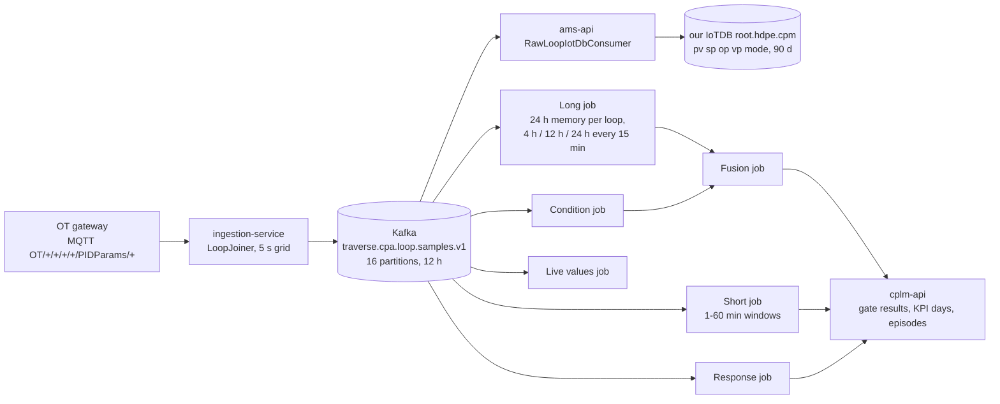
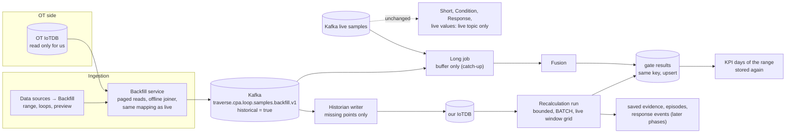
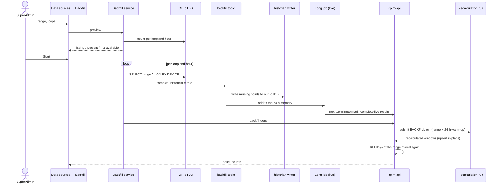
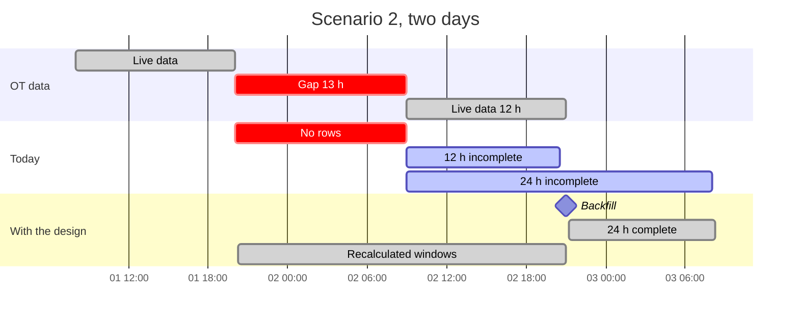

# Data gaps from the OT side: backfill from the OT IoTDB and recalculate the analysis

| | |
|---|---|
| Status | Research only, 27 Nov 2026. No code, container, job or data was changed. |
| Code read | Release v2.10.0 (`76bfe55a`, branch `feat/sr-mine` at `94386d1e`): Flink jobs, cplm-api, ingestion-service, ams-api historian writer, IoTDB layout scripts, deploy docs. File references are relative to the repository root. |
| Research | Apache Flink 1.18 documentation, Flink mailing list and JIRA, Flink Forward / Uber / Netflix / Lyft engineering material, time-series database and industrial historian documentation (section 3, with links). |
| Given by the owner | The plant fills the missing hours into a separate IoTDB on the OT side. We only read from it. A backfill service at the ingestion level pulls a chosen time range, the data flows into our application like normal data (but old), and it is stored in our historian. |
| Decisions needed | Section 11 |

## In short

- **Today a gap stays a gap.** When the OT data stops, the 12 h and 24 h results go to "Not enough data" (or stop
  altogether) and stay that way until the gap has left the window: up to 11.4 h (12 h) and 22.8 h (24 h) after the
  data returns. Nothing ever recalculates them, even when the missing data turns up later. CHG-226's "last stored
  result" only covers Flink restarts, not a real data gap, on purpose: a real gap must not be hidden.
- **Old data cannot simply be pushed into the live pipeline.** Every live Flink job judges time by the data
  ("event time"). Once newer data has passed, old samples are late: the Short job drops them silently, the Response
  job drops them, the Condition job and the live values job mix them up with current values, and the Long job keeps
  them but never recalculates windows it has already written. The Flink documentation, Uber and our own July
  incident say the same: do not replay old data into a running live stream (section 2.4).
- **The standard practice** (Kappa reprocessing, AVEVA PI backfill and recalculation, TimescaleDB refresh of
  invalidated ranges): keep the live pipeline untouched, load the late data into the store of record, then run the
  **same calculations as a separate, bounded job over exactly the affected time range**, write the results
  idempotently over the incomplete ones, and refresh what depends on them (daily figures).
- **Recommended design: one door in, three ways out.**
  1. **Backfill service (ingestion):** reads the chosen range from the OT IoTDB, builds samples with the same rules as
     live ingestion, and publishes them to a **separate backfill topic**, never to the live one.
  2. **Historian:** our IoTDB writer also reads the backfill topic, so trends, "Redraw from historian" and every
     historian-based analysis see the hours at once. It writes only the points that are missing.
  3. **Live catch-up:** the Long job also reads the backfill topic, only into its 24 h memory. From the next
     15-minute mark the current 12 h / 24 h results are complete again. No other live job reads it.
  4. **Recalculation:** a bounded job recalculates every 4 h / 12 h / 24 h window whose result was "Not enough data"
     or missing because of the gap, on the same window grid as the live job, and stores the results in their place.
  5. **Refresh:** the daily KPI days of the range are stored again; saved evidence and episodes follow (section 5.5).
- **Scenario 1** (gap 07:00-12:00, data back at 12:00, backfill at 16:00): the current results are complete from
  16:15 instead of 23:30 (12 h) and 11:00 the next day (24 h); the windows 07:15-16:00 are recalculated; the day's
  KPI comes out right without any repair (section 6).
- **Scenario 2** (13 h down, 12 h live, then backfill): the 24 h results are complete from the next 15-minute mark
  instead of the next morning; every 4 h / 12 h / 24 h window of the 25 hours touched by the gap is recalculated,
  using the day before the gap as warm-up; the KPI day before is stored again (section 7).
- **Limits:** raw data up to 90 days old (historian retention); recalculation up to about 13 days back (verdict
  history 14 days and the daily KPI re-store window). Older backfills fill the historian only.

---

## 1. Words used here

| Word | Meaning |
|---|---|
| Gap | A period with no samples from the OT side for one loop or the whole plant |
| Backfill | Loading the samples of a past period into our application after they became available |
| Recalculation | Running the analysis again for windows whose result was incomplete or missing |
| Window | The period a result describes: 4 h, 12 h or 24 h, ending on a 15-minute mark (live) |
| Watermark | Flink's "time has now passed this point" signal, taken from the samples' own timestamps |
| Live pipeline | MQTT → ingestion → `traverse.cpa.loop.samples.v1` → Flink jobs → cplm-api → screens |
| Store of record | Where the raw samples are kept for the long term: our IoTDB (90 days) |

---

## 2. What happens today

### 2.1 The data path

- The sample time is the source time from the payload (`LoopJoiner.cs:345-348`), so every result is cut on plant
  time, not on arrival time.
- Each partition has its own watermark: newest sample time minus 2 minutes; a partition with no data for 30 minutes
  counts as idle (`CplmIngestPipeline.java:68-73`, `CplmJobConfig.java:76`).
- The Long job keeps the last 24 h 10 min of each loop's samples and, every 15 minutes of sample time, calculates
  the 4 h, 12 h and 24 h windows from that memory (`CplmLongDiagnosticsStreamJob.java:212, 222-247, 272-323`).
- A window is "Not enough data" when it holds less than 95 % of its expected samples (G0 FAIL, INCOMPLETE;
  `ShortFeatureCalculator.java:121-150`, `CplmGateFusionEngine.java:126-128`).

### 2.2 When the data stops

| Case | What the engine does | Result rows |
|---|---|---|
| **Whole plant stops** | After 30 minutes every partition is idle and the watermark stops. No 15-minute mark is passed, so nothing is calculated. When data returns, the watermark jumps; the Long job fires its one pending mark, then skips straight to the current time (`:325-339`, added after the July incident) | **No rows at all** for the window ends inside the outage. Then "Not enough data" until the gap leaves the window |
| **One loop stops** (others keep the clock moving) | The loop's 15-minute marks keep firing; its windows shrink as its samples age out | "Not enough data" every 15 minutes while 32 or more samples remain, then nothing (`:62`) |

How long "Not enough data" lasts after the data returns at time E (95 % rule):

| Window | Gap length that makes it incomplete | Complete again from |
|---|---|---|
| 4 h | more than 12 min | E + 3.8 h |
| 12 h | more than 36 min | E + 11.4 h |
| 24 h | more than 72 min | E + 22.8 h |

The screens show this as "Not assessable · incomplete data" and the loops go Stale while no rows arrive. CHG-226 does
not change it: its "Last stored result" applies only to windows the Long job marks as refilling after a restart; a
real gap is not marked (`RefillSql.cs:43-58`, `LongBufferCoverage.java`). This is deliberate: a real data problem must
stay visible.

### 2.3 What each part does with old samples arriving late

| Part | What happens to a sample of 08:00 arriving at 16:00 | Where |
|---|---|---|
| ingestion `LoopJoiner` | No age check; an older value overwrites the newer one held for the loop; a burst collapses into a few tuples | `LoopJoiner.cs:278-318, 320-333` |
| Short job | Dropped silently once all its windows are past clean-up (1-3 min) | `ShortFeatureBufferFn.java:151-157` |
| Long job | Kept: appended to the 24 h memory, sorted and de-duplicated at the next mark. **Only windows calculated from then on benefit**; windows already written stay as they were | `CplmLongDiagnosticsStreamJob.java:212, 236-247` |
| Fusion job | Reads results in arrival order; persistence history, open conditions and health are "current" | `CplmGateFusionStreamJob.java:262-273` |
| Condition job | No order check: the old sample moves its clock back, the next live sample looks like a gap and closes open conditions as SOURCE_GAP | `ConditionDetector.java:61-79` |
| Response job | Dropped (older than the last sample) and counted | `ResponseCapture.java:150-153` |
| Live values job | Overwrites the live value: the screen shows the 08:00 value as current | `LoopLiveRbeJob.java:339` |
| Historian writer | Written; same timestamp = overwrite (last write wins) | `RawLoopIotDbConsumer.cs:21-22, 231` |

### 2.4 Why old data must not go into the live topic

- **Flink documentation:** "By default, when using event time windows, late events are dropped." A watermark never
  moves back, so after the gap everything older is late
  ([learn-flink](https://nightlies.apache.org/flink/flink-docs-release-1.18/docs/learn-flink/streaming_analytics/),
  [generating watermarks](https://nightlies.apache.org/flink/flink-docs-release-1.18/docs/dev/datastream/event-time/generating_watermarks/)).
- **Uber** rejected replaying history into Kafka: an order unlike the original "can cause inaccuracies with
  event-time windowing logic and watermarking"
  ([Uber, Kappa architecture](https://www.uber.com/en-US/blog/kappa-architecture-data-stream-processing/)).
- **Our July incident** (`issuesinpipeline.md` P0-2): backfilled history mixed into the live Long job's keys forced
  about 1,056 sequential 15-minute steps; the job could never finish a checkpoint and restarted for ever. The
  skip-ahead fixed the loop, but it also means a backfill through the live topic skips windows.
- **Our own design rule** (`docs/ot-data-integration/03-mqtt-ingestion-enrichment-service.md` section 6, "the second
  door"): nothing older than about 2 minutes enters the live topics; history goes to the historian, then to a
  recalculation. It was never built.
- It would only work if every live job were stopped, the data arrived in exact time order across all loops, and slowly
  enough not to skip marks. That is not an operating procedure.

### 2.5 What the existing history tools can and cannot do

| Tool | Can do | Cannot do |
|---|---|---|
| Historical Replay (`CplmHistoricalReplayJob`, `POST analysis-runs` REPLAY) | BATCH mode over IoTDB or Kafka, same calculators (`WindowEvaluation`), configuration in force (`BoundedBundle`) | Only 24 h tumbling windows; rows kept apart (purpose REPLAY); fills internal gaps by **holding the last value** (`:269-301`), which can hide a remaining gap; no persistence history, peers, conditions or health |
| On-Demand Evaluation (always running) | One loop, one 4 h / 12 h / 24 h window from IoTDB, within 90 days | One window per request; purpose EVALUATE (screens and KPIs ignore it); writes a full evidence set each time |
| Shadow run ("Try on past data") | 1-7 days from IoTDB, windows aligned with the live ones (`ShadowWindow.Plan`, CHG-222) | Purpose SHADOW, for comparisons only |
| Historian copy / backup (`iotdb-move-loop-tree.py`, `backup-iotdb.sh`) | Chunked, resumable copies with count checks; TsFile export / load | Same server or our own backups only; nothing reads an OT IoTDB |

So the parts exist (paged IoTDB reading, the calculators, the configuration in force, aligned windows, a run
register, idempotent result keys), but nothing writes an **official** recalculated result today: every bounded path
is kept apart from the live rows by its purpose (`CplmRecomputeService.cs:167`).

### 2.6 Limits that bound any backfill

| Store | Kept | Effect on a backfill |
|---|---|---|
| OT IoTDB | Owner's system | The source; must hold the gap with timestamps, values and mode (quality if possible) |
| Our IoTDB raw tree | 90 days (`iotdb-init-ttl.sh:119-121`) | Oldest raw data we can load |
| Gate results (verdicts) | 14 days at the plant (headroom rule) | Oldest window worth recalculating; older rows are deleted anyway |
| Daily KPI re-store | Days inside the gate-result retention minus one (13 days) | Oldest KPI day that can be stored again |
| Long features | 1 day | The Calculations pages show at most 1 day back |
| Short features | 6 hours | Short-window pages show at most 6 hours back |
| Response events | Accepted 90 days, censored 3 days | System Response events of a gap can be added up to these ages |
| Evidence boundary archive | 30 days | Saved 12 h / 24 h sets of a gap can be replaced up to 30 days back |
| Kafka samples topic | 12 hours | Not a source for gap data (it never arrived); limits nothing here |
| Long job memory | 24 h 10 min before the current mark | Only this part of a backfill can feed the live catch-up |

---

## 3. Standard practice (research)

### 3.1 Apache Flink and stream processing

| Practice | How it works | What it means here | Source |
|---|---|---|---|
| Event time gives repeatable results when historic data is processed again | Results depend on the data's timestamps, not on when it arrives | Our jobs already use event time, so a recalculation over the same samples gives the same windows | [Flink: time](https://nightlies.apache.org/flink/flink-docs-release-1.18/docs/concepts/time/) |
| Late data is dropped, or kept with allowed lateness and side outputs | `allowedLateness` keeps window state until it expires; each late element fires the window again (several results per window to de-duplicate); `sideOutputLateData` collects the rest | Raising lateness to 13 h on live jobs would keep 13 h of window state and fire windows again and again: not recommended. A side output that **counts** late samples is useful as an alarm | [Flink: windows](https://nightlies.apache.org/flink/flink-docs-release-1.18/docs/dev/datastream/operators/windows/) |
| An operator's event time is the minimum of its inputs | A second input that is "behind" holds the operator's clock back; `withIdleness` excludes a quiet input | A backfill input added to a live job must not take part in its watermark (our control streams are already marked idle, `CplmParameterSetBroadcastSupport.java:140-142`) | [Flink: time](https://nightlies.apache.org/flink/flink-docs-release-1.18/docs/concepts/time/), [mailing list](https://www.mail-archive.com/user@flink.apache.org/msg47086.html) |
| Same program, bounded source, BATCH mode | Perfect watermarks, input sorted by key, one key's state at a time; same final results as streaming | The recalculation job should run the same calculation code over a bounded IoTDB range; our replay job already runs in BATCH mode | [Flink: execution mode](https://nightlies.apache.org/flink/flink-docs-release-1.18/docs/dev/datastream/execution_mode/), [Krettek on back-fill jobs](https://go.mail-archive.com/user@flink.apache.org/msg37803.html) |
| Kappa reprocessing | Run a second instance of the same code over the history, write to the same idempotent sink or a new table, switch readers | The recalculation writes over the incomplete rows through the existing upsert key | [Kreps](https://www.oreilly.com/radar/questioning-the-lambda-architecture/), [Uber](https://www.uber.com/en-US/blog/kappa-architecture-data-stream-processing/) |
| Warm-up before the range | A stateful job needs enough earlier data to rebuild its state (Netflix backfills from Iceberg with its own bounded source; secondary summary) | Start the recalculation 24 h before the gap so the 24 h windows and the persistence history are full | [Netflix summary](https://chrisliew.gitbook.io/chrisliew-and-tech/big-data/backfilling-streams-in-kappa-architecture-at-netflix) (unconfirmed detail) |
| HybridSource (history, then live) | Bounded sources read first, then the unbounded one, in one job | Only when a job starts anyway; it cannot patch a running job | [Flink: HybridSource](https://nightlies.apache.org/flink/flink-docs-release-1.18/docs/connectors/datastream/hybridsource/) |
| State Processor API | Reads history in BATCH mode and writes it into a savepoint; the live job restarts from it | Possible way to put a gap into the Long job's memory, but needs a stop and a restart | [Flink: State Processor API](https://nightlies.apache.org/flink/flink-docs-release-1.18/docs/libs/state_processor_api/) |
| Idempotent sink | Upsert statements make re-runs harmless | Our key (loop, kind, window end, source, configuration) with the `sample_count >=` rule is exactly this | [Flink JDBC](https://ci.apache.org/projects/flink/flink-docs-master/docs/connectors/datastream/jdbc/index.html) (search excerpt) |
| Mark results on incomplete data, revise later | Beam panes EARLY / ON_TIME / LATE; OPC UA aggregate "Partial" and PercentDataGood; append-only history with record time (bitemporal) | Our G0 already marks incomplete windows; a recalculated window should say so and the replaced result should be kept on record | [Beam](https://www.oreilly.com/radar/the-world-beyond-batch-streaming-102/), [OPC UA Part 13](https://reference.opcfoundation.org/specs/OPC-10000-13/5.3.3.2) (search excerpt), [Fowler](https://martinfowler.com/articles/bitemporal-history.html) |
| Recalculate dependants in order | Prometheus rule backfill: backfill the inputs first, then what depends on them; AWS IoT SiteWise recalculates metrics on late data up to 7 days | Windows first, then the daily KPI days of the range | [Prometheus](https://prometheus.io/docs/prometheus/latest/storage/), [SiteWise](https://aws.amazon.com/about-aws/whats-new/2020/11/aws-iot-sitewise-now-allows-ingestion-of-data-up-to-7-days-in-past) |
| Not recommended | Pushing old data into the live source of a running event-time job; very long allowed lateness; processing-time logic in anything that must replay; a second job sharing the live consumer group | Section 4 rejects options A and B for these reasons | the sources above |

### 3.2 Industrial historians and time-series databases

Pages marked "snippet" could only be read through search-engine text (the AVEVA, AWS and InfluxData documentation
sites need a browser); the rest were read directly.

| Practice | How it works | What it means here | Source |
|---|---|---|---|
| **AVEVA PI Analysis: backfill and recalculation of a time range** (the closest industrial analogue) | Two modes: "leave existing data and fill in gaps" or "permanently delete existing data and recalculate". Event-frame analyses: recalculation deletes and regenerates every event frame in the range, annotations included. "Recalculate dependent analyses" can recalculate dependants several times | Our recalculation offers the same two modes (fill gaps by default). Episodes are our event frames: in "recalculate" mode they must be rebuilt over the whole range, and the user must be warned about notes and shelving on them. Daily figures are updated once, after all windows | [AF Analytics backfill](https://docs.aveva.com/bundle/pi-server-l-af-analytics/page/1022569.html) (snippet) |
| PI automatic backfill and automatic recalculation | After the analysis service was down, gaps up to 72 h (default) are backfilled automatically; longer ones only warn. Late input before the last evaluated trigger queues an automatic recalculation (60-900 s wait, up to 180 days); event-frame generation is excluded | Set a maximum span for automatic work and keep the raw data longer than it. Recalculate once per backfill run, not per late sample | [auto backfill](https://docs.aveva.com/bundle/pi-server-l-af-analytics/page/1021632.html), [auto recalculation](https://docs.aveva.com/bundle/pi-server-l-af-analytics/page/1018630.html) (snippet) |
| PI Data Archive late writes | Out-of-order values skip compression and cost the archive extra work | Expect a write cost for backfilled hours; throttle large runs | [AVEVA feedback](https://pisystem.feedback.aveva.com/ideas/PIINTF-I-156) (comment, not official docs) |
| **Sparkplug B 3.0 `is_historical`** | Store-and-forward or backup data "should not be considered a real time/current value"; chronological order is required only for non-historical data | Backfilled samples carry `historical: true` and never update live values, alarms or the live jobs; they may arrive out of order | [Sparkplug 3.0](https://sparkplug.eclipse.org/specification/version/3.0/documents/sparkplug-specification-3.0.0.pdf) §6.4.6, §5.16 |
| Ignition / Cirrus Link store-and-forward | Historical events go straight to the historian, bypassing tags, so no scripts or alarms fire; a tag write older than the current value is ignored; "store and forward does not guarantee all data" | Same split as our design: historian and recalculation, not the live path. The live door should ignore older-than-current samples (5.1). A preview must show what is still missing | [Cirrus Link History Store](https://docs.chariot.io/x/BYD5Ag), [Ignition store and forward](https://docs.inductiveautomation.com/docs/8.1/platform/database-connections/store-and-forward) |
| OPC UA Part 11 HistoryRead | Explicit start / end time, server-side paging with continuation points; `isReadModified` returns replaced values with who and when | A backfill is always an explicit range read in pages; replaced results keep an audit of the old value | [Part 11 6.5.3](https://reference.opcfoundation.org/Core/Part11/v105/docs/6.5.3), [continuation points](https://reference.opcfoundation.org/specs/OPC-10000-11/6.3) |
| **Apache IoTDB 1.3 late writes** | A point older than data already on disk goes to unsequence files, merged later by compaction (write amplification under heavy late data). Writing a timestamp again overwrites it; a NULL in the new write leaves the old value | Re-running a backfill is safe; a real "replace" needs a delete first (we do not replace: fill gaps only). Throttle and measure compaction | [IoTDB ICDE 2022](https://sxsong.github.io/doc/22icde-separation.pdf), [write data](https://iotdb.apache.org/UserGuide/V1.3.x/Basic-Concept/Write-Data) (snippet) |
| IoTDB time-range queries and copy tools | `time >= .. and time < ..`, `ALIGN BY DEVICE`, `LIMIT`; `export-data.sh` (1.3.2+); **Pipe** (1.2+, `start-time` / `end-time` from 1.3.1) copies a range from one IoTDB to another, run by the sending side | Page by time (`time > last_ts LIMIT n`), not deep OFFSET. A Pipe would copy raw data but bypass our mapping, the backfill topic and the engine; it also needs the OT side to connect out to us. Not chosen, kept as a fallback for raw-only loads | [query](https://iotdb.apache.org/UserGuide/V1.3.x/Basic-Concept/Query-Data.html), [Pipe](https://iotdb.apache.org/UserGuide/V1.3.x/User-Manual/Data-Sync_apache.html), [export](https://iotdb.apache.org/UserGuide/V1.3.x/Tools-System/Data-Export-Tool.html) |
| **TimescaleDB continuous aggregates** | Late inserts are logged as invalidated ranges; a refresh recomputes only the affected buckets; data outside the policy's look-back is never revisited and the old value is served "indefinitely" | Exactly our daily KPI today (it never revisits a corrected day). Hence the invalidation list in 5.5 | [refresh](https://www.tigerdata.com/docs/api/latest/continuous-aggregates/refresh_continuous_aggregate), [refresh explained](https://www.tigerdata.com/blog/continuous-aggregate-refresh-demystified) |
| InfluxDB 2 late data | A count "checksum" task recomputes only windows whose counts changed | The preview's per-hour counts double as the list of windows to recalculate | [InfluxData guide](https://docs.influxdata.com/resources/how-to-guides/late-arriving-data/) (snippet) |
| AWS IoT SiteWise | Accepts data up to 7 days old and recalculates affected metric windows, replacing earlier values, GOOD quality only | A fixed age limit, automatic recalculation, quality-aware. We use the configuration in force at the window's time, not today's | [SiteWise](https://aws.amazon.com/about-aws/whats-new/2020/11/aws-iot-sitewise-now-allows-ingestion-of-data-up-to-7-days-in-past), [expressions](https://docs.aws.amazon.com/iot-sitewise/latest/userguide/expression-tutorials.html) (snippet) |
| Settled and unsettled results | Seeq splits results into settled and still-changing; OPC UA Part 13 "Partial" marks an incomplete interval that may change on re-fetch | Our "Not enough data" is the provisional state; "Recalculated after data backfill" is the revised one, with the original kept on record | [Seeq patent](https://patents.google.com/patent/US11074272), [OPC UA Part 13](https://reference.opcfoundation.org/specs/OPC-10000-13/5.3.3.2) (snippet) |

**What the two research tracks agree on:** keep the live path clean; load late data into the store of record as
historical; recalculate only the affected windows with the same logic, by explicit range; write idempotently; update
dependants once, in order; offer "fill gaps" and "recalculate" explicitly; rebuild event-like outputs over the whole
range; mark provisional and revised results and keep the original; set an age limit inside the raw retention.

---

## 4. The options

Effort: S = up to a day, M = 2-4 days, L = one to two weeks, each with tests and a lab check.

| | Option | How | For | Verdict |
|---|---|---|---|---|
| A | Push the backfill into the live samples topic | The backfill service publishes old samples like live ones | everything | **No.** Short and Response drop them, Condition and live values are corrupted, the Long job skips marks; our July incident (2.3, 2.4) |
| B | Raise the live jobs' allowed lateness to the gap length | Keep window state for 13 h+ and fire windows again | current and past windows | **No.** State grows by the lateness, every late sample re-fires windows; our jobs are hand-written buffers, not Flink windows, so it would not cover them anyway |
| C | Restart Long and Fusion after the backfill with a history preload | HybridSource (IoTDB range, then Kafka) or the "B2" IoTDB refill of `flink-restart-data-gap.md` | current windows | Possible, not recommended: a planned restart per backfill, the IoTDB refill assumes quality, past windows are still not recalculated |
| D | **Live catch-up: the Long job reads a separate backfill topic into its 24 h memory** | Second input, buffer only, no timer and no watermark from it; the next 15-minute mark sees the full window | current windows (scenario 1, the 24 h part of scenario 2) | **Yes.** Small change in one job; uses behaviour the job already has (late samples are kept and sorted) |
| E | Patch the Long job's memory offline (State Processor API) | Stop with a savepoint, write the gap samples into it, resume | current windows | No: two restarts per backfill, a tool only engineers can run |
| F | **Bounded recalculation job writing official results** | Same calculators over the affected range from the historian, live window grid, stored over the incomplete rows | past windows (both scenarios) | **Yes.** The standard Kappa practice; builds on the replay job, the run register and the upsert key |
| G | One On-Demand Evaluation per affected window | Existing requests, one loop and window each | past windows | No: a 13 h plant-wide gap is about 30,000 requests, each with a full evidence set; results stay EVALUATE and do not reach screens or KPIs |
| H | Nothing beyond CHG-226 | Wait for the gap to leave the windows | none | Not acceptable (owner) |

Recommended: **D + F**, fed by one backfill service, with the historian load and the downstream refresh (section 5).

---

## 5. Recommended design

### 5.1 Part 1: Backfill service (ingestion)

- **Where:** a "Backfill" action on Administration → Data sources (SuperAdmin, `ingestion.manage`), with an API on
  ingestion-service (`POST /backfills`, `GET /backfills/{id}`, cancel). A new data-source type for the OT IoTDB
  (host, port, user, password kept like the MQTT credentials, path pattern per loop).
- **Preview first:** for the chosen loops and range, per loop and hour, the samples in the OT IoTDB against the samples
  already in our historian and the expected count (5 s grid). It shows what is missing, what overlaps and what the OT
  side does not have either. The person confirms.
- **Read:** time-range queries per loop and chunk (for example one hour per device, `ALIGN BY DEVICE`, ascending,
  paged by time with `time > last_ts LIMIT n` rather than deep OFFSET), the same pattern as the CHG-101 copy tool
  (resume state, count check, retries, disk check).
- **Limits:** one run at a time; a maximum span per run (for example 7 days); nothing older than our historian's
  90 days.
- **Build samples like live ingestion:** the same `LoopParameterMapper`, `param_roles`, mode vocabulary and quality
  decoding, and an **offline `LoopJoiner`** driven by the data's clock (the joiner takes its clock from the caller,
  `LoopJoiner.cs:70-80`), with the live joiner's grid and hold rules, so a backfilled sample is the sample live
  ingestion would have produced. It must not hold a value across a hole the OT data also has.
- **Publish** to a new topic `traverse.cpa.loop.samples.backfill.v1` (same schema, keyed by loop, in time order per
  loop, rate-limited), each sample marked `historical: true` and `backfill_id`. Never to the live topic. This is the
  Sparkplug "historical" idea: old data is labelled so nothing treats it as live (section 3.2).
- **Fill gaps only (default):** skip timestamps our historian already holds. Overwriting raw points would change data
  that saved evidence was built on (`EvidenceTraceForm.cs:52`, `TRACE_HISTORIAN_DIFFERS`).
- **Run register:** `backfill_run` (range, loops, state, counts read / published / skipped, who, when), audited,
  resumable and idempotent (a second run over the same range publishes nothing new).
- **Guard the live door too:** today ingestion only refuses samples from the future. Samples more than a few minutes
  older than the loop's newest one (gateway store-and-forward flushing into MQTT) should go to the backfill path or
  the dead-letter topic, not into `LoopJoiner`, where they overwrite newer values (`LoopJoiner.cs:278-318`).

### 5.2 Part 2: Historian

- The existing writer (`RawLoopIotDbConsumer`) subscribes to the backfill topic with its own consumer group, same
  write path and stall logic. IoTDB accepts out-of-order points (unsequence data) and compacts them later.
- **Missing points only** (part 1 already skips existing timestamps; the writer can check once more per batch).
- **1-minute rollup:** the continuous query `cq_cpm_raw_1m` looks back only 5 minutes (`iotdb-layout-v2.sh:116-122`), so
  the backfilled hours never reach the 1-minute tree used by long trends. The backfill run must re-aggregate its range
  (`SELECT ... INTO` for the range, as the copy tool does).
- **Quality:** our historian stores pv, sp, op, vp and mode but not quality (`RawLoopIotDbConsumer.cs:26-30`); every
  historian-based calculation assumes GOOD (`IotDbLoopReader.java:105-123`). Recommended: add a quality measurement to
  the `cpm_raw` template for live and backfilled samples alike. Otherwise a recalculated window treats bad-quality
  periods as good, where the live job would not.

### 5.3 Part 3: Live catch-up in the Long job

- A second Kafka source on the backfill topic, joined into the Long job **only**, handled like the peer samples
  already are: added to the loop's memory, never a timer trigger (`CplmLongDiagnosticsStreamJob.java:205-210`).
- It must **not take part in the watermark** (marked idle, or a watermark that never holds the live one back), or the
  Long job's clock would wait for the backfill (Flink: an operator's time is the minimum of its inputs).
- Samples older than the memory's horizon (current mark minus 24 h 10 min) are dropped at the next mark by the
  existing eviction; repeated timestamps are dropped by CHG-062a; the coverage start moves back by itself
  (`LongBufferCoverage.java:25-29`).
- **Effect:** at the next 15-minute mark the 4 h, 12 h and 24 h windows contain the backfilled hours, and the live
  results are complete again. The first verdicts may be capped by Fusion's persistence rule (its history holds
  "NONE" entries for the gap), which is correct: a finding must persist to be confirmed.
- Short, Condition, Response and the live values job do **not** read the backfill topic.

### 5.4 Part 4: Recalculation run (past windows)

- **Trigger:** automatically when a backfill run finishes (or by hand on the same page), one run per backfill,
  registered in `analytics.analysis_run` with a new purpose `BACKFILL` and submitted like the replays
  (`CplmRecomputeService.cs:184-238`).
- **Range:** window ends from gap start + 15 min to the earlier of gap end + 24 h and the current mark; data read from
  gap start − 24 h (warm-up), limited to the gate-result retention (13 days).
- **Which windows:** default "fill gaps only": every 4 h / 12 h / 24 h window end of the range whose stored row is
  missing or "Not enough data" (G0 FAIL). Optional "recalculate everything in the range" for SuperAdmin. This is AVEVA
  PI's backfill versus recalculation choice (section 3.2).
- **Same grid and code as live:** windows ending on the live 15-minute marks (not 24 h tumbling), calculated by the
  live classes (Long diagnostics and Fusion functions, with the Condition detector replayed over the range for G10 /
  G11), the persistence history carried window by window in time order, peers' samples read for G13, and the
  configuration in force at each window end (`BoundedBundle`). Today's replay differs in four ways that must be
  closed: 24 h tumbling only, value held across holes (inflates completeness), no persistence history, no
  conditions or peers (2.5).
- **Stored as official results:** the run writes through the gate-results topic with source `flink`, purpose `LIVE`
  and the window's original configuration hash, so cplm-api's upsert (`CplmResultConsumerService.cs:213-254`, only when
  the new sample count is at least the stored one) **replaces the incomplete row in place** and inserts the missing
  ones. The rows carry `analysis_run_id` and a payload note "recalculated after backfill, at …", so screens can say so.
- **Keep the old result on record:** before a row is replaced, its previous version goes to a small revision table
  (window, old diagnosis, old sample count, run id, time). This is the append-only practice in section 3.1; the
  owner decides (section 11).
- **Do not feed episodes from it directly:** the episode service handles results in arrival order
  (`CplmEventFrameService.cs:131-136`); recalculated rows arriving later would close or open episodes wrongly. They
  carry the "recalculated" mark and the episode service skips them (part 5).
- Short features: optional, only for the part of the gap still inside their 6-hour retention.

### 5.5 Part 5: Refresh what depends on the windows

| Item | Today | Change |
|---|---|---|
| Daily KPI days | Re-stored only when missing, a rule version changes or the day end moves (`FleetKpiDaily.cs:179`) | When a recalculation finishes (once, after all its windows), mark the plant days it touched (06:00-06:00) as out of date (an invalidation list, like TimescaleDB's); the hourly pass stores them again within its 13 days |
| Saved 12 h / 24 h evidence sets | The archive keeps the first set of a boundary (`ON CONFLICT DO NOTHING`) | A complete set replaces an archived "Not enough data" set of the same boundary; the recalculation emits sets only for boundaries in its range |
| Episodes | Lifecycle from live rows in arrival order | Phase 4: rebuild the episodes of the range in order from the recalculated rows, as PI regenerates event frames. Episodes carry user actions (shelving, notes, `analytics.cplm_event_actions`): the run lists them and asks before replacing; in "fill gaps" mode episodes are only extended or split, never deleted. Until phase 4 they stay as they were (they already mark unobservable windows) |
| Condition events (limit, freeze) | Lost for the gap | Written by the recalculation's condition replay (deterministic ids) |
| System Response events | Dropped; the gap censors the open event (SOURCE_GAP) | Phase 3: a bounded response capture over the gap, events with deterministic ids, models reviewed as usual |
| IoTDB 1-minute rollup and KPI history | Fed only live | Re-aggregated for the range (5.2); KPI history from the recalculated rows |
| Live values | Current values only | Never touched by a backfill |

### 5.6 What the user sees

- Administration → Data sources → **Backfill**: range, loops, preview (missing / present / not on the OT side), Start,
  progress, result ("12,840 samples loaded · 228 windows recalculated · 2 KPI days updated").
- Results recalculated after a backfill carry one short note where their time is shown: "Recalculated after data
  backfill · 27 Nov 16:20". No other layout change.
- Pipeline Health lists open gaps per loop (from the historian) and their state: Missing → Loaded → Recalculated.

### 5.7 One backfill end to end

---

## 6. Scenario 1: a 5-hour gap inside the day

Data stops at 07:00, returns at 12:00; the OT side has the missing hours by 16:00 and the backfill runs then.
Whole plant (one loop alone behaves the same, except that it writes "Not enough data" rows during the gap instead of
none).

```mermaid
gantt
  title Scenario 1, one day (plant time)
  dateFormat HH:mm
  axisFormat %H:%M
  section OT data
  Live data                 :done, 00:00, 7h
  Gap                       :crit, 07:00, 5h
  Live data again           :done, 12:00, 12h
  section Today
  No rows                   :crit, 07:00, 5h
  12 h "Not enough data"    :active, 12:00, 690m
  section With the design
  Backfill at 16:00         :milestone, 16:00, 0m
  Live 12 h / 24 h complete :done, 16:15, 465m
  Recalculated 07:15-16:00  :done, 07:15, 525m
```

| Time | Today | With the design |
|---|---|---|
| 06:45 | Last results before the gap | same |
| 07:00-12:00 | No rows (the watermark stops after 30 min); loops go Stale | same (the data is not there yet) |
| 12:00 | Data returns; the pending 07:00 window (complete) is written, then 12:00 onward | same |
| 12:00-16:00 | 4 h, 12 h, 24 h all "Not enough data" | same |
| 16:00 | Missing hours available on the OT side | Backfill: about 5 h × ~150 loops ≈ 540,000 samples read, published and written to the historian |
| 16:15 | still "Not enough data" (12 h until 23:30, 24 h until 11:00 tomorrow; 4 h until 16:00) | **Live 4 h / 12 h / 24 h complete again** (catch-up) |
| ~16:30 | windows 07:15-11:45 do not exist; 12:00-16:00 say "Not enough data" | **Recalculated:** 07:15-16:00, 4 h / 12 h / 24 h, missing rows added, incomplete rows replaced |
| next 06:00 | the KPI day 06:00-06:00 is stored with the 24 h window still "Not enough data" | stored complete; no repair needed, because the live results were already complete |
| Trends | hole 07:00-12:00 for good | filled from the historian |

---

## 7. Scenario 2: 13 hours down, 12 hours live, then backfill

Data stops at 20:00 on day 1, returns at 09:00 on day 2. At 21:00 on day 2 the missing 13 hours are on the OT side.

| Item | Today | With the design |
|---|---|---|
| Rows during the gap | none (day 1 20:15 to day 2 08:45) | added by the recalculation |
| 4 h windows | complete from 13:00 day 2 | gap windows recalculated |
| 12 h windows | complete again from 20:30 day 2; 09:00-20:15 "Not enough data" | 09:00-20:15 recalculated; later ones unchanged |
| 24 h windows | "Not enough data" until 08:00 day 3 | **complete from 21:15 day 2** (catch-up: the Long memory keeps day 1 21:05 onward, which is all the next 24 h windows need); day 1 20:15 to day 2 21:00 recalculated |
| Warm-up | — | the recalculation reads from day 0 20:00 (our historian holds it), so its first 24 h window is full |
| Windows recalculated | — | 25 hours of window ends × 3 kinds ≈ 300 per loop, only those missing or incomplete |
| KPI day 1 (06:00 day 1 - 06:00 day 2) | stored with the night missing | marked out of date and stored again |
| KPI day 2 | stored at 06:00 day 3 with the 24 h window incomplete | complete (catch-up), no repair |
| Saved evidence, 18:00 / 06:00 boundaries | 06:00 day 2 set missing (no row) | written by the recalculation |
| System Response events in the gap | none | phase 3: captured from the historian |

---

## 8. Other cases

| Case | What happens with the design |
|---|---|
| One loop's gap while the others run | Same steps for that loop; its live windows wrote "Not enough data" rows, which are replaced |
| Gap older than 24 h but inside 13 days | No live catch-up (outside the Long memory); recalculation and KPI re-store only |
| Gap older than 13 days (up to 90) | Historian only: trends and on-demand evaluations work; verdicts and KPI days are not recalculated (their history is already deleted) |
| The OT side has holes too | The preview shows them; windows that are still below 95 % stay "Not enough data" after the recalculation (correct) |
| Backfill overlaps data we already have | Existing timestamps are skipped (fill gaps only); our value is kept |
| Backfill while the OT link is still down | Allowed; when live data returns, the Long job's normal path continues; the recalculation covers what was written incomplete |
| Flink restart during a backfill | The backfill topic keeps the samples (retention to set, e.g. 3 days); the Long job re-reads from its committed position; the recalculation is a separate run and can be repeated (idempotent) |
| Configuration changed during the gap | Each window uses the configuration in force at its end (`BoundedBundle`); a replaced row keeps its original configuration hash |
| A window both before and after a day-start boundary | KPI days are found by the 06:00 plant day (CHG-106); every touched day is re-stored |
| Two backfills over the same range | The second publishes nothing new (timestamps present) and recalculates nothing (rows complete) |
| Gateway clock offset (measured +132 s, `v2.5-ot-instrumental-requests.md` O4) | Backfilled timestamps come from the OT IoTDB; if they differ from the gateway's live clock, windows shift. Agree one time source with the plant (NTP) before the first backfill |
| Gateway store-and-forward replays old MQTT messages | Refused by the new live-door age check (5.1) and sent to the backfill path instead of corrupting `LoopJoiner` |

---

## 9. Risks and guards

| Risk | Guard |
|---|---|
| Old samples reaching the live topic by mistake | Separate topic; the live-door age check; a side output that counts late samples in the Short job (today silent) |
| Backfill load slowing the plant cluster | Rate limit in the backfill service; the recalculation is one bounded job (one Flink slot, 5 free at the plant), run outside peak hours if needed |
| IoTDB out-of-order compaction cost | Moderate volumes (a 13 h plant gap ≈ 1.4 million rows of 5 values); measure on the lab first |
| Recalculated result differs from what live would have produced | Same classes, same grid, persistence and conditions carried in order, configuration in force; a lab test compares a recalculated day with an untouched live day |
| Quality treated as GOOD | Store quality in the historian (5.2) |
| Episodes or evidence disturbed | Recalculated rows marked; episodes and evidence follow their own rules (5.5) |
| A recalculation hiding a real gap | No value held across holes; G0 decides as live does; the preview shows what the OT side lacks |
| Deployed gate configuration lost after a Flink restart (finding F2, 24 Nov) | The recalculation takes the configuration hash of the row it replaces; fix F2 first anyway |

---

## 10. Phases

| Phase | Content | Effort | Gives |
|---|---|---|---|
| 1 | Backfill service (OT IoTDB data source, preview, paged reads, offline joiner, backfill topic, run register, UI) + historian writer subscription + 1-minute re-aggregation + live-door age check | L | Trends, Redraw, evaluations and shadow runs see the gap hours |
| 2 | Live catch-up in the Long job (backfill input, idle watermark) | M | Current 12 h / 24 h results complete at the next mark (scenario 1, scenario 2's 24 h) |
| 3 | Recalculation run on the live grid (purpose BACKFILL, same classes, persistence and conditions in order, configuration in force, upsert in place, revision record) + KPI day invalidation + evidence replace rule | L | Past windows and KPI days corrected |
| 4 | Episodes of the range in order; System Response capture over the gap; quality measurement in the historian | M-L | Full history for investigations |

Phase 1 needs ingestion-service, ams-api and the frontend; phase 2 the Flink jar (Long job, a full Flink swap);
phase 3 the Flink jar and cplm-api; phase 4 both. Each phase is useful on its own and each needs a lab rehearsal
with a simulated gap: stop the simulator for 5 hours, load the hours through a test OT IoTDB, compare with an
untouched run.

---

## 11. Owner decisions

1. **Default mode:** fill gaps only (recommended), or recalculate everything in the range.
2. **Replaced results:** keep a revision record of the old "Not enough data" rows (recommended), or overwrite.
3. **Age limits:** raw up to 90 days; recalculation up to 13 days (recommended, set by retention).
4. **Who runs a backfill:** SuperAdmin only (recommended), or Admin too.
5. **Quality:** add a quality measurement to the historian (recommended), or treat backfilled samples as GOOD.
6. **Same timestamp in both places:** keep ours (recommended), or the OT IoTDB wins.
7. **Time source:** confirm with the plant that the OT IoTDB and the gateway use the same synchronised clock.
8. **Episodes and System Response events of a gap:** recalculate (phase 4), or leave them and mark the gap.
9. **Automatic recalculation** right after each backfill (recommended), or by hand.
10. **Order of phases** (1 → 2 → 3 → 4 recommended; 1 + 3 without 2 also works, but current windows then wait for
    the gap to leave them).

---

## 12. Checked and not checked

- Checked in code (v2.10.0): every behaviour in section 2 with its file and line; the existing bounded paths; the
  result keys and upsert rule; the KPI re-store rule; retention values.
- Checked in documentation: the July incident, the "second door" rule, the evidence trace check, the gateway clock.
- Not checked: the OT IoTDB itself (version, path layout, whether it stores quality and mode, its timestamps); the
  plant's IoTDB layout setting on the VM; volumes and timings (no lab run); the behaviour of an event-time timer
  registered behind the watermark (not documented by Flink).
- Research links marked "search excerpt" or "summary" could only be read indirectly.
