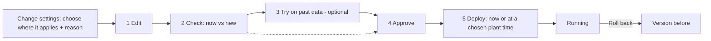
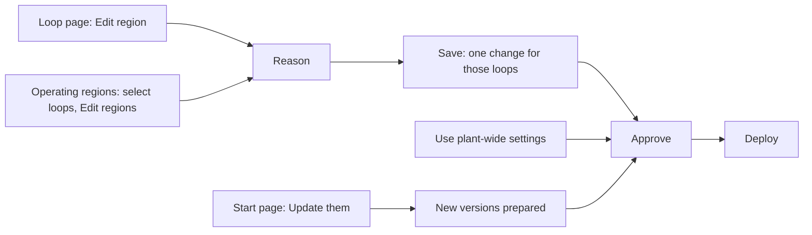

# System Response and Gate Configuration: items for SME review

23 Nov 2026. The owner asked us to build everything with sensible defaults now and have the SME confirm or change them
later. This page lists every value and question that needs your review. Nothing here needs a code change: each answer is a
setting, a loop declaration or a value entered in the application.

Please fill in the **Your answer** column ("OK", or the value you want instead). The engineering background is in
`docs/system-response-fixes-for-sme.md` (items 1-7) and the plant figures in `docs/next-release/system-response-plant-queries.md`.

## 1. Already decided by the owner (for your information)

| Topic | Decision |
|---|---|
| Which events are captured | **Auto (AUT) only.** No Manual bump tests for now; Cascade (and master / slave loops) is a later phase |
| Output moves made by the controller in Auto | Kept as events; they are the plant's main source of models today |
| Controller tuning | Read from the DCS: P, I and D are published on change with PV / SP / OP; nobody enters tuning by hand |
| Operating regions | The recommended values in section 3 are loaded with the release; you confirm or change them |
| Plant day | Stays 00:00 to 00:00 until you confirm the shift pattern (section 6) |
| Gate Configuration: what is listed | Only settings that can really be changed. Retention, Loop Registry values, fixed rules and automatically worked-out values are not listed |
| Gate Configuration: each setting | Shows the value in use and where it comes from |
| Two settings still open | At-limit dwell warning and tuning target λ show "Not decided: <value> used" (section 9) |
| Who may change what | Objective type and evidence types no longer need a SuperAdmin. A whole-plant change still does |
| Approval | Someone other than the author approves. An Admin or SuperAdmin may approve their own change (recorded). Region changes follow the same rule |
| Restarts | A settings change never restarts the analysis |

## 2. Defaults built into the engine

| Setting | Default now | Your answer |
|---|---|---|
| Setpoint step | At least 1 % of the PV range and 4 × the noise of the 2 minutes before | |
| Ramp | At least 0.02 % of the PV range per second for 2 minutes | |
| Settled | PV within 0.5 % of its range for 2 minutes, or within its normal noise band if wider. (Textbook settling uses 2-5 % of the step change: say if you prefer that) | |
| Smallest PV move for rise time and settling | 0.5 % of the PV range | |
| Loops without a recorded PV range | Today's fixed values (please give PV ranges instead, see section 7) | |
| Valve at its limit | Output within 1 % of either end for 10 s or more during an event: the event is set aside (censored) | |
| PV left its operating region | Outside the loop's region for 10 s or more: the event is set aside | |
| Controller tuning changed | Any change of P, I or D after the step: the event is set aside | |
| Leaving Auto during an event | To CAS or MAN: the event is set aside | |
| Decay ratio | A second peak counts only after the PV crosses back through its final value, both peaks above 4 × the noise; otherwise "not applicable" | |
| Prediction band on the model check | 95 % | |
| "Residuals not white" | A note on a validated model, never a rejection | |
| λ for the tuning advice | The model's dead time (SIMC "tight") on every loop, until you name averaging loops (section 5) | |

## 3. Operating regions (recommended values, loaded with the release)

A region is the band a loop normally runs in. It does two things: an event whose PV leaves the band for 10 s is set aside,
and **a window with the PV outside the band more than 20 % of the time loses its verdict** (gate G2r), which also changes the
Overview and KPIs. A band that is too narrow therefore removes good verdicts, for example during a grade change.

Proposal: mean ± 3 standard deviations of PV in Auto over the last 30 days, kept inside what was observed. Units are each
loop's PV units.

| Loop | Recommended region | Note | Your answer |
|---|---|---|---|
| FIC10301 Catalyst | 51.4 – 73.5 | | |
| FIC10303B Activator | 13.4 – 18.9 | | |
| FIC10401 Press. hexane R-1021 | 771 – 829 | | |
| FIC10402 Mother liquor R-1021 | 26,600 – 42,650 | wide spread: likely several operating levels | |
| FIC10409 Ethylene R-1021 | 17,380 – 20,970 | | |
| FIC10502 Mother liquor R-1022 | 63,700 – 77,340 | | |
| FIC10509 Ethylene R-1022 | 19,040 – 22,480 | | |
| LIC10401 Level R-1021 | 8.4 – 11.6 | | |
| LIC10501 Level R-1022 | 7.1 – 13.0 | | |
| FIC10504 Butene R-1022 | none | no single operating point (0 – 631) | |
| FIC10303A Activator | none | near 0 most of the time (on / off dosing) | |
| FIC10302 Catalyst | none | never in Auto in 30 days | |
| FIC10501 Press. hexane R-1022 | none | no data feed (23 samples in 30 days) | |

Should other loops get a region? Name them; we can propose values the same way.

## 4. Process type: integrating or self-regulating

The engine treats every level loop (LIC) as integrating and every other loop as self-regulating. Please check:

| Loop | Why we ask | Your answer (integrating / self-regulating) |
|---|---|---|
| TIC10603 Temperature 50R-1023 | an exothermic reactor temperature can behave as integrating | |
| PIC30204 Pressure 50TK3041 | closed tank: gas pressure can be integrating | |
| PIC40101 TK4011 distilled hexane | closed tank | |
| PIC20501 Silos 50SI-2031 / 2032 | closed vessels | |
| PIC10104 Heat system 50R-1011 | closed heating loop | |
| PIC30305 | its description says "Level 50E-3021" but its type is Pressure: which is right? | |
| Any level loop with a gravity outflow that depends on the level | that level is self-regulating | |

## 5. Tuning advice: averaging level loops

The advice uses λ = dead time (tight control) on every loop. A surge or buffer level that should absorb flow changes
(averaging control) needs a much larger λ. **Which level loops are averaging?**

| Loop | Averaging? (yes / no) |
|---|---|
| (list the LIC loops that are surge / buffer levels) | |

## 6. Plant day and shifts

| Question | Default now | Your answer |
|---|---|---|
| Are the shifts exactly 06:00 – 18:00 and 18:00 – 06:00, every day? | | **Yes** (owner, 23 Nov) |
| Does the daily production report run 06:00 to 06:00? If yes, the plant day, the daily KPI history and the saved evidence sets move to 06:00 / 18:00 (one setting) | 00:00 to 00:00 | **Yes**: `PLANT_DAY_START=06:00` at the deploy (owner, 23 Nov) |
| Is a 06:00 – 06:00 day named by the date it starts or ends on? | start date | |

## 7. Questions for I&C (Yokogawa CENTUM)

| Question | What we assume now | Answer |
|---|---|---|
| Are P, I and D published on change under the loop's `PIDParams` with the names P, I, D (like PV, SV, MV, MODE)? | yes | |
| P = proportional band in %, I and D in seconds? | yes (CENTUM) | |
| Control algorithm per loop: PID, PI-D or I-PD (or automatic)? | I-PD in Auto (CENTUM default); only the setpoint advice depends on it | |
| PV range for every loop that publishes tuning (needed for the margins and the advice; FIC10302 had none until 23 Nov) | taken from the loop registry | |

## 8. Plant data found during the checks (for action, not a setting)

- 18 tags are registered as loops but are not PID loops and never sent data: 5 FQIC (batch totalisers), 5 HIC (hand
  controllers, tracking switches), 8 SIC ramp flags. They will be retired in Loop Registry.
- FIC10501 (priority A) has practically no data; FIC30102, FIC30701, LIC30206 and PIC10704 too. PIC60251, PIC50306,
  IIC20101A / B / C, SIC20303, SIC20511, SIC20521 and SIC20531 are not in the historian at all. Please check their feed.
- FIC10302 (priority A) was never in Auto in the last 30 days: is that its normal mode?

## 9. Gate Configuration: how a change is made

**Where to start:** Set up → Gate Configuration. The start page has one loop search and four choices (One loop · A loop type ·
Whole plant · Operating regions). Below them, "Changes in progress" shows each change with its next step, and "Running now"
shows what each level runs.

| Level | What it changes |
|---|---|
| One loop | Only that loop ("own settings") |
| A loop type | Every loop of that type, unless a loop has its own settings |
| Whole plant | Every loop, unless its type or the loop has its own settings |
| Operating regions | Region minimum and maximum for many loops at once |

The most specific level wins: loop, then type, then plant, then factory.

- Check shows exactly what changes. Try on past data runs the change on the loop's recent data and compares the results;
  nothing on the plant changes.
- Approve: a second person. An Admin or SuperAdmin may approve alone. A whole-plant change needs a SuperAdmin. An approval
  lasts 72 h.
- Running: no restart. The analysis confirms it in about 5 minutes.

**Per-loop settings**

"Use plant-wide settings" removes a loop's own settings, so it goes back to its type or plant settings (same approve, then
deploy). "Update them" appears on the start page when loops with own settings are on older plant settings.

**What changes in the results**

- New results use the new settings from the time the change takes effect. Stored results are not rewritten.
- 12 h and 24 h verdicts move gradually as their windows fill (up to 12 h or 24 h).
- A region decides when a window counts as outside the operating region (more than 20 % of a window outside: the region
  check fails and the window gets no verdict). Regions can therefore change the verdicts and KPIs of those loops.
- Only a plant-day-start change, a new analysis version or adding Cascade need an analysis restart.

**What we ask you to review**

- At-limit dwell warning (seconds): keep the default or give a value?
- Tuning target λ: keep the default or give a value?
- Are the recommended operating regions right (section 3)?
- Does the approval rule fit the plant (second person; Admin or SuperAdmin alone)?
- Is anything on the screens unclear?

## 10. Later phases (no answer needed now)

Cascade and master / slave loops (their own event type); Manual bump tests if the plant adopts them; keeping key System
Response parameters for 3 years.
