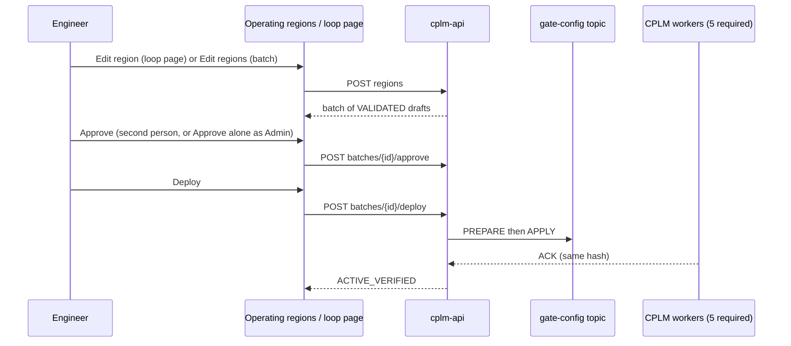
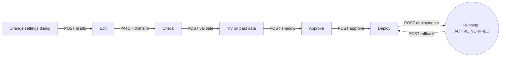
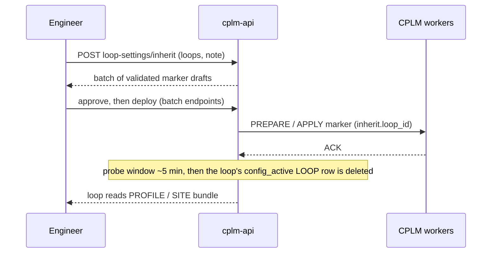

# System Response release: what changed, and what it means for Flink, the database and the plant

23 Nov 2026. One linear history: `feat/sr-engine-fixes` and `feat/sr-mine` both at `d2407216` (CHG-106..109, 204..226 and the
lab-retest fixes), unpushed, containing `feat/cpa-redesign` up to v2.9.1; the build is made from that head. **No deployment bundle is built until the owner approves.** Plan:
`docs/next-release/system-response-implementation-plan.md`; owner decisions: `system-response-owner-decisions.md`; SME
items: `sme-review.md`; lab results: `system-response-e2e-results.md`.

## 1. What changed, by phase

| Phase | CHG | Change | Where |
|---|---|---|---|
| 1 | 204-211 | Engine fixes: PV-range-scaled step / settle tests, servo steps on an even grid, textbook decay ratio, valve-at-limit and region-exit censors, declared process type, 95 % prediction band, closed-loop fit centred on the pre-step state, model check replayed from the previous event's own start | Flink |
| 1 | (owner, 22 Nov) | Capture in **AUT only** (`--response-capture-modes AUT`); leaving AUT censors the event | Flink |
| 1 | 106 | `PLANT_DAY_START` (default 00:00 = unchanged): the evidence boundaries and the daily KPI day can follow 06:00 / 18:00 shifts | Flink, cplm-api, frontend, compose |
| 2 | 212-215 | Controller tuning from the DCS: P / I / D read from the samples, CENTUM ideal PID (Kc = 100 / P × OP span / PV span), "tuning changed" censor, margins / Bode / SIMC advice, Frequency tab | Flink, frontend |
| 2 | 107 | Tuning history: cplm-api stores each loop's tuning (effective-dated) and links each model to it; `GET .../loops/{id}/controller-tuning` | cplm-api |
| 4 | 216 | Setpoint-step models for integrating (level) loops (`PEM_ARMAX_RATE`) | Flink |
| 4 | 217 | Servo dead time no longer one read short on jittered data | Flink |
| 4 | 108 | Per-loop settings apart from the plant-wide ones: operating regions for many loops at once, re-stack of loops with their own settings after a plant-wide change, batch approve / deploy | cplm-api |
| 4 | 109 | Model review queue (one row per loop and path to review) | cplm-api |
| 4 | 218 | "Models to review" on System Response | frontend |
| 4 | 219 | Gate Configuration "Per-loop settings" view; the Response job named as a reader of the region | frontend, catalogue |
| fixes | 108 follow-up, 220 | One approval rule everywhere (a second person, or an Admin / SuperAdmin alone, recorded); SuperAdmin approves site-wide; expired approvals re-approvable; a loop's first own bundle starts from the plant-wide bundle; batch lookup without the 200 cap | cplm-api, frontend |
| fixes | 108 follow-up 2 (+ UI by CPA Updates) | The rest of the Gate Configuration check: Effective values over the class pack; per worker the bundle it really runs; no "active" before a scheduled time; rollback only from the current deployment to the version before it; shadow status refreshed; lost Kafka messages re-sent, then failed | cplm-api, frontend |
| 5 | 223 `3d0791d9` | "Use plant-wide settings": a LOOP version carrying an `inherit` marker makes the loop follow the plant-wide bundle again; `POST .../loop-settings/inherit` | Flink (every CPLM job), cplm-api |
| 5 | 224 `109f55e2` | Gate property values: `GET effective` returns `entries[]`, the catalogue returns `kind` / `editable`; only the 63 editable properties are shown and edited; non-editable values are dropped from new versions; only a site-wide change needs a SuperAdmin | cplm-api |
| 5 | 225 `431e23fd` | Temperature and vapour-pressure class packs: `G9.role` SUPPORTING (valve geometry never decides alone, rule R07); UNKNOWN pack period maximum 17,280 s (4.8 h) so 5 cycles fit the 24 h window | Flink, cplm-api (factory layer) |
| 5 | 222 `28a7ef2d` | "Try on past data" (shadow run): always linked to its change (the submit cannot be cancelled by the client); window plan on the loop's newest LIVE 24 h window end, whole days 1-7, offset = end mod 24 h, so every shadow window pairs with a live one | cplm-api |
| 5 | 221 `4457e36c` | Gate Configuration as a guided journey: start page, loop / type / plant pages, change page with five steps (Edit, Check, Try on past data, Approve, Deploy), Operating regions page, dialogs (Change settings, Edit region, Edit regions, Use plant-wide settings, Update them); the old workspace (Effective / Bundles / Per-loop settings views) removed, old `?loop=` / `?view=` / `?bundle=` links redirect. Task 11 = CHG-224 in the UI (editable settings only, value in use and where it comes from) | frontend |
| 5 | 226 `91d9b2aa` | After a Flink restart the screens keep each loop's last stored result: the Long job stamps `coverage_from_ms` / `warming_up` on 4 h / 12 h / 24 h results, Fusion copies them, cplm-api (`RefillSql.cs`) serves the last real verdict while a window is refilling; planned restarts use a savepoint (`migration/flink-stop-with-savepoint.sh`, `04b` `RESUME_LONG_FROM` / `RESUME_FUSION_FROM`) | Flink (Long, Fusion), cplm-api, frontend, `migration/` |
| fixes | lab retest `d2407216` | Plant page matched the SITE bundle's `scopeRef` "" wrongly; Check / Approve hid non-editable values that are dropped; worker-runs lookup ordered by deployment creation (a restarted worker replaying old ACKs no longer shows an old version); region basis wording; plain wording on several states | frontend, cplm-api |

Also in the branch: v2.9.1 (CHG-183..203, built 15 Nov, not deployed) with migration `cpm-22-response-redraw-retention`.

## 2. Services, database, topics, configuration

| Item | Change |
|---|---|
| Images | **Flink jar / image**, **cplm-api**, **ams-frontend**. Ingestion, ams-api, historian, gateway: unchanged |
| Ship together | the jar and cplm-api carry the same property catalogue (hash `aee93593…`; the catalogue file is unchanged by CHG-224): a deployment needs workers on the catalogue cplm-api validated against. **The frontend ships only with the CHG-223 + CHG-224 server (cplm-api + jar)**: the UI posts `loop-settings/inherit` and its Edit step reads `editable` / `entries`; against an older cplm-api the Edit step is empty. Deploy the jar before anyone uses "Use plant-wide settings" (an older worker would apply the marker as the loop's own bundle) |
| Database | **No new migration** from this work, CHG-221..226 included (`changes_tracker.md` states "No migration" for each). `cpm-22` (v2.9.1) only if v2.9.1 is not deployed first. Tables newly written: `cpm.controller_snapshot` (tuning history, kept; a row only per tuning change); batches use the existing `note` column |
| Scripts | new `migration/flink-stop-with-savepoint.sh`; changed `migration/04b-submit-flink-jobs.sh` (resume variables), `migration/lib.sh` (`MINIO_CONTAINER`), `migration/deploy/stub-04b.sh`, `migration/MARUN-DISK.md` 3A; procedure `docs/next-release/flink-savepoint-procedure.md`; read-only plant queries `chg224-plant-bundle-check.sql`, `chg225-geometry-impact.sql` |
| Kafka | no new topic. P / I / D ride on `traverse.cpa.loop.samples.v1` as extra fields (ingestion already maps P → p, I → i, D → d) |
| Compose / `.env` | `PLANT_DAY_START` (cplm-api `Cpm__PlantDayStart`, both Flink submitters); default `00:00`. **Marun: add `PLANT_DAY_START=06:00` to `migration/.env` before the Flink swap** (shifts confirmed 23 Nov), so the day start rides the release's own Flink restart |
| New job arguments (all optional, defaults apply) | `--response-capture-modes` (AUT), `--g12-lambda-rule` (DEAD_TIME), `--g12-controller-scan-s` (1), `--g12-settle-noise-multiplier`, `--g12-actuator-limit-band-fraction`, `--g12-actuator-limit-dwell-s`, `--g12-region-exit-dwell-s` (10), `--plant-day-start` (00:00) |
| Settings | no new setting from CHG-221..226 (savepoint variables are per-run, see Scripts) |
| New API | `POST .../configuration/loop-settings/inherit` {site, loopIds 1-200, note} (CHG-223); `GET .../configuration/effective` adds `entries[]`, `GET .../configuration/catalogue` adds `kind` / `editable` / `setIn` / `registryField` (CHG-224); fleet / kpis / loops, rankings, priority queue, heat map, `loops/{id}/gates/latest`, `loops/{id}/kpi-summary` gain `lastStored`, `resultAt`, `updatingSince` (CHG-226); `GET .../loops/{id}/controller-tuning`; `GET/POST .../configuration/regions`; `GET .../configuration/loop-settings/stale`; `POST .../loop-settings/restack`; `GET .../configuration/batches/{id}`, `POST .../batches/{id}/approve`, `.../deploy`; `GET .../models/review-queue` (base `/api/v1/cpm`) |

## 3. Effect on the Flink jobs

| Job | At the deploy | After |
|---|---|---|
| **AMS - CPLM Response Engine** | **Resubmit without state** (new fields in its keyed state; never a savepoint upgrade, never a ZK-HA restore of the old jar) | Event and result identities change for loops without a bundle. A loop's model check and band start from its **second** accepted event after the deploy. Expect more `ACTUATOR_CONSTRAINT` / `REGION_EXIT` / `TUNING_CHANGED` censors, far fewer models rejected as "no better than a flat line", setpoint steps getting models for the first time |
| Short, Long, Fusion and the other CPLM jobs | New jar. They may restore from savepoints (the sample class only gained nullable fields), or start fresh in the plant's usual full swap | With a fresh start the 12 h / 24 h verdicts refill in about 11 h / 23 h. Long and Fusion read `--plant-day-start`: at Marun `06:00`, so the saved 12 h sets end 06:00 / 18:00 and the 24 h set and the daily KPI day run 06:00 → 06:00 |
| All CPLM workers | Announce the new catalogue in their CAPABILITY record | A region deployment now also waits for the Response Engine's ACK |
| All CPLM jobs (CHG-223) | Must understand the `inherit` marker before one is deployed | `EffectiveBundleSelector` passes a LOOP version carrying `inherit` over to the PROFILE (else SITE) bundle in force, else the class pack; a newer own version governs again; a marker on another scope is refused at PREPARE |
| All CPLM jobs (CHG-225) | New class-pack values | Temperature / vapour-pressure loops: a geometry-only valve verdict becomes "insufficient evidence" (plant measure: 2.4 % of 12 h and 3.5 % of 24 h temperature verdicts rested on geometry; TIC80105 changes from suspected final element nonlinearity 0.89 to no valve diagnosis); UNKNOWN pack period max 4.8 h |
| Long, Fusion (CHG-226) | Long keeps `cplm-buffer-coverage-from-ms` per loop in keyed state (restore-compatible, uids unchanged) and stamps `coverage_from_ms` / `warming_up` on every 4 h / 12 h / 24 h result; Fusion copies both (payload only, G0 unchanged); On-Demand Evaluation and Historical Replay omit them | A fresh submit still refills the windows, but the screens show the last stored result meanwhile. A planned restart with a savepoint keeps the windows: the lab proved Long resumed strictly from a savepoint across the jar change (23 Nov, stop 11:38 UTC, resumed 11:40) |

## 4. What needs a restart, and what does not

| Change at the plant | Restart? |
|---|---|
| Any gate configuration change (loop, type or plant level) | **No.** Broadcast to the running jobs, confirmed by each worker; Running after about 5 min (the probe window) |
| "Use plant-wide settings" (CHG-223) | **No** (same broadcast; the jar must already be the new one) |
| Add or change an operating region (one loop or many) | **No.** The bundle is broadcast to the running jobs, each worker acknowledges it, and it applies from its effective time. Checked on the lab (all 5 required workers ACK, ACTIVE_VERIFIED) |
| Deploy any plant-wide or per-loop Gate Configuration bundle, or a re-stack batch | No (same broadcast) |
| The DCS starts publishing P / I / D | No: ingestion forwards them, the engine reads them on the next event |
| Declare or correct a loop's PV range | No restart; the next event uses it (a new tuning row is written when the range changes) |
| `PLANT_DAY_START` (e.g. 06:00) | Yes: resubmit Long + Fusion and recreate cplm-api (`deploy.sh`); planned: stop Long + Fusion with a savepoint, set the variable, resume (`RESUME_LONG_FROM` / `RESUME_FUSION_FROM`); the kept KPI days are re-stored on the next daily pass |
| A new Flink jar | Yes: use `flink-stop-with-savepoint.sh` then `04b` with the resume variables (Long, Fusion); the Response job is always resubmitted without state |
| Add Cascade to the capture (later phase) | Yes: resubmit the Response job with `--response-capture-modes AUT,CAS` |

## 5. Behaviour the plant will see

- **Gate Configuration is a guided journey:** start at `/cpm/config` (one loop search, four cards, changes in progress,
  running now). **Change settings** asks "Apply to" (this loop, every loop of a type, the whole plant) and a reason, then
  opens the change page: Edit, Check, Try on past data, Approve, Deploy. Operating regions has its own page. Only the 63
  editable settings are listed, each with the value in use and where it comes from; the two decisions read "Not decided"
  with the value used. Approval: a second person, or an Admin / SuperAdmin alone ("Approve alone", recorded); a plant-wide
  change needs a SuperAdmin. Old bookmarks redirect.
- **Last stored result (CHG-226):** after a Flink restart a loop whose windows are refilling shows its last real verdict
  with "Last stored result - date - time" once per row (KPI drill-down, Overview loops requiring review, Performance
  findings and gate matrix, Loop Explorer band) instead of "not enough data".
- **Regions change verdicts:** a window with the PV outside its loop's region more than 20 % of the time fails G2r and loses
  its fused verdict; events leaving the region are censored. Regions are entered after deploy (section 6).
- **Approvals:** every Gate Configuration approval needs a second person, except an Admin or SuperAdmin approving their own
  (recorded as `[self-approved as <role>]` in the approval and the audit). Site-wide bundles need a SuperAdmin.
- **Per-loop settings** keep a loop's own values; after any plant-wide change the screen offers to re-stack those loops so the
  plant-wide change reaches them too.
- **Tuning:** the Frequency tab shows the tuning each event ran under, the history, margins and advice ("advice only, never
  applied"). A loop that publishes tuning but has no PV range shows "No PV range recorded".
- **Review:** System Response lists one model to review per loop (no baseline first).

## 6. Steps at the plant after the deploy

1. Load the 9 recommended regions (`sme-review.md` section 3) in Gate Configuration → Per-loop settings, approve (a second
   person, or a SuperAdmin alone) and deploy. No restart.
2. Retire the 18 non-PID tags in Loop Registry.
3. Declare the PV range of every loop that publishes tuning.
4. I&C: publish P / I / D under `PIDParams` with PV / SV / MV / MODE.
5. Plant day start: already set to `06:00` at the deploy (section 2). Check: the long / fusion log line `CHG-102: evidence emit=…` shows day start 06:00; the newest saved 12 h set ends 06:00 or 18:00 (+03:30); after the first 06:00 + 1 h the daily KPI pass logs "recomputed" for the kept days (about 14) and the newest day ends 06:00. Record the switch date in `prod_decision.md`. The long job emits its first sets once every sample partition has data, at the latest 30 min after the swap (watermark idleness): check after that. Lab-proven 23 Nov with day start 11:45.

## 6a. Lifecycle: adding or changing an operating region

All in cplm-api (`/api/v1/cpm/configuration`), tables in `traverse_cplm`. Topics: `traverse.cpa.context.gate-config.v1`
(bundle broadcast, compacted) and `traverse.cpa.context.gate-config.acks.v1` (worker ACKs and CAPABILITY records).

| # | The engineer does | What happens behind it | API / permission | Data and audit |
|---|---|---|---|---|
| 1 | **Edit region** on a loop page, or Gate Configuration → **Operating regions** → **Edit regions** (min / max per loop, both empty = clear), **Save** | The table lists every active loop of the site with PV range, region and source. For each changed loop one LOOP draft is built on the bundle the loop runs under now (its own LOOP bundle, else the active PROFILE / SITE bundle with a LOOP layer), `G2r.pv_region_min` / `_max` set, validated. All drafts form one batch (`[batch <id> regions]` in the note). Rows with errors (unknown or retired loop, one bound, min >= max) are refused one by one; a region outside the PV range is a warning | `GET regions?site=`, `POST regions` · `cpm.config.read` / `.draft` | `cpm.gate_config_bundle` (VALIDATED or REJECTED); audit `CONFIG_DRAFT_CREATED` per loop, `CONFIG_REGION_BATCH_CREATED` |
| 2 | **Approve** (a second person) or **Approve alone** (the author as Admin / SuperAdmin) | Each validated draft gets an approval bound to its content hash, valid 72 h (re-approvable when expired); a self-approval is recorded as such; an Engineer cannot approve their own | `POST batches/{id}/approve?site=` · `cpm.config.approve` | `cpm.config_approval`, bundle APPROVED; audit `CONFIG_DRAFT_APPROVED` (`selfApproved`, `role`) |
| 3 | **Deploy** | One deployment per bundle: SCHEDULED, PREPARE on the broadcast topic, every required worker (the CPLM jobs that read a catalogue property, the Response Engine included) ACKs PREPARE with the same hash on one jar, PREPARED, APPLY at the effective time, APPLY ACKs, PROBING, ACTIVE_VERIFIED (a result carries the hash, or the probe window passed). A missing ACK after 5 min = PARTIALLY_ACKNOWLEDGED; a NACK = ACTIVATION_FAILED; a lost message is re-sent by the 30 s sweep, then failed. **No Flink restart** | `POST batches/{id}/deploy?site=` · `cpm.config.activate` | `cpm.config_deployment`, `cpm.config_worker_ack`; at ACTIVE_VERIFIED `cpm.config_active` names the bundle and the previous one is SUPERSEDED; audit `CONFIG_DEPLOYMENT_SCHEDULED`, `CONFIG_ACTIVE_VERIFIED` (or `CONFIG_REJECTED`) |
| 4 | (nothing: the engine applies it) | From the effective time: the Short job checks G2r against the region (a window more than 5 % outside = WARN, more than 20 % = FAIL, and a FAIL window's fused verdict is excluded); the Response job censors an event whose PV leaves the region for 10 s (`REGION_EXIT`) | none | results carry the new bundle hash |
| 5 | After a plant-wide (SITE / PROFILE) deployment: the notice "N loops have their own settings on the previous plant-wide settings" → **Update them**, then approve and deploy as in 2-3 | For each such loop a new LOOP draft = the current plant-wide layers + the loop's own layer, as one batch (`[batch <id> restack]`) | `GET loop-settings/stale?site=`, `POST loop-settings/restack` · `cpm.config.read` / `.draft` | audit `CONFIG_DRAFT_CREATED`, `CONFIG_RESTACK_BATCH_CREATED` |

## 6b. Lifecycle: a gate configuration change (change page, five steps)

| # | The engineer does | What happens behind it | API / permission | Data and audit |
|---|---|---|---|---|
| 1 | **Change settings** on the start, loop, type or plant page: Apply to (this loop / a loop type / the whole plant) and a reason, **Start** | A new version of that scope (LOOP / PROFILE / SITE). A next version starts from the newest one of the scope (a draft not yet approved, by number); a first version starts from the plant-wide bundle in force (LOOP: the active PROFILE, else SITE; PROFILE: SITE), the factory layers only when nothing above is active (`startChange.ts`). The page opens on **Edit** | `POST drafts` · `cpm.config.draft` | `cpm.gate_config_bundle` DRAFT; audit `CONFIG_DRAFT_CREATED` |
| 2 | **Edit**: only the editable settings (catalogue `editable`), each with the value in use and where it comes from | Each save is checked against the catalogue (type, range) and the draft's version tag (409 when someone else changed it); a non-editable property is refused with where it is changed; every new draft drops non-editable values from its non-factory layers; the old comparison is cleared | `PATCH drafts/{id}` with If-Match · `cpm.config.draft` | audit `CONFIG_DRAFT_EDITED` |
| 3 | **Check** | Every rule of the catalogue (dependencies such as max > min, R07, the execution plan); the change class is the class of what this version changes (POLICY, STATE_BOUNDARY, ...). The list shows only what the person changed | `POST drafts/{id}/validate` · `cpm.config.validate` | VALIDATED or REJECTED with every reason; audit `CONFIG_DRAFT_VALIDATED` |
| 4 | Optional **Try on past data** on a loop (1-7 whole days) | A SHADOW analysis run replays the loop's history from IoTDB under the draft's values (class pack under the draft's layers), ending on the loop's newest LIVE 24 h window end (offset = end mod 24 h) so each shadow window pairs with a live one; no operational output. The run is always linked to the change, even if the browser gives up during the ~30 s submit. The comparison (before / after per gate) refreshes the run's state from Flink | `POST drafts/{id}/shadow`, `GET drafts/{id}/shadow` · `cpm.config.shadow` / `.read` | `analytics.analysis_run`, SHADOW rows in `cplm_gate_results`; audit `CONFIG_SHADOW_STARTED` |
| 5 | **Approve** (or **Approve alone**) | A second person, or the author as Admin / SuperAdmin (recorded `[self-approved as <role>]`). Only a SITE bundle needs a SuperAdmin (CHG-224: no property needs one any more). Valid 72 h; an expired approval can be given again | `POST drafts/{id}/approve` · `cpm.config.approve` | `cpm.config_approval`; audit `CONFIG_DRAFT_APPROVED` |
| 6 | **Deploy**, optionally "Effective from" | As 6a step 3. A bundle with a future effective time is prepared and applied by the workers but takes effect only then ("Takes effect at ...", never ACTIVE_VERIFIED before). The page watches the ACK matrix: SCHEDULED, PREPARING, PREPARED, APPLYING, PROBING, then ACTIVE_VERIFIED ("Running"), PARTIALLY_ACKNOWLEDGED or ACTIVATION_FAILED; a partial or failed one can be deployed again while the approval is valid | `POST deployments` `{bundleId, scheduledFor}`, `GET deployments/{id}` · `cpm.config.activate` / `.read` | `cpm.config_deployment`, `cpm.config_worker_ack` |
| 7 | **Values in use** on the loop page | The loop's values the engine's way (the bundle's layers over the class pack) with each value's source (`entries[]`); per worker the bundle it really runs, and "some parts run another version" during a partial deployment (a worker's newest acknowledged deployment, ordered by deployment creation) | `GET effective?loopId=` · `cpm.config.read` | reads `cpm.config_active`, `cpm.config_worker_ack` |
| 8 | **Roll back** (only on the scope's current deployment) | A new deployment (kind ROLLBACK) of the version active before it; when verified the rolled-back deployment is ROLLED_BACK. None for a first version, only one at a time; rolling back a later own version re-deploys a marker | `POST deployments/{id}/rollback` · `cpm.config.rollback` | as 6a step 3; audit `CONFIG_DEPLOYMENT_SCHEDULED` (kind ROLLBACK) |

## 6c. Lifecycle: "Use plant-wide settings" (CHG-223)

| # | The engineer does | What happens behind it | API / permission | Data and audit |
|---|---|---|---|---|
| 1 | **Use plant-wide settings** on Operating regions or the loop page, loops (1-200) and a reason | One batch of validated drafts, each holding the plant-wide layers (the re-stack's base rule, `LoopSettingsService.PlantWideAsync`) plus `"inherit": {"loop_id": ...}`; a marker cannot be edited | `POST loop-settings/inherit` · `cpm.config.draft` | `cpm.gate_config_bundle`; audit `CONFIG_DRAFT_CREATED` |
| 2 | **Approve** (or Approve alone), **Deploy** | As 6a steps 2-3; the workers store and ACK the marker like any bundle; `EffectiveBundleSelector` then skips it to the PROFILE (else SITE) bundle in force, else the class pack | batch `approve`, `deploy` | as 6a |
| 3 | (nothing) | Once the marker verifies (about 5 min) the loop's `cpm.config_active` LOOP row is deleted and its previous own version SUPERSEDED; regions, effective, stale and summary read the loop under the plant-wide bundle; the loop leaves the re-stack list. A later own version supersedes the marker | none | `cpm.config_active`; audit `CONFIG_ACTIVE_VERIFIED` |

## 7. Verification

- Tests: the full Flink suite; cplm-api config / region / review-queue / tuning / plant-clock tests on the lab database; the
  frontend CPM test files, tsc and eslint (see each CHG in `changes_tracker.md`).
- Lab end to end (23 Nov, one deploy, `system-response-e2e-results.md`): A1-A8, A10, B1-B8 and the review list pass, incl.
  the B6 re-run after the approval fix; the duplicate censored event seen on the lab is fixed and checked live.
- New Gate Configuration pages: lab E2E 23 Nov (Day 1440 / Night 1440 / Day 768): start, loop, type, plant and regions pages,
  Change settings dialog, the five steps with Approve alone and Deploy to Running, Values in use = the 63 editable entries
  of `effective`, "Use plant-wide settings" end to end, last stored result with a probe loop (removed afterwards), TEMP pack
  draft Valid. Combined deploy `91d9b2aa` passed all six E2E checks; the `d2407216` re-check is in progress: see
  `system-response-e2e-results.md` (screen issues list, left-on-the-lab list). At the plant: open a loop page, Change
  settings, step through to Deploy on a low-risk property; read a window refill after a planned restart.
- Not covered on the lab: A9 (every simulated loop carries an old P), the Engineer approval path (no such user on the lab),
  the plant-day start (optional), and the closed-loop setpoint methods (CHG-216 / 217 rest on bench tests; a smoke check
  on the lab modelled a setpoint step).

## 8. Open for later (not in this release)

Cascade / master-slave; Manual bump tests; keeping P / I / D in the historian (the tuning history covers the analysis need).
Gate Configuration minors (retest item 12 and the deferred list in memory): the Check "Now" column reads "-" for a type
change whose loops already run the class pack values; "Same result" in Try on past data carries no diagnosis (the server
returns changed windows only); the Edit step shows property codes; Loop Explorer drawer phrases; older partly-deployed
versions are shown as in progress.
(The Gate Configuration gaps 1, 2, 4, 6, 7, 9 of `gate-configuration-e2e-check.md` were moved into this release by the
owner on 23 Nov.)

## 9. Records

`changes_tracker.md`: CHG-106, 107, 108, 108 follow-up, 109, CHG-204..220 and CHG-221..226 sections (CHG-221 incl. the
"Lab retest fixes" paragraph). `prod_decision.md`: plant day start, tuning history, per-loop settings and regions, approval
rules, the System Response engine section, the Gate Configuration deployments table (shadow-run window row), and the rows
for CHG-223 (own settings removable), CHG-224 (editable settings only), CHG-225 (geometry supporting) and CHG-226 (last
stored result, savepoint restarts). `docs/theme/redesign/text-changes.md`: CHG-221 section. Savepoint procedure:
`flink-savepoint-procedure.md`; restart data gap: `flink-restart-data-gap.md`.
