# CPA — KPI and application logic (SME review copy)

Baseline: branch `feat/v25-next-release` as deployed at Marun, v2.8.0.1 (2026-10-16). Calc 3.0.0, dynamics pack 2.0.0.
Scope: Control Performance Analytics (CPA / CPLM): Flink calculation jobs, `cplm-api`, the `/cpm/*` pages; plus the AMS alarm KPIs.
Everything here is transcribed from code. Detail references: [KPI-LOGIC.md](KPI-LOGIC.md) (fleet KPIs),
[cpm-gate-reference.md](../docs/cpm-gate-reference.md) (per-gate maths), [cpm-calculation-reference.md](../docs/cpm-calculation-reference.md) (engine as implemented),
`kpi-documentation.docx` (7 Oct full reference with page screenshots), [cpa-system-and-application-architecture.md](../docs/cpa-system-and-application-architecture.md).

---

## 1. Where the numbers are computed

| Stage | Component | Computes | Cadence |
|---|---|---|---|
| Ingestion | `ingestion-service` | one PV / SP / OP / MODE / VP tuple per loop from per-parameter MQTT messages | grid 5 s, forward-fill |
| Short features | Flink `CplmShortFeatureStreamJob` | G0–G4 and the loop KPIs (MAE, IAE, good-error time, effort, travel, saturation) | 1m–60m windows |
| Long diagnostics | Flink `CplmLongDiagnosticsStreamJob` | G5–G11, G13, VP tracking, aligned G0–G4 recompute | 4h / 12h / 24h every 15 min |
| Conditions | Flink `CplmConditionStreamJob` | G10 limit dwell and G11 freeze conditions as they happen | per sample |
| Gate fusion | Flink `CplmGateFusionStreamJob` | exclusions, G12 flag, G13, G14, G15 verdict, hypotheses, recommendation | 12h and 24h only |
| System response | Flink `CplmResponseAnalysisJob` | G12 step response metrics, process model, validation | per qualifying step |
| Instrument health | Flink `CplmInstrumentContextJob` | NE107 eligibility per loop role | per observation + 60 s timer |
| Live values | Flink `LoopLiveRbeJob` | report-by-exception PV / SP / OP / VP / MODE (deadband 0.05 EU) | on change |
| Storage, roll-ups | `cplm-api` (.NET) | stores rows verbatim; episodes, fleet KPIs, priority, readiness, exports | per record / per request |
| Pages | `/cpm/*` (React) | formatting only; never recompute an engine number | — |

Rules: one compute route (Flink); cplm-api never recomputes a gate; pages never recompute a KPI. Error convention `e = SP − PV`. OP is normalised to 0–100 % of the declared OP range before any gate maths.

### 1.1 Ingestion facts that decide whether a loop is judged at all

| Rule | Value / behaviour | Consequence when unmet |
|---|---|---|
| Tuple emitted | only after PV, SP and OP each seen once; a tick where no member advanced is skipped (no duplicate timestamps) | quiet gateway = gap, not flat data |
| Grid | `grid_seconds` 5 s; slower signals forward-filled; `event_ts` = newest source timestamp | — |
| Quality | worst of PV / SP / OP OPC quality; GOOD only if all three good; numeric `quality` field is ignored (string only) | OPC integer qualities would read as GOOD |
| MODE | `mode_value_map` translates the DCS enum (CENTUM: 1=AUT, 2=MAN, 3=CAS, 4=MAN IMAN); unmapped values pass through raw | raw enum → not auto → G1 EXCLUDED on every window |
| VP | optional; `vpApplicability` EXPECTED / NOT_INSTALLED / NOT_APPLICABLE from the registry (CHG-088) | see G14 |
| Dead letters | `traverse.ingestion.ot-dlq` (TOPIC_SHAPE_MISMATCH, MISSING_FIELD, BAD_TIMESTAMP, FUTURE_TIMESTAMP > 300 s, UNKNOWN_PARAMETER) | sample never reaches the engine |

## 2. Windows

| Window | Tier | Type | Size / new result every | Lateness | Minimum data | Produces |
|---|---|---|---|---|---|---|
| 1m | short | tumbling | 1 min / 1 min | 30 s | ≥ 10 samples and G0 ≠ FAIL | G0–G4, loop KPIs |
| 5m | short | sliding | 5 min / 1 min | 60 s | same | same |
| 10m | short | sliding | 10 min / 2 min | 90 s | same | same |
| 15m / 30m | short | sliding | 15 or 30 min / 5 min | 2 min | same | same |
| 60m | short | sliding | 60 min / 5 min | 3 min | same | same |
| 4h | long | rolling buffer | 4 h / 15 min | recomputed | ≥ 32 samples | G5–G11, G13 + aligned G0–G4 |
| 12h | long | rolling buffer | 12 h / 15 min | recomputed | ≥ 32 samples | same + **fused verdict** (G12, G14, G15) |
| 24h | long | rolling buffer | 24 h / 15 min | recomputed | ≥ 32 samples | same + **fused verdict** |

- The G0–G4 values on a fused 12h / 24h verdict are recomputed over that same 12h / 24h slice, not taken from a short window.
- Pages default to the **12h** verdict with a 24h switch (CHG-089). Fleet KPIs use the newest fresh result of the selected kind.
- A short window with G0 = FAIL or n < 10: `sufficient_data = false`, metrics null, G1–G4 NOT_EVALUATED (shown DECLINED).
- Every Flink restart without saved state refills the buffers: first 12h verdicts ≈ 11.4 h later, 24h ≈ 22.8 h later.

## 3. Sample qualification

| Rule | Definition |
|---|---|
| Valid sample | PV, SP, OP finite; otherwise dropped. Non-finite VP → "no VP", sample kept |
| Good quality | token GOOD (or OPC integer ≥ 192). UNCERTAIN, BAD, UNKNOWN are not good; bad samples stay in the arrays and count in `bad_quality_pct` |
| Automatic mode | manual tokens win (MAN, MANUAL, M, IMAN, ROUT, LO, LOCAL, OFF, TRACK); auto = AUTO, AUT, A, AUTOMATIC, NORMAL, NORM, CAS, CASC, CASCADE, RSP, DDC, SUP, SUPERVISORY. Cascade slaves count as auto |
| Eligible VP | present, GOOD, not a held value older than 60 s |
| Sample period Ts | median Δt between samples (5 s if < 2 samples) |
| σ | population standard deviation |

## 4. Loop KPIs per window (short tier, `ShortFeatureCalculator`)

```
e(i)            = SP(i) − PV(i)                                 PV units
MAE             = mean |e|            RMSE = sqrt(mean e²)       sample means, not time-weighted
IAE             = Σ |e|·Δt            ISE  = Σ e²·Δt             zero-order hold, last sample gets median Δt
ITAE            = Σ (t − t_start)·|e|·Δt                        t anchored to window start
band            = 0.005 × (PV_max − PV_min)                     0.5 EU when no PV range declared
good_error_pct  = count(|e| ≤ band) / n                          "Good-error time", 0–1
auto_pct        = count(mode automatic) / n                      "Time in auto"
saturation_pct  = count(OP ≤ 5 % or OP ≥ 95 %) / n               limits = 5 / 95 pp of declared (or 0–100) OP range
OCE             = auto_pct × good_error_pct × (1 − saturation_pct)
effort_ratio    = σ(OP) / σ(PV)
activity_norm   = (σ(OP)/100) / (σ(PV)/(PV_max − PV_min))        used by G4 when a PV range is declared, else effort_ratio
op_travel       = Σ |ΔOP|             travel_per_day = op_travel × 24 / window_h   (linear extrapolation)
reversals       = sign changes of ΔOP (|ΔOP| > deadband 0.5 pp)   reversals_per_hour = reversals / window_h
freeze_index_s  = longest run |ΔPV| ≤ 1e-9 × Ts
completeness    = n / round(window_s / grid)                     not clamped to 1
```

## 5. Gates G0–G15

Status words: PASS healthy · WARN attention / symptom seen · STRONG strong symptom evidence (not good) · FAIL / EXCLUDED window unusable · NOT_EVALUATED.

| Gate | Question | Inputs / formula | Status rule (factory defaults) | Configurable key |
|---|---|---|---|---|
| G0 data quality | enough good data? | completeness, bad_quality_pct, duplicate timestamps, gaps (Δt > 1.5 Ts) | FAIL if bad ≥ 0.50; PASS if completeness ≥ 0.98 ∧ bad < 0.05 ∧ no duplicates; WARN if completeness ≥ 0.95; else FAIL | `G0.coverage_min` 0.95, `G0.bad_fraction_max` 0.05 (0.98, 0.50 fixed) |
| G1 mode / service | in automatic? | auto_pct | PASS ≥ 0.90; WARN ≥ 0.70; else **EXCLUDED** (window discarded) | `G1.auto_fraction_min` 0.70 (0.90 fixed) |
| G2 SP stability | setpoint steady? | sp_range = max SP − min SP vs band = declared EU band, else `stability_band_span_fraction` × PV span (0.01 tight, 0.05 averaging), else 1.0 EU | PASS if sp_range < band, else WARN (never FAIL) | `G2.stability_band_span_fraction`, `G2.stability_band_pv_eu` |
| G2r operating region | PV / OP inside commissioned region? | share of samples outside PV or OP region bounds | PASS ≤ 0.05; WARN ≤ 0.20; else **FAIL** → EXCLUDED_OPERATING_REGION | `G2r.applied_input_region_min/max` (0–100) |
| G3 base performance | error inside the good band enough of the time? | good_error_pct (+ MAE, RMSE, IAE, ISE, ITAE, OCE as evidence) | PASS if good_error_pct ≥ 0.50 (0.30 averaging loops), else WARN | `G3.error_band_span_fraction` 0.005, `G3.objective_compliance_min` 0.5 / 0.3 (real fraction since CHG-096) |
| G4 controller effort | actuator working too hard? | activity_norm (or effort_ratio), travel/day, reversals/h | STRONG > 8; WARN > 3; else PASS | `G4.activity_warn_ratio` 3, `G4.activity_high_ratio` 8 |
| G5 oscillation (ACF) | regular cycle? | ACF of the detrended shape signal; period = median of 2 × zero-crossing spacing × Ts; regularity = min(1, P / 3σ(periods)) | WARN when any ACF period exists, else PASS. Period is **valid** only if inside τmin–τmax, regularity ≥ 0.10 and ≥ 8 samples/period | `G5.period_min_s/max_s`, `G5.regularity_min` 0.1, `G5.min_samples_per_period` 8 |
| G6 spectrum | one dominant frequency? | Welch PSD (Hann, 256-sample segments, 50 % overlap); peak_ratio = peak-lobe energy / total; harmonics HAR = (A2+A3+A5)/A1, HER = (A2²+A3²+A5²)/A1²; FFT period valid if peak/median ≥ 3 (harmonic fold k = 2…5 accepted) | WARN if peak_ratio > 0.5, else PASS | `G6.peak_to_background_min` 3.0, `G6.segment_samples` 256 |
| G7 shape | triangular (stick-slip) not sine? | per valid cycle, normalised to [−1, 1]: score = SSE_sine / (SSE_sine + SSE_tri); triangularity = mean | NOT_EVALUATED without a valid period; STRONG > 0.8; else PASS | `G7.shape_score_high` 0.8, `G7.min_accepted_cycles` 5 |
| G8 Horch asymmetry | PV–OP lag asymmetric? | φ±(k) standardised cross-correlations to lag ≤ 200 (needs ≥ 202 samples); oddness = Σ\|φ₊−φ₋\| / (Σ\|φ₊−φ₋\| + Σ\|φ₊+φ₋\|) | STRONG > 0.7; else PASS | `G8.asymmetry_display_threshold` 0.7 |
| G9 phase geometry | PV–OP loop has stiction corners? | per-cycle shoelace area / bounding box; corner score = share of turning angle at corners ≥ class angle (qualified variant needs an OP move ≥ 0.5 pp) | NOT_EVALUATED (no valid cycles, area > 1.5 / 2.0, effort or OP travel below floor); PASS if area < 0.05; STRONG if area > 0.30; else PASS | `G9.area_valid_min/max`, `G9.area_display_threshold` 0.3, `G9.corner_angle_deg`, `G9.min_command_range_pp` |
| G10 limits / valve | OP stuck at or cycling against a limit? | saturation_pct, longest dwell at a limit, cycling (≥ 3 exits and ≥ 2 % occupancy); VP tracking \|OP − VP\| mean / P95 / non-following dwell | WARN if occupancy ≥ 0.05, or dwell ≥ 30 samples × Ts, or cycling; else PASS | `G10.limit_tolerance_pp` 5, `G10.occupancy_warn_fraction` 0.05, `G10.nonfollowing_error_pp` 5, `G10.nonfollowing_dwell_s` 60 |
| G11 sensor freeze | measurement frozen? | freeze_index_s, freeze_fraction = freeze run / n, drift/day, spikes (> 3σ), quantisation | WARN MATERIAL_FREEZE (≥ 60 s **and** ≥ 10 % of window → EXCLUDED_SENSOR) or WARN FREEZE_EPISODE; else PASS | `G11.freeze_dwell_s` 60, `G11.freeze_tolerance_pv_eu` 0 |
| G12 step test | approved step test recorded? | registry flag only (the Response Engine results are not joined) | PASS if recorded, else NOT_EVALUATED (flag NO_STEP_TEST). **No computational effect** | — |
| G13 interaction | does a peer loop move with this one? | up to 12 configured peers: coherence, cross-correlation, lag ≤ 600 s, support ≥ 1800 s | WARN if a peer has coherence ≥ 0.6 and \|xcorr\| ≥ 0.5; PASS if none; NOT_EVALUATED without peers | `G13.coherence_display_min` 0.6, `G13.lag_max_s` 600, `G13.max_peers` 12 |
| G14 valve confirmation | does the valve follow the controller? | VP eligible samples, P95 \|OP − VP\|, non-following dwell | see §6.4 | `G14.require_independent_review` |
| G15 diagnosis | fused verdict | see §6 | DETECTED / CLASSIFIED / SUSPECTED / CONFIRMED / INSUFFICIENT_EVIDENCE (= the band, CHG-094) | `G15.minimum_evidence_groups` 2, `G15.recovery_support_s` 21600 |

Shape signal for G5–G9: PV when the class is integrating (LIC, PIC gas), else OP; linearly detrended, mean removed.

## 6. Fusion (G12–G15, `CplmGateFusionEngine`)

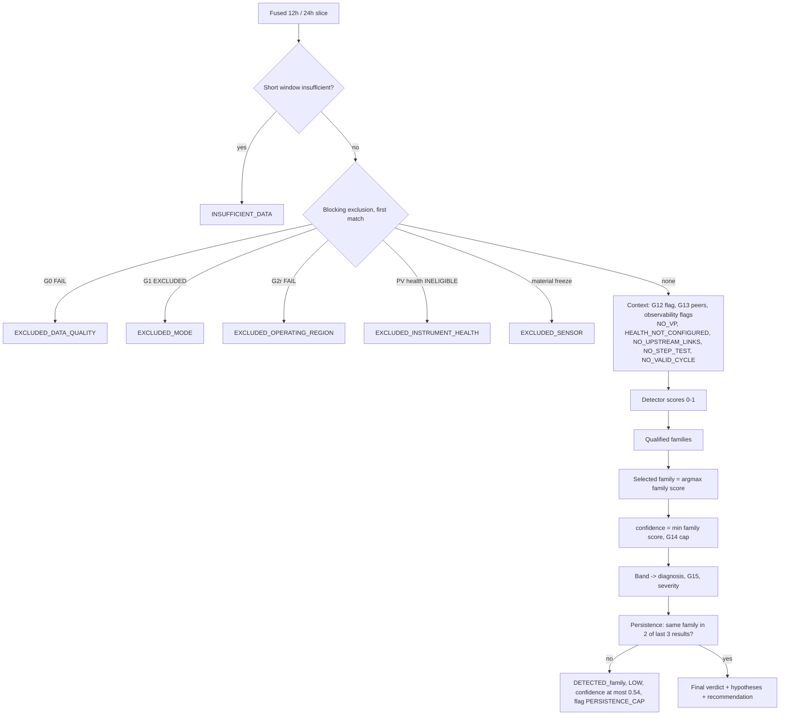

All exclusions carry confidence 0.

### 6.1 Detector and family scores

| Score | Formula (clamped 0–1) | Gate |
|---|---|---|
| oscillation | acf_regularity | G5 |
| fft | fft_peak_ratio | G6 |
| effort | effort_ratio / 8 | G4 |
| stiction | triangularity | G7 |
| horch | horch_oddness | G8 |
| geometry | corner_score_qualified (only with a valid period) | G9 |

```
qualified(score, gates)   ⇔ score ≥ 0.55  or a related gate is STRONG / WARN
family_oscillation        = max(oscillation, fft) × prior_oscillation     if oscillation qualified
family_stiction           = max(stiction, horch)  × prior_stiction        if stiction qualified
family_effort             = effort × prior_effort                         if effort qualified
family_geometry           = corner_score_qualified × prior_geometry       if geometry selectable (class role, prior > 0)
selected                  = argmax over qualified families  (ties: stiction > oscillation > effort > geometry)
confidence                = min(family score, G14 cap)   (cap applies to valve claims only)
```

Stiction additionally needs: oscillation qualified **and** a shape cue (G7 STRONG, stiction ≥ 0.55 or qualified corner ≥ 0.5) **and** actuator stress (G4 / G10 STRONG or WARN, effort ≥ 2 × floor, OP range ≥ floor, cycling, or ≥ 3 reversals) **and** ≥ 2 independent non-geometry evidence groups.
With configured peers, oscillation without actuator stress **blocks stiction** (DISTURBANCE_CONTEXT → leading cause external disturbance).

Family labels: stiction / geometry → `FINAL_ELEMENT_NONLINEARITY`; oscillation → `OSCILLATION`; effort → `EXCESSIVE_EFFORT`.

### 6.2 Bands (`DiagnosisBands`)

| Evidence score c | Diagnosis | G15 status | Severity |
|---|---|---|---|
| c < 0.35 | NO_CALL ("No fault identified" on screen) | INSUFFICIENT_EVIDENCE | LOW |
| 0.35 ≤ c < 0.55 | DETECTED_family | DETECTED | LOW |
| 0.55 ≤ c < 0.75 | CLASSIFIED_family | CLASSIFIED | MEDIUM |
| 0.75 ≤ c < 0.90 | SUSPECTED_family | SUSPECTED | HIGH |
| c ≥ 0.90 | CONFIRMED_family (final-element family only with G14 CONFIRMED, else SUSPECTED at 0.89) | CONFIRMED | HIGH |

The score is shown as "evidence score N" (0–100): an uncalibrated match score, not a probability. Severity follows the band only.

### 6.3 Persistence

`need = 2 of the last 3` fused results of the same window kind with the same elevated family. Not met and the result is SUSPECTED / CONFIRMED → renamed DETECTED_family, severity LOW, confidence ≤ 0.54, flag PERSISTENCE_CAP. Note: three consecutive results of a sliding window are 45 min apart, so this is weaker than "three windows" suggests.

### 6.4 G14 valve-position confirmation

| State | Condition | Cap on a valve claim |
|---|---|---|
| CONFIRMED | \|OP − VP\| ≥ 5 pp for ≥ 60 s (non-following dwell) | 1.00 |
| CONTRADICTED | ≥ 30 eligible VP samples, P95 \|OP − VP\| < 5 pp, dwell < 60 s (valve tracks) | 0.54 |
| NOT_CONFIRMED | VP expected but absent, or no positive evidence (flag NO_VP) | 0.89 |
| NOT_APPLICABLE | loop declared NOT_INSTALLED / NOT_APPLICABLE (CHG-088): no NO_VP flag; valve family still ranked, tops out at SUSPECTED 0.89 | 0.89 |
| — | selected family is oscillation or effort | no cap |

### 6.5 Hypotheses (CHG-095) and recommendation (CHG-094)

| Hypothesis state | When |
|---|---|
| QUALIFIED | family qualified (score, supporting observations) |
| DISQUALIFIED | real contradiction or disqualifier only (e.g. DISTURBANCE_CONTEXT against tuning, valve tracks against stiction) |
| NOT_ASSESSED | a required input is missing: disturbance without peer links (NO_UPSTREAM_LINKS); stiction with neither VP nor a valid cycle; sensor without a health source and no freeze (HEALTH_NOT_CONFIGURED). `missing_inputs` carried on the result |
| NO_EVIDENCE | nothing scored |

ACTUATOR_LIMIT and SENSOR hypotheses are scored and shown but never become the leading cause.

| Leading hypothesis | Recommendation |
|---|---|
| Valve (stiction / final element) | positioner / HART data and a controlled bump test; without VP: approved bump / stroke test before retuning |
| OSCILLATION_TUNING | review gain and integral time; a step test confirms |
| EXTERNAL_DISTURBANCE | trace the upstream / interacting loop before retuning this one |
| EXCESSIVE_EFFORT | review gain and derivative, PV filtering / noise; check OP travel and reversals |

Urgency by band: DETECTED "Monitor … if it persists"; CLASSIFIED "Plan a review"; SUSPECTED / CONFIRMED the action.

## 7. G12 System response (`CplmResponseAnalysisJob`)

```
trigger T   = max(1.0 EU, 0.01 × span, 4 × 1.4826 × MAD(pre-window 120 s))
step        = |x − median(pre)| ≥ T and the new level holds within T/2 for 30 s   (loop in auto, good quality)
capture     = ≥ 180 s, ≤ 4 h; censored on a gap > 60 s, mode change or a newer step
p(t)        = (y(t) − y0) / (yss − y0);  t10 / t50 / t63 / t90 = first crossing held ≥ 5 s
rise time   = t90 − t10;  overshoot % = 100 × (max p − 1);  decay = (p2 − 1)/(p1 − 1)
settling    = PV within max(0.1 EU, 2 % of |Δy|) of yss for 120 s
model       = FOPDT (IPDT for level): Kp, θ, τ with standard errors (bootstrap 200, 95 %)
validate    = improvement = 1 − RMSE_free / RMSE_baseline on the NEXT event: ≤ 0 REJECTED; noise-level RMSE or bias → CANDIDATE; else VALIDATED
```

First event is always WAITING (needs an independent event). Not produced: stability margins, SIMC tuning advice, SP steps on integrating loops. Retention: unreviewed models > 14 d deleted, CENSORED events 3 d (CHG-091).

## 8. Instrument health (NAMUR NE107, `CplmInstrumentContextJob`)

| Condition (first match) | Eligibility | Effect |
|---|---|---|
| no device bound | NOT_CONFIGURED | flag HEALTH_NOT_CONFIGURED; sensor cause NOT_ASSESSED |
| no health interval yet / collection STALE, OFFLINE | UNKNOWN / LIMITED | flag HEALTH_LIMITED |
| F (failure) or measurement INVALID on the signal; C (check) on the signal | INELIGIBLE | window EXCLUDED_INSTRUMENT_HEALTH |
| S (out of spec) on the signal; M with degraded measurement | LIMITED | flag only |
| M only, flags on another variable, no active diagnostic | ELIGIBLE | — |

Health never changes the evidence score; it excludes a window or adds a flag. Freshness timer 60 s.

## 9. Episodes (Loop Events, `EventFrameLifecycle`)

| Step | Rule |
|---|---|
| Open | first fault verdict of a family (anything but NO_CALL, INSUFFICIENT_*, EXCLUDED_*) from a LIVE result; replays never open or close |
| Extend / Escalate | same family again; Escalate when the severity band rises |
| Peak | highest evidence score seen (ratchets up); peak diagnosis follows it |
| Unobservable | excluded / insufficient window: availability UNOBSERVABLE, episode stays OPEN |
| Close RECOVERED | clear verdict with qualified support ≥ 21 600 s (6 h, `G15.recovery_support_s`) |
| Close FAMILY_CHANGED | another family held 3 consecutive results (45 min); new episode opens |
| Shelve | ISA-18.2 style: SHELVED until `shelve_until`, then EXPIRED by a 60 s sweeper; acknowledging never ends a shelf |
| Retention | episode captures 2 d after close; reconstructions 3 d; pinned never |

## 10. Fleet KPIs (Overview, `/cpm/kpi` drill-downs; `FleetKpiClassifier`)

Basis: each monitored loop counted once from its **newest LIVE result of the selected window kind (12h default, 24h switch)**, which must be **fresh** (window end ≤ 1 h old = four missed 15-min evaluations).

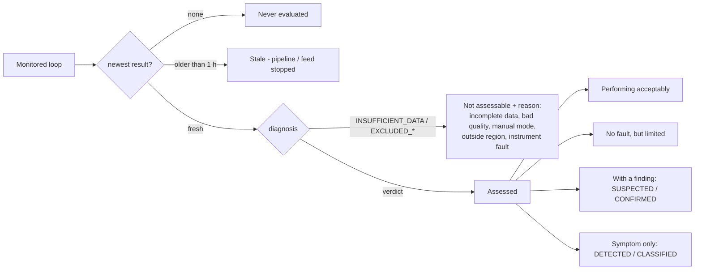

States sum to monitored loops; outcomes sum to Assessed; every tile count equals the rows in its drill-down (tested).

| KPI | Rule | Denominator | Threshold (config `Cpm:Kpi:*`) |
|---|---|---|---|
| K1 Performing acceptably | Assessed ∧ diagnosis ∈ {NO_CALL, INSUFFICIENT_EVIDENCE} ∧ auto_pct ≥ 0.95 ∧ saturation_pct ≤ 0.10 ∧ G3 = PASS ∧ G4 ≠ STRONG. A no-fault loop missing any criterion = "No fault, but limited" (`limitedBy`: OUT_OF_MODE, SATURATED, G3_BELOW_FLOOR, G3_NOT_EVALUATED, G4_STRONG) | monitored | `NormalModeMin` 0.95, `SaturationMax` 0.10 |
| K2 In auto mode | auto_pct ≥ 0.95 | fresh rows with auto_pct measured | `NormalModeMin` 0.95 |
| In manual mode | manual share ≥ 0.50 | same | `ManualModeMin` 0.50 |
| K3 Oscillating | Assessed ∧ SUSPECTED_/CONFIRMED_OSCILLATION | Assessed | — |
| K4 Suspected valve problem | Assessed ∧ SUSPECTED_/CONFIRMED_FINAL_ELEMENT_NONLINEARITY | Assessed | — |
| K5 Excessive actuator effort | Assessed ∧ SUSPECTED_/CONFIRMED_EXCESSIVE_EFFORT | Assessed | — |
| K6 Saturated / at limit | saturation_pct > 0.10 (limit basis shown: registry OP range or 0–100 fallback) | fresh rows with saturation measured | `SaturationMax` 0.10 |
| K7 Not assessable | fresh ∧ INSUFFICIENT_DATA or EXCLUDED_*, by reason (incomplete: completeness < 0.95; bad quality ≥ 0.50; manual; region; instrument) | monitored | `G0CompletenessMin`, `G0BadQualityMax` (reason text) |
| K8 Stale | result exists, window end > 1 h old | monitored | `FreshSeconds` 3600 |
| K9 Never evaluated | no result of this window kind | monitored | — |

- DETECTED / CLASSIFIED are **not** findings (listed as "symptom only"); only SUSPECTED / CONFIRMED (evidence ≥ 0.75) count.
- Change since 24 h ago: the same classification as of now − 24 h; shown in **percentage points** of the share.
- 14-day trend: one point per day at the same time of day, same classification; each day's loops listable (`?asOf=`); a day with nothing judged is "no data", never 0 %.
- "Not measured" is never shown as 0 (e.g. `acf_period_s = 0` with NO_VALID_CYCLE reads "period not measured").

### 10.1 Performance page headline (`FleetKpiPerformance`, CHG-093)

Over **every assessed loop in scope** (never a ranked subset), each tile stating its denominator and exclusions (not assessable, stale, never evaluated, not measured, no span):

| Tile | Formula |
|---|---|
| Good-error time | mean and median of good_error_pct × 100 over assessed loops with a value |
| Median error (% of span) | per loop MAE ÷ (pvMax − pvMin) × 100, then the median; loops without a registered span excluded, never mixed |
| Loops with periodic diagnosis | assessed loops whose family is OSCILLATION or FINAL_ELEMENT_NONLINEARITY at any band |

### 10.2 Priority queue (`FleetPrioritySql`)

Current findings only (fresh, finding diagnosis, not actively shelved). Level = loop criticality × finding severity:

| criticality \ severity | HIGH | MEDIUM | LOW |
|---|---|---|---|
| critical | High | High | Medium |
| high | High | Medium | Low |
| medium | Medium | Low | Low |
| low | Low | Low | Low |

Order: level → lowest good-error % → oldest open episode → highest evidence score → loop id.

### 10.3 Per-loop KPI cards (Loop Explorer, `/loops/{id}/kpi-summary`)

Newest fused window of the selected kind vs the one 24 h earlier; judged by the engine's own gate where one exists, else by the fleet rule. Groups: Control performance (service factor ≥ 95 %; good-error time vs profile G3 floor; MAE and RMS as % of PV span; PV 2σ as % of span, context only), Actuator activity (OP saturation ≤ 10 % with limit basis; travel / reversals vs G4; SP changes/h), Evidence quality (data coverage ≥ 95 %). Each card links to its proof (Calculations, trend lane, Window Inspector). No span registered → no % value.

## 11. Loop-class defaults (`loop-dynamics-profiles.yaml` / factory layer)

| Setting | FIC | PIC liquid | PIC gas | PIC vapour | LIC | TIC | UNKNOWN |
|---|---|---|---|---|---|---|---|
| Dynamic class | fast self-reg | fast self-reg | integrating | slow self-reg | integrating | slow self-reg | fast self-reg |
| Objective | tight | tight | averaging | tight | averaging | tight | tight |
| Period band τmin–τmax (s) | 10–900 | 5–1800 | 120–14400 | 300–28800 | 120–14400 | 300–28800 | 5–86400 |
| Min valid cycles | 5 | 5 | 3 | 3 | 3 | 3 | 5 |
| G3 min good-error | 0.50 | 0.50 | 0.30 | 0.50 | 0.30 | 0.50 | 0.50 |
| G2 SP band (fraction of PV span) | 0.01 | 0.01 | 0.05 | 0.01 | 0.05 | 0.01 | 0.01 |
| G9 corner angle (°) | 65 | 60 | 50 | 45 | 50 | 45 | 65 |
| G9 area band | 0.05–1.5 | 0.05–1.5 | 0.05–2.0 | 0.05–2.0 | 0.05–2.0 | 0.05–2.0 | 0.05–1.5 |
| G9 role / geometry prior | support / 0.5 | support / 0.5 | display / 0.3 | **primary / 1.0** | display / 0.3 | **primary / 1.0** | display / 0 (off) |
| Min OP travel for G9 (pp) | 2.0 | 2.0 | 1.5 | 1.0 | 1.5 | 1.0 | 2.0 |
| Shape signal | OP | OP | PV | OP | PV | OP | OP |

All classes: G4 WARN > 3 / STRONG > 8; G10 limit 5 pp, occupancy 0.05; VP non-following 5 pp / 60 s; persistence 2 of 3; recovery support 21 600 s; good-error band 0.5 % of PV span. Resolution order: class pack → yaml → governed bundle (site / profile / loop, first hit wins, edited on Gate Configuration). Class from registry loopType, else tag prefix (F / P / L / T), else UNKNOWN.

## 12. Application flow

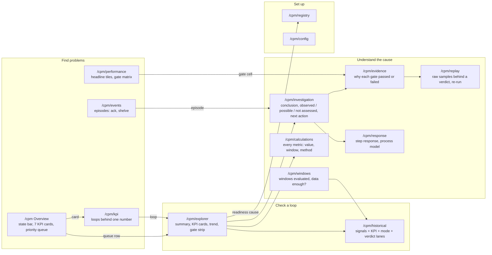

- Context carried between pages: `loop`, `site`, `area`, `unit`, and the window kind (`?window=` 12h / 24h; `?kind=` on Historical / Replay / Evidence). Plant-wide pages open on the whole plant from the menu.
- Proof chain: tile (count, rule, window, computed at) → drill-down list (each loop's deciding value vs threshold) → the loop's evidence (Calculations row with formula and history, Window Inspector for the window, trend with the window marked).
- Vocabulary: one band per result everywhere (`bandOf`): Confirmed red; Suspected / Classified / Detected amber; NO_CALL "No fault identified". Changes in pp. "Not measured — reason" never beside a green gate; green only where it means acceptable control.
- Availability words per metric (first match): excluded window → N/A; insufficient → Insufficient data; missing → Not calculated; stiction disqualified → Not scored; period ≤ 0 → Not calculated; owning gate without verdict → Not calculated.
- Evidence reconstruction is stored beside the original (run identity, config, versions), never over it (CHG-099).

## 12.1 User journeys

Roles: **Operator / shift engineer** (find and follow problems), **Control engineer** (check a loop, understand the cause, act), **Commissioning engineer** (set up loops and thresholds), **Admin / SuperAdmin** (pipeline health, governance). Pages in each diagram are the real routes; the arrow text is the action the user takes.

### J0 — Whole application, by task

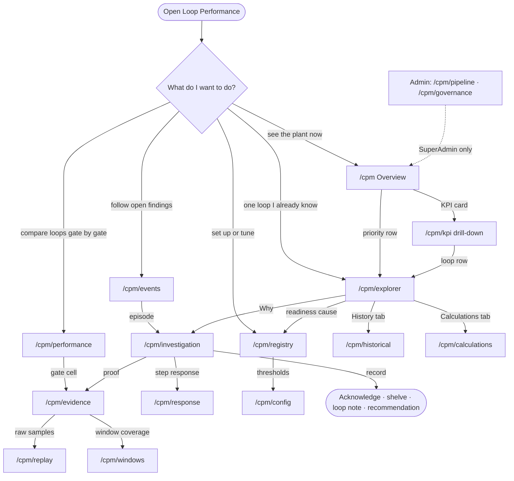

### J1 — Shift start: what needs attention (Operator)

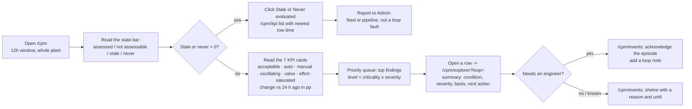

### J2 — Verify one KPI number (Operator, SME audit)

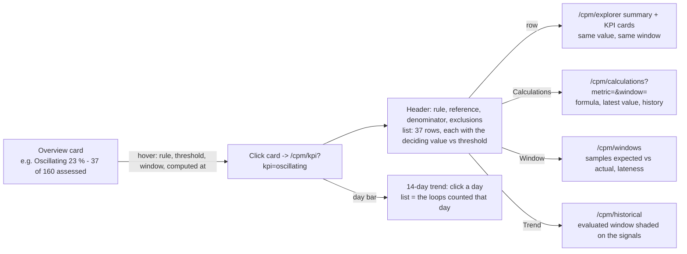

### J3 — Investigate a finding to a cause (Control engineer)

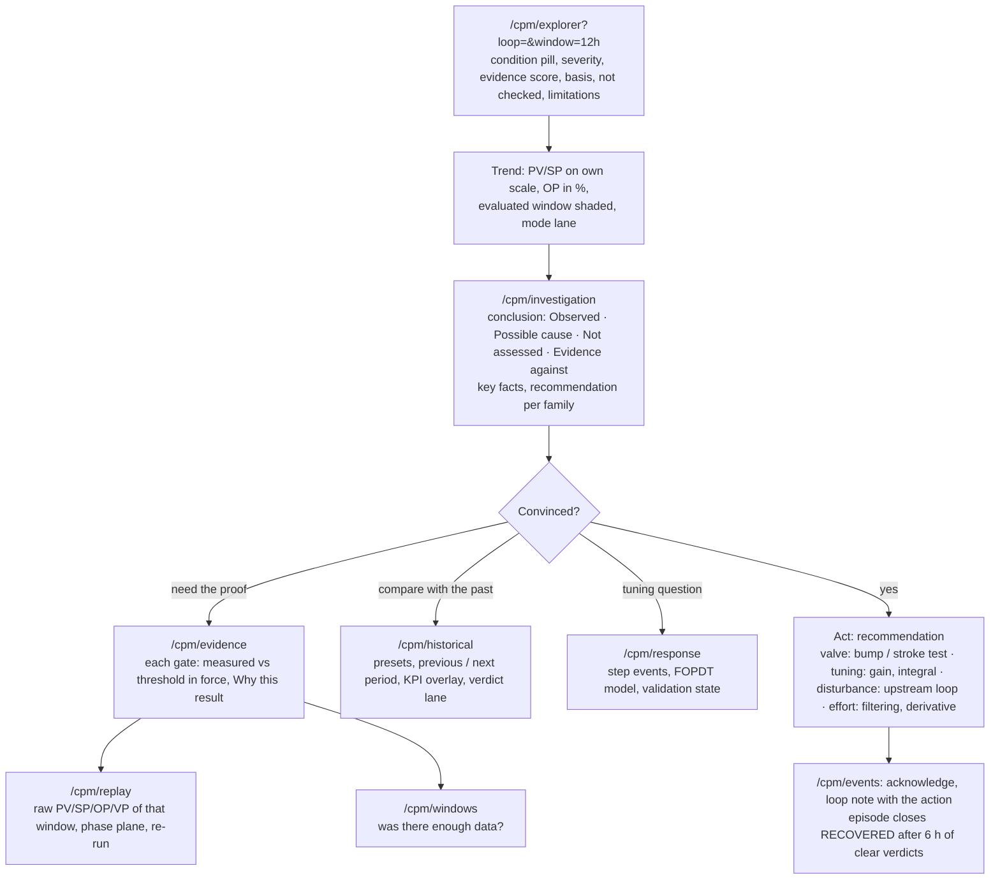

### J4 — Episode lifecycle as the user sees it

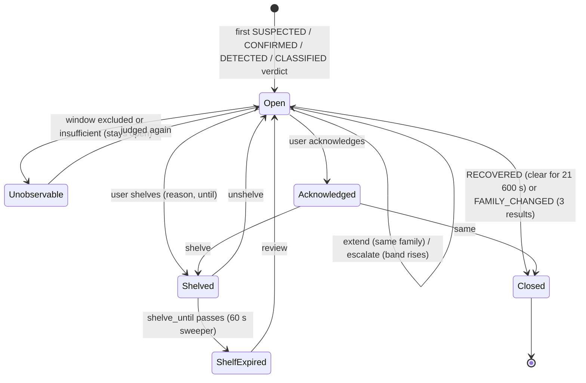

Tabs on `/cpm/events`: All · Open · Unobservable · Unacknowledged · Acknowledged · Shelved · Shelf expired · Closed; triage order = open first, highest peak score, newest. Shelving never changes the engine verdict; a shelved finding leaves the priority queue only.

### J5 — Onboard a loop (Commissioning engineer)

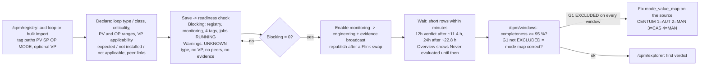

### J6 — Tune gate thresholds (Commissioning engineer + approver)

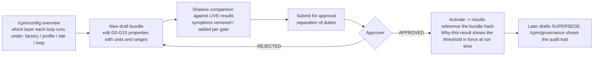

### J7 — Step test and process model (Control engineer)

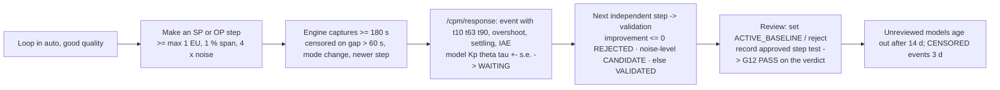

### J8 — Data problem, not a loop problem (Operator -> Admin)

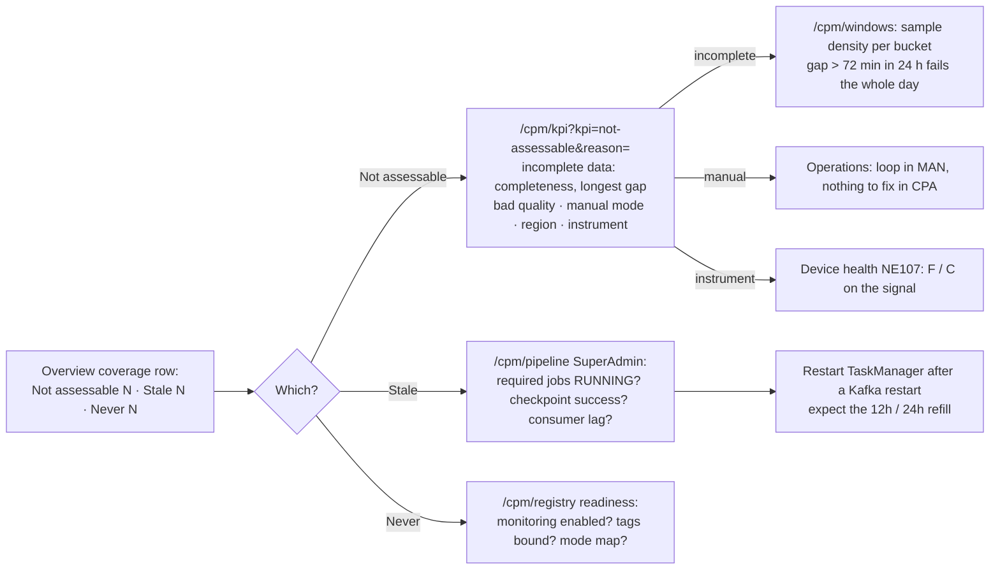

### J9 — Take the evidence out (Control engineer, auditor)

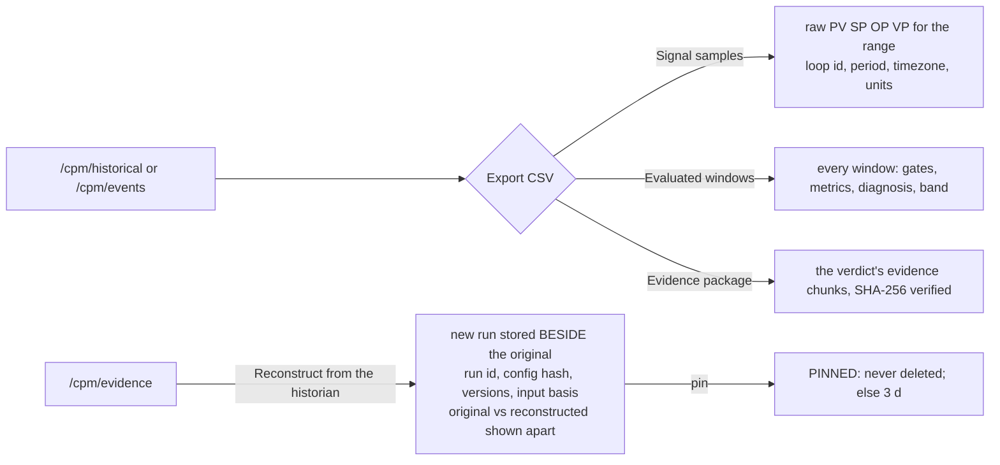

## 13. Alarm KPIs (AMS, `AlarmKpiStreamJob`)

| KPI | Formula | Window | Thresholds |
|---|---|---|---|
| Alarm rate | count of lifecycle events with state ACTIVE | 10 min sliding, every 1 min | > 10 MINOR_FLOOD, > 20 MAJOR_FLOOD, > 50 SEVERE_FLOOD (fixed) |
| Standing alarms | +1 on ACTIVE, −1 on CLEARED (floored at 0) | running | — (global counter, approximate after restarts) |

## 14. Points for SME verification (known limitations, none change a stored value)

1. Persistence "2 of 3" spans 45 min of a sliding window, not three independent windows.
2. G5 is WARN whenever any ACF period exists, even out of band; validity (band, regularity) only gates G7 / G9 / fusion.
3. G12 on the verdict is a registry flag; captured step responses do not feed the diagnosis.
4. Fixed in code, not on Gate Configuration: G0 0.98 / 0.50, G1 0.90, G2r 0.05 / 0.20, G6 0.5, G9 0.30, G11 60 s / 10 %, G13 xcorr 0.5, bands 0.35 / 0.55 / 0.75 / 0.90, caps 0.89 / 0.54.
5. `travel_per_day` on a 1m window is a 1440× extrapolation (reversals/h 60×); `completeness` is unclamped and measured against its own median Δt.
6. ACTUATOR_LIMIT and SENSOR are never the leading cause; no final-element fault can be CONFIRMED without a measured VP (design decision).
7. `mode_value_map` must map every DCS enum (incl. CAS); an unmapped value excludes every window of every loop on G1 while G0 still passes.
8. Numeric OPC `quality` is ignored by ingestion (string only).
9. Live RBE has no heartbeat: a steady loop emits once; after an edge restart live tiles stay empty until a value moves > 0.05 EU.
10. The fusion job reads VP applicability (CHG-088) but not peer applicability; a disturbance cause reads NOT_ASSESSED on loops without links.
11. Historical replay writes gate results only (no short / long feature rows) and never touches episodes.
12. Every Flink restart without saved state costs ≈ 23 h of 24h verdicts (≈ 11.4 h of 12h verdicts).

## 15. Source index

| Topic | Files |
|---|---|
| Ingestion | `src/services/ingestion-service/Pipeline/` (OtTopicParser, OtPayloadParser, LoopParameterMapper, LoopJoiner) |
| Short KPIs, G0–G4, windows | `src/flink/.../cplm/engine/ShortFeatureCalculator.java`, `cplm/ShortWindowSpecs.java`, `CplmGateEngine.java` |
| Long diagnostics G5–G11, G13 | `.../cplm/engine/LongDiagnosticsCalculator.java`, OscillationMath, WelchPsd, ShapeMath, VpTrackingMath, InteractionGate |
| Fusion G12–G15 | `.../cplm/CplmGateFusionEngine.java`, `fusion/DiagnosisBands.java`, `fusion/Hypothesis.java`, `fusion/VerdictAssembly.java`, `fusion/Recommendations.java`, `fusion/Confirmation.java` |
| Defaults | `resources/cplm/loop-dynamics-profiles.yaml`, `resources/cplm/gate-config/factory-layer.json`, `CplmLoopDynamicsProfile.java` |
| G12 response | `.../cplm/response/*` |
| Instrument health | `.../cplm/health/*` |
| Conditions | `.../cplm/condition/CplmConditionStreamJob.java` |
| Episodes | `src/services/cplm-api/Services/EventFrameLifecycle.cs`, `BackgroundServices/CplmEventFrameService.cs` |
| Fleet KPIs | `src/services/cplm-api/Services/Kpi/FleetKpiClassifier.cs`, `FleetKpiModels.cs`, `FleetKpiPerformance.cs`, `Data/FleetKpiSql.cs`, `Data/FleetPrioritySql.cs`, `Controllers/CpmFleetKpiController.cs` |
| Tests | `tests/cplm-api.Tests/FleetKpi*Tests.cs`, `KpiConsistencyTests.cs`; Flink `BandAndRecommendationTest`, `HypothesisStatesTest`, `VpApplicabilityTest`, `CplmFormulaContractTest` |
| Display rules | `src/frontend-ob/src/components/Cpm/vocabulary.ts`, `gateStatus.ts`, `metricAvailability.ts`, `calcCatalogue.ts`, `kpi/loopKpiView.ts`; navigation `components/nav/cpmTasks.ts` |
| Alarm KPIs | `src/flink/.../AlarmKpiStreamJob.java` |
