# Current state: CPLM, analysis and the closest analogs of a KPI catalog and issue ledger

Read-only analysis of the control-loop performance domain (`cplm-api` + the CLPM Flink outputs it consumes), `analysis-service` and `notification-service`, written 2026-09-30 against branch `feat/v25-next-release` (HEAD 6344ce9b). Everything below was verified in code, SQL or config unless marked **(inferred)**. Where a document disagrees with the code, the code is stated and the disagreement noted.

## 1. Scope and sources examined

| Area | Files read (all under `d:/HMI_Project_Usama/AMS-open/`) |
|---|---|
| cplm-api | every `.cs` under `src/services/cplm-api/` (Program, 18 controllers, 10 background services, Config/*, Data/*, Services/*, Registry/*), `appsettings.json`, `Config/property-catalogue.json` (165 entries), `execution-plan.installed.json`, `unsupported-in-build.json` |
| Schema | `database/scripts/29,30,32,34,42,44,52,53,54,55,56,57,58,59,60,61` (traverse_cplm), `14,23` (traverse_analysis), `39_timescale_policies.sql` |
| Other services | all of `src/services/analysis-service/`, all of `src/services/notification-service/` |
| Docs | `docs/cpm-gate-reference.md`, `docs/cpm-calculation-reference.md`, `docs/cpa-event-shelving.md`, `docs/cplm-consumer-cutover-runbook.md`, `audit.md`, `gate_evidence_workbench-proposed.md`, `prod_decision.md`, `checklist.md`, `changes_tracker.md` (CHG-010/023/024/030/032/033) |
| Frontend (endpoints only) | `src/frontend-ob/src/api/cpm/*`, `hooks/useCpm.ts`, `hooks/useLoopLive.ts`, `components/Cpm/**` poll settings |
| Flink (payload shape only) | `src/flink/.../cplm/CplmGateResultFields.java`, `condition/ConditionEvent.java`, topic constants |

Not examined: Flink job internals (another agent), ams-api, ingestion-service.

## 2. How it works today

### 2.0 The CPLM flow (service view)

```
OT MQTT -> ingestion-service (joiner: pv/sp/op/[vp]/mode tuple on a grid)
   -> Kafka traverse.cpa.loop.samples.v1
   -> Flink: Short Feature (G0-G4, 1m tumbling + 5 sliding)  -> traverse.cpa.clpm.feature.short.v1
            Long Diagnostics (G5-G11, 4h/12h/24h rolling)   -> traverse.cpa.clpm.feature.long.v1
            Gate Fusion (G12-G15, fires on 12h/24h only)    -> traverse.cpa.clpm.gate.results.v1
            Condition Engine (fast G10/G11 dwell/freeze)    -> traverse.cpa.clpm.condition.v1
            Response Engine (G12 event-keyed)               -> traverse.cpa.clpm.response.results.v1
            all engines: evidence manifests + chunks        -> traverse.cpa.clpm.gate.evidence.v1
            Instrument Context (NE107 -> eligibility)       -> traverse.cpa.context.instrument-health.v1
            Loop Live RBE                                   -> traverse.cpa.live.loop.metrics -> Sparkplug/EMQX
   -> cplm-api consumers (ONE member per group), traverse_cplm (Postgres, no Timescale at the plant):
        results   -> analytics.cplm_{gate,short_feature,long_feature}_results (+ IoTDB KPI dual-write)
        frames    -> analytics.cplm_event_frames (episodes) + cplm_episode_capture
        evidence  -> analytics.evidence_manifest / evidence_chunk
        conditions-> analytics.condition_event ; response -> analytics.response_event/metric/system_model
        config ack-> cpm.config_worker_ack / config_worker_capability
   <- cplm-api control plane: cplm.loop.evidence/engineering/model on traverse.cpa.ams.metadata.updates,
      signed gate-config bundles on traverse.cpa.context.gate-config.v1 (compacted)
   -> REST /api/v1/cpm/* via the gateway (:8081) -> React (react-query polling; live values via MQTT only)
```
Topics: `src/services/cplm-api/CplmOptions.cs:7-23`; consumers registered in `Program.cs:143-168`.

### 2.1 Loop / asset model (traverse_cplm, schema `cpm`)

- **`cpm.loop_registry`** (`database/scripts/32_cpm_loop_registry.sql:18-48`): PK `loop_id VARCHAR(64)`; `asset_id UUID` is a **soft reference** to `traverse_assets.assets.assets(id)` (different database, no FK, `:19-22`); `site NOT NULL`, `area`, `unit` denormalised strings; `loop_type` CHECK in `FIC,PIC,PIC_GAS,PIC_VAPOUR,LIC,TIC,UNKNOWN`; `criticality`; `monitoring JSONB {"enabled"}` (drives whether Flink evaluates it); `tags JSONB {pv,sp,op,vp,mode}` = denormalised UNS paths; `engineering JSONB`; unique `lower(loop_id)` (`:55`). v2.5 adds five explicit dimensions `service_family, dynamic_class, objective_type, topology, command_path` + `acquisition JSONB` + `classification_source PRESET_FROM_LOOP_TYPE|EXPLICIT` (`57_cpm_loop_model_dimensions.sql:10-24`).
- **`cpm.loop_tag_map`** (`32:67-79`): normalised source of truth `(loop_id, signal_role, uns_path)` with roles `PV,SP,OP,VP,MODE,STATUS,QUALITY,UPSTREAM,UTILITY`. Signal roles are CPM-only; Traverse has no signal-role concept on a tag (`:62-65`).
- **`cpm.loop_link`** (`32:142-153`): loop-to-loop `PEER|UPSTREAM_OF|DOWNSTREAM_OF|CASCADE_PRIMARY|CASCADE_SECONDARY`, `origin asset-graph|manual`; projected from asset-model `GET /assets/{id}/relationships?direction=both` (`Services/Registry/CpmLoopRegistryService.Projection.cs:27-103`). A read failure projects nothing rather than inventing links (`:47-54`).
- **Signal-asset projection ("Option C")** (`Registry/CpmLoopRegistryService.SignalAssets.cs`): for each of `PV,SP,OP,VP,MODE` (`:33`) cplm-api creates or overrides one UNS asset (type 5 Measurement, template `CpmLoopSignal`) whose transport overrides point at where the loop pipeline actually writes: `ioTDbPathOverride = <LoopRootPrefix>.<SafeNode(loopId)>.<role>` and Sparkplug `device = loopId sanitised [A-Za-z0-9_-]` (`:42-43, :168-184`); a loop Device node (type 4, template `CpmLoop`) is created when all mapped paths share one prefix (`:88-104, :209-217`). The ledger `cpm.loop_signal_asset` (`44_cpm_signal_asset_ledger.sql:16-24`) records `created_by_projection` so unmap deletes only what the projection created. Two sanitisers exist for the two planes (`:35-43`).
- **Control-plane broadcast**: activation/republish produces `{calcInstanceId: loopId, parameters:[cplm.loop.evidence {hasPeerLinks, hasStepTest, peers}, cplm.loop.engineering, cplm.loop.model]}` keyed by `loopId` to `traverse.cpa.ams.metadata.updates` (`Registry/CpmLoopRegistryService.Evidence.cs:95-125`, topic `Services/CpmLoopRegistryService.cs:445`).
- **Instrument context** (`54_cpm_instrument_bindings.sql`): effective-dated primary device per signal role with a DB-enforced no-overlap constraint (`:25-49`), NE107 observation ledger (`:53-79`), device health intervals (`:81-99`), `cpm.loop_health_context` eligibility `ELIGIBLE|LIMITED|INELIGIBLE|UNKNOWN|NOT_CONFIGURED` (`:101-119`).
- Legacy tables `cpm.threshold_profile`, `cpm.loop_group(_member)`, `cpm.loop_tag_catalog` (`32:86-134`) exist but no cplm-api code reads them (grep: only `threshold_profile_id` column is carried).
- Onboarding contract served by `GET /api/v1/cpm/registry-contract` (`Controllers/CpmLoopsController.cs:296-326`).

### 2.2 KPI catalog

**Where KPIs are defined: in Java, not in a table or bundle.** The formulas live in the Flink engine (`docs/cpm-calculation-reference.md` §1-§4 is the extracted as-implemented reference; e.g. `err = SP − PV`, `MAE/RMSE` per-sample, `IAE/ISE/ITAE` zero-order-hold, `effortRatio = std(op)/std(pv)`, ACF/FFT period, triangularity, Horch oddness, phase geometry, saturation occupancy, freeze index). cplm-api holds only hand-maintained mirrors: `Services/WindowCatalog.cs:7-13` ("a hand-maintained mirror of the job sources, not something the jobs publish") and `Services/GateCatalog.cs:25-95` (17 gates with method id + version, e.g. `G5.ACF_OSCILLATION 3.0.0`, `G6.WELCH_PSD 1.0.0`, `G15.FUSION 3.0.0`).

| Tier | Windows (`WindowCatalog.cs:25-40`) | Metrics stored as columns | Table / partition |
|---|---|---|---|
| short (G0-G4, G2r) | `1m` **tumbling** (30 s lateness); `5m/1m`, `10m/2m`, `15m/5m`, `30m/5m`, `60m/5m` **sliding** | `iae, ise, mae, rmse, good_error_pct, effort_ratio, travel_per_day, reversals_per_hour, auto_pct, completeness` (`30_cplm_analytics_schema.sql:92-112`) | `analytics.cplm_short_feature_results`, key `(loop_id, window_kind, window_end, source, bundle_hash)` (`53:103-104`) |
| long (G5-G11) | `4h/12h/24h` rolling buffer, 15-min event-time cadence, min 32 samples | `acf_period_s, acf_regularity, effort_ratio, triangularity, horch_oddness, corner_score, travel_per_day, reversals_per_hour, harmonic_amplitude_ratio, harmonic_energy_ratio` (`30:139-159`) | `analytics.cplm_long_feature_results` |
| fusion (G12-G15) | fires on `12h`/`24h` only (`WindowCatalog.cs:43`) | above + `diagnosis, severity, confidence`; the 17 gate statuses, `observations/hypotheses/leading_hypothesis/confirmation`, flags, ~120 keys live **only in `payload JSONB`** (`30:59-62`) | `analytics.cplm_gate_results` |

- Only `1m` is tumbling; the other five short kinds overlap (`audit.md:11`; served honestly as `overlapping` in `GET /resolutions`, `WindowCatalog.cs:66`). Summing across sliding kinds double-counts.
- Run identity on every result row (`53_cplm_v25_identity_evidence.sql:73-85`): `method_run_ids {gate: uuid}`, `bundle_hash` (config the row was computed under, `legacy` pre-v2.5), `context_revision`, `result_revision`, `purpose LIVE|REPLAY|SHADOW|EVIDENCE_RECONSTRUCTION`, `analysis_run_id`, `source_commit`, `jar_sha256`, `dataset_hash`. A different bundle is a **new row**, not an overwrite (`:97-106`).
- Persistence is verbatim: the consumer copies JSON fields into columns and stores the whole message (`BackgroundServices/CplmResultConsumerService.cs:217-258`, guard `EXCLUDED.sample_count >= existing` `:257`); it never derives a KPI (`docs/cpm-calculation-reference.md` §8). A parallel IoTDB series `root.<site>.cpm.<loop>.kpi.<family>` is dual-written at `window_end` (`:382-412`) and, per `audit.md` B-3, has no reader.
- `kpis-latest`: `GET /loops/{id}/kpis/latest?resolutions=1m,5m,...&limit=12` answers several kinds in one request using the same SQL as `GET /loops/{id}/kpis` (`Data/KpiSql.cs`, `Data/KpiReads.cs:16-34`, `Controllers/CpmAnalyticsController.cs:150-175`, CHG-024). `/kpis` has a keyset cursor `before=window_end` (`:127-133`). Short-window gate statuses are projected from the payload (`KpiSql.cs:63-75`).
- Retention. Lab: Timescale hypertables on `window_end`, 7-day chunks, compress after 30 d, retention short 365 d / long 730 d / gate 730 d (`39_timescale_policies.sql:144-172`). **Plant: no Timescale**; v2.6 turns the three tables into daily RANGE partitions dropped by `FeaturePartitions` (`Services/FeaturePartitions.cs:10-28, 46-59`) with `retention_policy` rows `SHORT_FEATURES 3 d, LONG_FEATURES 30 d, GATE_RESULTS 30 d (14 if the headroom rule fires)` (`prod_decision.md:39-41`).
- The 165-property **gate configuration catalogue** (`Config/property-catalogue.json`, hash `8bbcbbbb…`) governs evaluator *parameters* per gate (100 POLICY, 65 STATE_BOUNDARY), not KPI definitions; `Config/execution-plan.installed.json` fixes gate-to-horizon assignments (`scheduler_mode FIXED_COMPILED`). 

### 2.3 Gates and configuration bundles

- A **gate** is one evaluator with a status vocabulary (`docs/cpm-gate-reference.md` §1): G0 data quality `PASS/WARN/FAIL`, G1 mode `PASS/WARN/EXCLUDED`, G2 SP stability, G2r region, G3 error, G4 effort `PASS/WARN/STRONG`, G5-G11 long-tier diagnostics, G12 response, G13 interaction, G14 fault-scoped confirmation, G15 decision. Roles: BLOCKING (G0, G1, G11), ELIGIBILITY (G2, G2r), PERFORMANCE (G3, G4), PRIMARY/SUPPORTING (G5-G10, G13), CONFIRMATION (G14), FUSION (G15) (`GateCatalog.cs:27-94`). Blocking order and per-class thresholds (pack 2.0.0): `cpm-gate-reference.md` §5-§6.
- **Bundles** (`58_cpm_config_governance.sql:9-34`): immutable once past DRAFT, scope `SITE|PROFILE|LOOP|REGIME`, `layers jsonb [{kind, ref, ordinal, content, content_hash}]`, `resolved jsonb {properties, sources, execution_plan}`, `content_hash` = SHA-256 of RFC 8785 canonical JSON, `change_class POLICY|STATE_BOUNDARY|DEPLOYMENT`, 13 states. Approvals bind to the content hash (`:49-59`); deployments carry the required worker matrix and every PREPARE/APPLY ACK (`:62-95`); `cpm.config_active` is one row per `(site, scope_kind, scope_ref)` (`:97-106`); `cpm.config_worker_capability` is what each running job announced (`:109-120`).
- **Effective resolution**: deterministic merge `FACTORY -> SITE -> exactly one PROFILE -> LOOP -> exactly one REGIME`; absent inherits, `RESET_TO_INHERITED` removes an override, explicit null is refused, an unset catalogue property is `NO_VALUE` (`Config/EffectiveConfigResolver.cs:9-18, 63-94`). The profile is derived from `loop_type` (`Services/Config/ConfigStore.cs:35-39`, e.g. `FIC -> FLOW_FAST_SELF_REG`). The FACTORY and PROFILE layers are the jar's exported `factory-layer.json` (`Services/Config/FactoryLayers.cs:8-11`). Active bundle for a loop = most specific of `LOOP > PROFILE > SITE` (`ConfigStore.cs:61-70`; fleet form `Services/Config/EffectiveSummary.cs:25-28`); with no active bundle the engine runs the factory layer (`Controllers/CpmConfigurationController.cs:71-79`).
- **Lifecycle**: draft (`ConfigStore.cs:105-139`) -> PATCH with `If-Match` etag, value validated at edit time (`:144-188`) -> validate (`:191-216`, report stored on the bundle) -> optional SHADOW analysis run (`CpmConfigurationController.cs:215-240`) -> approve by an independent reviewer, self-approval refused, `ControlAuthority` role for site-wide/objective changes (`ConfigStore.cs:219-233`) -> deploy: `SCHEDULED -> PREPARE broadcast -> PREPARED -> APPLY -> PROBING -> ACTIVE_VERIFIED` when a result carrying the hash appears (or the probe window passes), previous bundle `SUPERSEDED`; any NACK or mixed jars -> `ACTIVATION_FAILED`; rollback = new deployment of the previous bundle (`Services/Config/ConfigDeploymentService.cs:39-44, 137-231, 234-247`). Change class is promoted through the catalogue dependency graph (`Config/PropertyCatalogue.cs:70-83`).
- **How gates reach Flink**: an HMAC-SHA256-signed envelope (service key) on `traverse.cpa.context.gate-config.v1`, keyed by `bundle_id` so compaction keeps the latest phase (`Services/Config/BundleEnvelope.cs:9-14, 38-46`); every result then pins `bundle_hash`. Properties the build does not read are still stored but flagged `NOT_READ_BY_BUILD` (`Config/unsupported-in-build.json`; e.g. every `G*.mode` and `G*.role`).
- **JSONB traps**: gate statuses, flags, verdict v2 and versions are only in `cplm_gate_results.payload` (`30:59-62`); short-tier gate statuses were invisible to the API until `audit.md` Phase A (`audit.md` B-1, now `KpiSql.cs:63-68`); `/calculations` reads engine versions from the payload of the newest row (`Data/GateReadSql.cs:71-80`).

### 2.4 Events, episodes and evidence

**Fast conditions** (`analytics.condition_event`, `53:24-45`): PK `(loop_id, gate, kind, start_ms)`, `kind LIMIT_LOW|LIMIT_HIGH|FREEZE`, `state OPEN|UPDATE|CLOSED`, `close_reason PV_MOVED|LEFT_LIMIT|SOURCE_GAP`, `evidence JSONB` (`ConditionEvent.java:25-38`); upsert never regresses CLOSED (`Services/ConditionEventStore.cs:78-96`).

**Episodes** = `analytics.cplm_event_frames` (`34_cplm_event_frames.sql:19-52`, extended by `53:53-59`, `60:31-55`, `61:17-19`): one row per `(loop_id, window_kind, family)` while open (partial unique index `34:57-59`), with `opened_at, closed_at, peak_diagnosis, peak_confidence, last_*, severity, window_count, availability_state OBSERVED|UNOBSERVABLE, condition_state OPEN|CLOSED, qualified_support_ms, support_until, result_revision, close_reason, calculation_version, dynamics_profile_version, ack_state, acked_by/at, note, shelf_state NONE|SHELVED|EXPIRED, shelved_by/at, shelve_until, shelve_reason, capture_count`. The lifecycle is a pure function (`Services/EventFrameLifecycle.cs:96-140`):

```mermaid
stateDiagram-v2
  [*] --> OPEN : fault verdict (family = diagnosis minus DETECTED_/CLASSIFIED_/SUSPECTED_/CONFIRMED_)
  OPEN --> OPEN : Extend (same family; support union, peak ratchets)
  OPEN --> OPEN : Escalate (severity band rose LOW<MEDIUM<HIGH)  -> capture
  OPEN --> OPEN_UNOBSERVABLE : EXCLUDED_* / INSUFFICIENT_DATA (availability=UNOBSERVABLE, condition stays OPEN)
  OPEN_UNOBSERVABLE --> OPEN : next evaluable result
  OPEN --> OPEN : Observe (clear verdict but support < recovery_support_s)
  OPEN --> CLOSED : Close RECOVERED (clear verdict with enough qualified support) -> capture
  OPEN --> CLOSED : FAMILY_CHANGED (closes, opens the new family) -> capture
  note right of OPEN : operator axes, independent of each other -\n ack UNACKNOWLEDGED|ACKNOWLEDGED ;\n shelf NONE|SHELVED|EXPIRED (sweeper flips to EXPIRED once a minute)
```



- Non-LIVE purposes and non-`flink` sources never touch the timeline (`BackgroundServices/CplmEventFrameService.cs:128-133`). Overlapping windows add only non-overlapping support (`EventFrameLifecycle.cs:157-183`).
- **Mutability**: the frame row is UPDATEd in place (`CplmEventFrameService.cs:267-281`); it is not append-only. Append-only companions: `analytics.cplm_event_actions` (`ACKNOWLEDGED|SHELVED|SHELVE_UPDATED|UNSHELVED|SHELVE_EXPIRED`, actor/at/until/reason, `60:58-67`, written in the same transaction as the frame `Services/EventActionStore.cs:32-82`) and `analytics.cplm_episode_capture (episode_id, method_run_id, kind OPEN|ESCALATE|CLOSE)` (`61:23-29`). Timescale deliberately excludes the frames table (`39:21-23`).
- **Shelving** (CHG-032): reason >= 3 chars, `until` within `Cplm:Shelving:MaxHours` 168 (`Services/EventShelvingRules.cs:31-56`); acknowledge clears an EXPIRED shelf and keeps an active one (`EventActionStore.cs:65-82`); `GET /events?includeShelved=false` hides active shelves only (`Controllers/CpmEventsController.cs:85-87`); sweeper `UPDATE ... RETURNING` every 60 s (`BackgroundServices/CplmShelfExpirySweeper.cs:31-56`).
- **Severity model**: `severity LOW|MEDIUM|HIGH` comes from the fused verdict band (`cpm-gate-reference.md` §4 G15: `<0.35 NO_CALL LOW`, `<0.55 DETECTED LOW`, `<0.75 CLASSIFIED MEDIUM`, `<0.90 SUSPECTED HIGH`, `>=0.90 + VP CONFIRMED HIGH`); `BandRank` (`EventFrameLifecycle.cs:93-94`). Only one fault family exists in the bands today (`FINAL_ELEMENT_NONLINEARITY`; catalogue lists four families `CpmEventsController.cs:177-183`).
- **Evidence classes and retention** (CHG-033): every live artifact is inserted `TRANSIENT` (`Services/EvidenceBlobStore.cs:109-116`) and deleted after `Cplm:EvidenceTransientHours` (6) or above `Cplm:EvidenceTransientBudgetBytes` (2 GiB); an episode transition promotes the verdict's `method_run_ids` manifests to `EPISODE` (kept `retention_policy.EPISODE` = 90 d **after the episode closed**, never while open; `Services/EpisodeCaptureStore.cs:27-49`, `Services/EvidenceRetentionTiers.cs:66-71`); `STANDARD` = reconstructions/replays (`retention_policy` days, 3 d at the plant); `PINNED` = investigation references, never expired (`56_cplm_investigation_refs.sql:9-22`, `outcome WORK_COMPLETED|PERFORMANCE_RESTORED|INCONCLUSIVE`). OPEN+ESCALATE captures cap at `Cplm:EpisodeCaptureMax` 3; CLOSE always captures (`CplmEventFrameService.cs:45-47`).
- **How evidence references raw data**: not by IoTDB path or time range. An artifact is the array itself: `analytics.evidence_manifest` (`53:150-190`: `method_run_id, gate_id, artifact_kind, role_or_path, x/y quantity+unit, encoding f64le+gzip, chunk_count, sha256, chunk_sha256[], readiness PENDING|COMPLETE|FAILED|EXPIRED, provenance JSONB, retention_class, pinned`) plus `analytics.evidence_chunk(evidence_id, chunk_no, payload bytea)`; a reconciler links `gate_result_id` afterwards (`BackgroundServices/CplmEvidenceConsumerService.cs:156-166`). Site scope is derived through `provenance->>'loop_id'` joined to the registry (`Controllers/CpmEvidenceController.cs:61-69`). Bytes are served per chunk with an immutable ETag (`:32-59`) or as one bundle (`Services/EvidenceManifestReader.cs:113-137`). An expired artifact answers `EVIDENCE_EXPIRED, reconstructable: true` and can be rebuilt by an `EVIDENCE_RECONSTRUCTION` run under the original identity (`analytics.analysis_run`, purposes `REPLAY|SHADOW|EVIDENCE_RECONSTRUCTION`, `53:120-146`).
- Frames do not carry a window end, run id, bundle hash or context revision themselves (CHG-030 API gap, `changes_tracker.md:2148-2150`); since CHG-033 the capture table is the only link from an episode to its evidence.

### 2.5 Readiness and data quality

`GET /loops/{id}/readiness` (`Controllers/CpmReadinessController.cs:106-230`) answers "can this loop produce a diagnosis I would act on": blockers = registry row, `monitoring.enabled`, PV/SP/OP/MODE mapped, all CPLM Flink jobs RUNNING; warnings = `loop_type UNKNOWN`, no VP (confidence capped 0.89), no peer links (G13 NOT_EVALUATED), binding provenance not via asset-model (one `POST /resolve/batch`, `:350-360`), no short features / verdicts yet. `ready = no blockers`, `degraded = ready and warnings` (`:222-224`). Job list of 13 required jobs `:45-61`; `/pipeline-status` and `/pipeline-metrics` (`:236-282`).

Coverage/staleness are computed **in Flink and stored, not computed by the service**: G0 `completeness = n / expected` with PASS >= 0.98 / WARN >= 0.95 / FAIL (`cpm-gate-reference.md` §2; column `completeness` `30:108`; plant patch: expected from declared `grid_seconds`, `prod_decision.md:56`), `sufficient_data` in the payload (`KpiSql.cs:54`), `qualified_support_ms` / `recovery_support_s` on the verdict (`CplmGateResultFields.java` fields), `availability_state` on the frame, instrument eligibility per role (`cpm.loop_health_context`), fleet health filters `missing-binding | stale-collection | active-affected` (`Data/FleetLatestSql.cs:71-95`), live staleness `lastSourceTs` vs `lastEmissionTs` (`hooks/useLoopLive.ts:36-42`). Evidence readiness `PENDING|COMPLETE|FAILED|EXPIRED` (`Services/EvidenceAssembly.cs:32-71`). Consumer health `DISABLED_BY_CONFIG|NEVER_STARTED|STALLED|RUNNING` + projection lag on `/health` (`Program.cs:237-258`). There is no single per-metric `GOOD|STALE|UNAVAILABLE` field.

### 2.6 Roll-ups and fleet views

- `GET /fleet/summary|rankings|heatmap` (`Controllers/CpmFleetController.cs:49-267`) are **registry-driven** (LEFT JOIN so unevaluated loops stay visible) and scoped by the registry's denormalised `site/area/unit` (`FleetLatestSql.cs:21-26`). Each loop's "latest" verdict is two index probes (newest real verdict, else newest row) instead of a whole-table `DISTINCT ON` (`FleetLatestSql.cs:34-55`; indexes `52_cplm_fleet_latest_indexes.sql:18-28`, `Data/CplmReadIndexes.cs:28-36`). Summary returns counts (`total, monitored, withPeerLinks, withVp`) and a diagnosis histogram; rankings order server-side by whitelisted `confidence|error|mae|effort` (`:136-150`); heatmap returns 17 gate statuses per loop with `total`/`truncated` (`:214-265`). A 15 s single-flight cache per key (`Data/FleetReadCache.cs`). 
- **There is no loop -> unit -> plant numeric roll-up**: no unit/plant KPI aggregate table, view or job; the Performance page's fleet tiles are client-side statistics over the top-50 ranking (`audit.md:118`). Fleet-wide condition list: `Services/ConditionEventStore.cs:115-126`. Config state per loop in one read: `CpmConfigurationController.cs:97-125`.
- Measured (CHG-023, `changes_tracker.md:1290-1304`): Performance mount 34.8 s -> 0.14-0.18 s; rankings/heatmap HTTP 500 at 30 s -> 57-128 ms; `/calculations` 30 s -> 0.4-0.6 s; `/pipeline-metrics` 8.65 s -> 2.2 s cold / 14-24 ms cached.

### 2.7 notification-service

Two Kafka consumers, no HTTP surface beyond `/`, `/health`, `/metrics` (`Program.cs:35-57`): `traverse.alarm.root-cause-events` (Flink CEP in the alarm job; group `notification-service-group`, offset `Latest`, `Consumers/RootCauseConsumer.cs:26-42`) and `traverse.alarm.lifecycle-alerts` (`TELEMETRY_STALLED`, `ACK_SLA_BREACH`; `Consumers/LifecycleAlertConsumer.cs:44-57`, `Models/LifecycleAlert.cs:20-53`). Channels: EMAIL (SMTP via MailKit, no TLS/auth configured, `Providers/EmailProvider.cs:42-46`) and TEAMS adaptive card webhook (`Providers/TeamsWebhookProvider.cs`). **Policies, subscriptions and schedules are mocked in code**: one hard-coded policy `Critical Operations Team -> ops-lead@plant.local` (`Orchestrator/NotificationOrchestrator.cs:162-178`), shift check only tests day-of-week (`:150-160`); templates are inline HTML (`:121-148`); DLQ is a comment (`:62`, `RootCauseConsumer.cs:71`). It consumes nothing from CPLM: episodes, conditions and config events raise no notification. Deployed in compose (`infra/docker/docker-compose.yml:1263`).

### 2.8 analysis-service

Definition store + Flink dispatcher (`Program.cs`): CRUD `/analyses` (`:112-248`), `POST /analyses/{id}/execute` reads each input's current value from the Redis snapshot and publishes `traverse.analysis.executions` (`:256-310`, `CalcPayload :538-611`), status callback `PUT /analyses/executions/{id}/status` (`:355-377`), draft/published/archived versions (`:384-436`, `23_analysis_calc_versions.sql`), enable/disable commands on `traverse.analysis.commands` (`:512-529`). `Consumers/AnalysisResultConsumer.cs` consumes `traverse.analysis.results`, marks the execution, writes a Redis snapshot and registers the derived measurement in asset-model (`:72-136`). Types advertised: `rollup`, `threshold` (hi-hi/hi/lo/lo-lo/deadband/minDuration, `Models/Analysis.cs:196-220`), `rate_of_change`, `expression` (`:443-507`) — but only `expression`/Calculation is executed by `AnalysisExecutionJob` (`:491-497`); a non-calculation result comes back `skipped` (`AnalysisResultConsumer.cs:90-92`). Executions are a Timescale hypertable with 180 d retention on the lab (`39:111-118`). Live status: compose service (`docker-compose.yml:1340`), gateway route `/api/analyses` (`docs/api-gateway.md:35`), the Flink job is in the required list (`CpmReadinessController.cs:58`); **no frontend file calls `/api/analyses`** (grep of `src/frontend-ob/src`), so from the UI it is dormant **(inferred)**. `CpmEventsController.cs:109-112` explicitly cites its catalogue-without-executor pattern as an anti-pattern. It satisfies the Flink-only rule (compute delegated) but is a separate, simpler lineage from CPLM with no shared KPI/gate model.

### 2.9 Realtime delivery to the UI

- **REST polling only for CPLM results** — no SignalR or MQTT path from cplm-api (`audit.md:105`; the broadcast was deferred, `CplmResultConsumerService.cs:40-41`). react-query cadences: events and conditions 30 s (`hooks/useCpm.ts:88-97`, `components/Cpm/events/useConditions.ts:6-11`), fleet reads 60 s (`useCpm.ts:168,192,201`) behind the 15 s server cache, instrument health 30 s, deployments/analysis runs 5 s while in flight (`config/useConfig.ts:57-64`, `useCpm.ts:419`), evidence manifests polled until COMPLETE then immutable (`evidence/useEvidence.ts:17-37`), trend windows tick 60 s (`components/Cpm/shared.tsx:76-90`).
- **Live PV/SP/OP/VP/MODE** arrive by MQTT Sparkplug (`LoopLiveRbeJob -> traverse.cpa.live.loop.metrics -> sparkplug-edge-node -> EMQX /mqtt-ws`, `hooks/useLoopLive.ts:1-12`); deadband 0.05 EU, no heartbeat (`cpm-calculation-reference.md` §5).
- **Latency expectations**: short features ~2-3 min behind wall clock (watermark 2 min; sample idleness 30 min at the plant, `prod_decision.md:55`); long tier recomputed every 15 min; a verdict/episode needs a completed 12 h slice (`WindowCatalog.cs:72`); fast conditions within the dwell time (`BackgroundServices/CplmConditionConsumerService.cs:11-14`); config activation waits for ACKs and a pinned result (probe window 5 min default, `ConfigDeploymentService.cs:64-65`).

## 3. Code map

| Concern | file:line | Note |
|---|---|---|
| Service bootstrap, consumer switches, /health | `src/services/cplm-api/Program.cs:143-168, 222-285` | `Cplm:ConsumersEnabled` gates 8 hosted consumers; sweeper always on |
| Topics / group id | `src/services/cplm-api/CplmOptions.cs:7-23` | `traverse-cpa-cplm-results`; groups derive `-frames`, `-conditions`, `…-evidence` |
| Loop registry schema | `database/scripts/32_cpm_loop_registry.sql:18-153`, `57_...:10-24` | loop_id PK, soft asset_id, tags/monitoring JSONB, links |
| Signal-asset projection | `src/services/cplm-api/Services/Registry/CpmLoopRegistryService.SignalAssets.cs:33-296` | Option C; ledger `cpm.loop_signal_asset` |
| Link projection / broadcast | `…/Registry/CpmLoopRegistryService.Projection.cs:27-103`, `…Evidence.cs:95-125` | asset graph -> `cpm.loop_link`; `cplm.loop.*` parameters |
| Result tables + latest views | `database/scripts/30_cplm_analytics_schema.sql:34-176` | typed columns + payload JSONB |
| Identity, runs, evidence tables | `database/scripts/53_cplm_v25_identity_evidence.sql:24-203` | method_run_ids, bundle_hash, analysis_run, evidence_manifest/chunk, retention_policy |
| Result consumer + upsert | `…/BackgroundServices/CplmResultConsumerService.cs:120-258, 382-412` | at-least-once, poison-pill guard, IoTDB dual write |
| KPI reads | `…/Data/KpiSql.cs:11-82`, `…/Data/KpiReads.cs:16-34`, `…/Controllers/CpmAnalyticsController.cs:40-184` | gates/latest, gates history, kpis, kpis/latest, resolutions |
| Window / gate catalogues | `…/Services/WindowCatalog.cs:25-79`, `…/Services/GateCatalog.cs:25-107` | hand-maintained mirrors of the jar |
| Property catalogue / resolver / change class | `…/Config/PropertyCatalogue.cs:70-83`, `…/Config/EffectiveConfigResolver.cs:18-98`, `…/Config/ChangeClassifier.cs` | 165 properties, layer precedence |
| Bundle store / deployment / envelope | `…/Services/Config/ConfigStore.cs:35-233`, `…/ConfigDeploymentService.cs:39-247`, `…/BundleEnvelope.cs:9-46` | governance state machines, HMAC-signed publish |
| Config API | `…/Controllers/CpmConfigurationController.cs:45-260`, `CpmConfigDeploymentsController.cs` | catalogue, effective(/summary), drafts, validate, shadow, approve |
| Episode lifecycle | `…/Services/EventFrameLifecycle.cs:74-183`, `…/BackgroundServices/CplmEventFrameService.cs:123-281` | pure transitions; capture in the same tx |
| Shelving / actions | `…/Services/EventShelvingRules.cs:31-64`, `…/Services/EventActionStore.cs:32-124`, `…/Controllers/CpmEventActionsController.cs:40-107`, `…/BackgroundServices/CplmShelfExpirySweeper.cs` | ack, shelve, unshelve, history, expiry |
| Episode capture / evidence retention | `…/Services/EpisodeCaptureStore.cs:27-58`, `…/Services/EvidenceRetentionSweeper.cs:11-94`, `…/Services/EvidenceRetentionTiers.cs:20-120`, `…/Services/EvidenceBlobStore.cs:109-116` | TRANSIENT/EPISODE/STANDARD/PINNED |
| Evidence consumer / assembly / reads | `…/BackgroundServices/CplmEvidenceConsumerService.cs:88-166`, `…/Services/EvidenceAssembly.cs:32-71`, `…/Services/EvidenceManifestReader.cs:51-137`, `…/Controllers/CpmEvidenceController.cs:32-59` | manifest+chunks, sha verification, bundle framing |
| Conditions | `database/scripts/53…:24-45`, `…/Services/ConditionEventStore.cs:18-126`, `…/BackgroundServices/CplmConditionConsumerService.cs` | fast G10/G11 |
| Readiness / pipeline | `…/Controllers/CpmReadinessController.cs:45-61, 106-282` | 13 required jobs; blockers vs warnings |
| Fleet reads + cache + indexes | `…/Controllers/CpmFleetController.cs:49-267`, `…/Data/FleetLatestSql.cs:21-174`, `…/Data/FleetReadCache.cs`, `…/Data/CplmReadIndexes.cs:28-36` | CHG-023 |
| Partition maintenance (plant) | `…/Services/FeaturePartitions.cs:23-105`, `…/BackgroundServices/FeaturePartitionMaintenance.cs` | daily RANGE partitions, retention_policy rows |
| Single-member enforcement | `…/Services/SingleMemberGuard.cs:6-92` | split -> CRITICAL log + /health Degraded |
| Investigations, models, response, context | `…/Controllers/CpmInvestigationsController.cs`, `CpmModelsController.cs`, `CpmResponseController.cs`, `CpmContextController.cs`; `database/scripts/55,56,54` | pinned evidence refs; G12 event-keyed tables; bindings |
| Audit emission | `…/Services/CplmAuditEmitter.cs:24-81` | fire-and-forget to `traverse.cpa.audit-events` |
| notification-service | `src/services/notification-service/Program.cs:35-57`, `Orchestrator/NotificationOrchestrator.cs:23-178`, `Consumers/*.cs` | mocked policies; two alarm-side topics |
| analysis-service | `src/services/analysis-service/Program.cs:112-529`, `Consumers/AnalysisResultConsumer.cs:43-136`, `Models/Analysis.cs:91-289`, `database/scripts/14,23` | definitions + Flink dispatch; only expression executes |
| Lab retention (Timescale) | `database/scripts/39_timescale_policies.sql:93-172` | lab-only; plant uses partitions |
| Production settings of record | `prod_decision.md:31-74` | retention, engine, performance values at Marun |

## 4. Constraints, settled decisions and traps

1. **CPLM lives in cplm-api** (extraction complete; `Cpm__EnableMutations` and `Cplm__ConsumersEnabled` both `true` in compose, `docker-compose.yml:1408-1413`). ams-api keeps only `RawLoopIotDbConsumer` (`docs/cplm-consumer-cutover-runbook.md:136-137`).
2. **Exactly one member per consumer group**; a second member silently halves persistence. Code default group is `traverse-cpa-cplm-results` (`CplmOptions.cs:23`, confirmed live in `audit.md:66`); the runbook still names `ams-api-cplm-results` (`cplm-consumer-cutover-runbook.md:7-8`) — the doc is stale, trust the code/compose. Static membership `-sole` (`CplmResultConsumerService.cs:78`), 24 partitions (8+8+8), `SingleMemberGuard` surfaces a split on `/health` rather than crashing (`SingleMemberGuard.cs:23-25`).
3. **Flink-only compute**: cplm-api never derives a KPI or gate (`cpm-calculation-reference.md` §8-§9); analysis-service delegates too. The service-side "catalogues" are mirrors that can drift (`WindowCatalog.cs:7-13`); the v2.5 CAPABILITY records (`cpm.config_worker_capability`) are the only job-published truth.
4. **Replays never rewrite the operational timeline** (`CplmEventFrameService.cs:128-133`); a different bundle is a new result row (`53:97-106`).
5. **JSONB is where the interesting state is**: the 17 gate statuses, hypotheses, flags and versions are payload-only; any new consumer must parse `payload` (see `Data/GateMatrixProjection.cs`).
6. **Latest-verdict ordering trap**: `window_end DESC`, never `created_at` (a replay bumps `created_at`; `30:79-89, 125-130`); the self-healed `cplm_gate_latest` view and the controllers still order differently (CHG-023 deferred note, `changes_tracker.md:1329-1331`).
7. **Poison pills**: a record without a usable `windowEndMs` is skipped loudly, not retried (`CplmResultConsumerService.cs:191-200`); before that guard one message wedged all three streams (`audit.md` B-5).
8. **Retention is per environment**: lab = Timescale (`39_timescale_policies.sql`), plant = daily partitions + `retention_policy` rows; self-heal DDL creates tables and indexes but never a hypertable or a policy row (`audit.md` B-6; `CplmEventFrameService.cs:369-370`). Plant values: short 3 d, long 30 d, gate 30/14 d, TRANSIENT 6 h / 2 GiB, EPISODE 90 d after close, STANDARD 3 d (`prod_decision.md:35-41`).
9. **Evidence volume** was the v2.5 outage: ~1.4 GB/h at the plant filled a 96 GB shared disk in three hours (`changes_tracker.md:2320-2325`); the fix is class-based retention, not shorter retention (`gate_evidence_workbench-proposed.md:16-30`).
10. **Episodes are keyed by `window_kind`**, so one physical problem can have a 12 h and a 24 h episode; the proposal explicitly warns against letting a short window close a long-window episode (`gate_evidence_workbench-proposed.md:134-139`); fusion fires on 12 h/24 h only.
11. **Only 1 m is tumbling**; never sum across sliding kinds (`audit.md:11`).
12. Loop ids are case-insensitive everywhere (`lower(loop_id)` indexes, `42_cplm_event_frames_indexes.sql:4-9`).
13. **Auth is edge-only**: cplm-api authorises from gateway-injected claims; policies `analytics.view`, `cpm.manage`, `cpm.config.*`, `cpm.analysis.create`, `cpm.model.review`, `cpm.context.manage` (`59_cpm_v25_permissions.sql:13-24`).
14. Performance facts to preserve after any schema change: the three gate-result indexes and per-loop LATERAL probes (`prod_decision.md:70`), `created_at` indexes for the evidence reconciler (`:72`), 15 s fleet cache.
15. Frontend rules that shaped the API: no eager fetches, immutable evidence cached forever, background polls must not extend the idle-session clock (`components/Cpm/shared.tsx:70-74`).

## 5. Mapping to the Truss living-asset pitch

| Pitch concept | What exists today | Status | Notes / gap |
|---|---|---|---|
| Canonical configuration system (Truss) | UNS asset model in `traverse_assets` (signals, hierarchy), loop registry in `traverse_cplm` (soft `asset_id`), governed gate-config bundles with hash-bound approvals and worker ACKs | PARTIAL | Two sources of truth (assets vs loops) reconciled by projection jobs, not a graph; nothing models equipment/unit/plant entities as evaluable objects |
| KPI definition record {id, name, unit, time basis, scope entity, target, drill policy, formula} | Formulas compiled in Java (`cpm-calculation-reference.md`); `GateCatalog`/`WindowCatalog` are static C# mirrors; 165-property catalogue governs evaluator parameters with `id, gate, property, type, unit, default, validation, change_class, consumers, dependencies, effect` | PARTIAL | No KPI catalogue with target, scope entity or drill policy; time basis is engine windows (1 m…24 h), no shift/day/month basis; units live in catalogue rows and `response_metric.unit`, not on KPI rows |
| Assessments / condition evaluators parameterised by config (threshold, target deviation, variance, stagnation, limit breach) | G3 (target deviation band), G4/G5/G6 (effort/oscillation), G11 freeze = stagnation, G10 limit dwell = limit breach, G0 quality; thresholds per class via FACTORY→SITE→PROFILE→LOOP→REGIME bundles; analysis-service `ThresholdConfig` model with no executor | PARTIAL | Evaluators are loop-specific Java; `G*.mode/role` are `NOT_READ_BY_BUILD`; no generic evaluator that takes an arbitrary metric + entity |
| CEP patterns | `CplmConditionStreamJob` (dwell/freeze state machine OPEN/UPDATE/CLOSED); Flink CEP root-cause in the alarm job feeding notification-service | PARTIAL | Patterns are compiled, not configured; CPLM conditions are two kinds only |
| Issue record {issue_id, entity_id, type, start_time, status, severity, description, evidence_refs[], context_rev} append-only | `cplm_event_frames` {id, loop_id, family, opened_at/closed_at, condition_state, availability_state, severity LOW/MEDIUM/HIGH, peak/last diagnosis+confidence, ack/shelf axes, calculation_version, result_revision}; `cplm_event_actions` (append-only operator history); `cplm_episode_capture` (evidence links by method_run_id) | PARTIAL | `entity_id` is `loop_id` only; row is mutable (UPDATE in place), not append-only; no `description`; no `context_rev`/`bundle_hash` on the frame (only on result rows); evidence refs are an outboard table; keyed by `window_kind` (one issue can be two rows) |
| Evidence linking to raw readings / alarms / APM findings | Evidence = stored arrays per method run (manifest + chunks, sha-verified, class-retained); condition rows carry `evidence JSONB`; investigations pin manifest ids; instrument health lanes join by device binding | PARTIAL | References are to CPLM's own artifacts, not to IoTDB paths/time ranges, alarm ids or external findings; no cross-domain reference type |
| Provenance per field (source, timestamp, definition_id, context_revision) | Per result row: `method_run_ids{gate}`, `bundle_hash`, `context_revision`, `result_revision`, `purpose`, `source_commit`, `jar_sha256`, `dataset_hash`; per manifest: `provenance JSONB`; frames: `calculation_version`, `dynamics_profile_version` | PARTIAL | Provenance is per row/run, not per field; frames carry version labels only |
| Issues published to `traverse/runtime/issue/{id}` | Frames exist only as DB rows read by polling; governance/operator actions go to `traverse.cpa.audit-events` (fire-and-forget) | MISSING | No issue topic, no push (no SignalR/MQTT from cplm-api) |
| "Top Exceptions" per plant/unit | `GET /fleet/rankings` (bad actors by confidence/error/mae/effort, scoped site/area/unit, health filters), `GET /events?sort=triage`, fleet conditions list | PARTIAL | Loop-only; ranking limited to gate verdicts at 12 h/24 h; no exception list over equipment/unit KPIs |
| Roll-ups child→parent with explicit non-overlapping contribution rules | Counts and histograms per scope (`fleet/summary`); no aggregation table/job; sliding windows overlap | MISSING | Any roll-up must pick non-overlapping windows (1 m tumbling or window-day partitions); nothing does today |
| Per-metric quality GOOD/STALE/UNAVAILABLE and dataQuality {coverage, status} | G0 `completeness` + status, `sufficient_data`, `qualified_support_ms`, `availability_state OBSERVED/UNOBSERVABLE`, instrument eligibility, live `lastSourceTs`/`lastEmissionTs`, readiness `ready/degraded`, evidence readiness | PARTIAL | Rich but scattered and loop/window-scoped; no uniform per-metric quality envelope |
| Living object state per entity maintained by Flink | Flink keyed state per loop (rolling buffer, condition state, broadcast bundle state); service-side `FrameState`; Redis snapshot per metric for the live plane | PARTIAL | State is per loop and per job; no per-entity "object" exposed as one record |
| Entity generality (equipment, unit, plant) | `loop_id VARCHAR` everywhere; `site/area/unit` are string columns on the registry; UNS hierarchy lives in asset-model | MISSING | Every table, index, endpoint and Flink key is loop-scoped |
| Notifications on issues | notification-service consumes only alarm root-cause and lifecycle alerts; policies mocked | MISSING (for CPLM) | No subscriptions, templates or CPLM triggers |
| Config governance (versioning, approval, activation, rollback, provenance) | Bundles: immutable content hash, independent approval, ACK matrix, probe-verified activation, rollback, catalogue hash matching on every worker | EXISTS | Strongest existing analog of "config as canonical, versioned, deployed"; loop/gate-specific scope model |

## 6. Open questions

1. Should the episode row become append-only (issue + revisions) or stay a mutable head with `cplm_event_actions`/`cplm_episode_capture` as the append-only tail? The pitch's "only status/severity update" is close to today's Extend/Escalate but the frame also mutates peak/last/support fields.
2. Which stream is the "diagnostic decision stream" for an issue — the 24 h fused verdict, 12 h, or a parent issue over both `window_kind` rows (`gate_evidence_workbench-proposed.md:134-139`)? Today two rows can describe one fault.
3. Can KPI definitions leave Java? The property catalogue already carries id/unit/validation/consumers; extending it to KPI rows (formula id, time basis, target, scope) would need the jar to publish what it computes (the CAPABILITY record pattern) rather than a hand mirror.
4. Entity model: does `cpm.loop_registry` become one entity type in a graph (Truss) with `asset_id` hard-linked, or does the UNS hierarchy (`site/area/unit/device`) become the issue's `entity_id` space? The soft cross-database reference is the current constraint.
5. Evidence references across domains: alarms (`ams` database), instrument health (`cpm.*`), CPLM artifacts (`analytics.evidence_*`) have no common reference type or id space; who owns retention for a cross-domain ledger?
6. Push transport: is an issue topic (Kafka) enough, or does the UI need SignalR/MQTT for issues as it has for alarms? cplm-api deliberately has none.
7. Roll-up basis at the plant: with short features kept 3 days and gate results 14-30 days, any unit/plant KPI must be materialised as it happens (Flink) or it cannot be recomputed later.
8. Retention budget for an issue ledger: `prod_decision.md` sizes the disk from CPLM rates; an append-only ledger with revisions per evaluation (633 k evaluations/day cited in the proposal, `gate_evidence_workbench-proposed.md:28-30`) needs its own byte budget.
9. notification-service: rebuild (policies in a database, CPLM/issue triggers) or retire in favour of the pitch's issue topic?
10. analysis-service: retire, or reuse its definition/version model as the KPI definition store? It has no UI caller today and executes only expressions.
