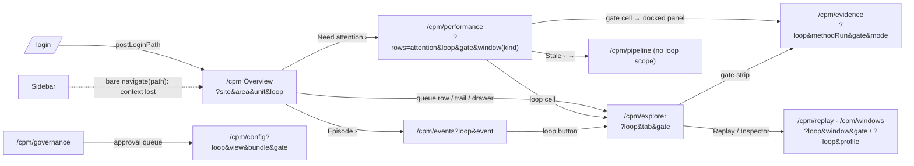

# Current state: UI routes, dashboards, roles/personas and navigation context

Read-only analysis of the frontend (`src/frontend-ob`), the Node auth-service and the gateway as they exist on
branch `feat/v25-next-release` (2026-09-30). Every claim cites `path:line`; anything not verified in code is marked
"(inferred)". Where a doc and the code disagree, the code is trusted and the disagreement is named.

## 1. Scope and sources examined

- Router, shell, guards: `src/frontend-ob/src/App.tsx` (991 lines), `productSlice.ts` (the CPA slice flag).
- Stores: `store/authStore.ts`, `store/alarmStore.ts` (SignalR), `store/mqttStore.ts` (Sparkplug B), `store/timeStore.ts`
  (display-runtime time window), `store/liveMetric.ts`.
- CPM pages and helpers: `components/Cpm/*` (Overview, Performance, Explorer, Investigation, Events, Historical,
  Windows, Replay, Calculations, Registry, Pipeline, Governance), `evidence/`, `response/`, `config/`, `cpaHref.ts`,
  `plantScope.tsx`, `plantLocation.tsx`, `shared.tsx`, `hooks/useCpm.ts`, `api/cpmApi.ts`, `api/cpm/*`.
- CAMS pages: `components/Dashboard/Dashboard.tsx`, `Analytics/Analytics.tsx`, `AlarmConsole/`, `LiveEvents/`, `Soe/`,
  `HistoricalViewer/`, `IoTDBTrend/`, `EdgeNodeMonitor/`; Designer launch/runtime only: `Designer/DisplayLauncher.tsx`,
  `DisplayViewer.tsx`, `TrendPage.tsx`; `Administration/*`; `shared/ConnectivityBanner.tsx`, `api/apiHealth.ts`.
- Auth: `src/services/auth-service/src/services/auth.service.ts`, `rbac/permission-catalog.ts`,
  `src/services/gateway/Program.cs` + `appsettings.json` (route map), `src/services/_shared/TraverseAuth.cs`,
  `database/scripts/17_traverse_auth_schema.sql`, `33_cpm_permissions.sql`, `37_rbac_catalog.sql`,
  `47_ingestion_permissions.sql`, `59_cpm_v25_permissions.sql`, `13_personal_views_schema.sql`, `docs/auth-jwt-contract.md`.
- Docs: `openbridge-agent-rules.md`, `conversion.md`, `docs/cpa-ui-fix-plan.md`, `docs/cpa-application-flow-audit.md`,
  `docs/frontend-audit.md`, `docs/ui-pages-review-checklist.md`, `changes_tracker.md` (CHG-030, Gate Configuration
  redesign), `HMI-GAP-REMEDIATION-PLAN.md`, `MIGRATION_LOG.md`; pitch: `unified/Executive Summary.md`,
  `unified/Architecture for Living-Asset Runtime and Plant Manager Dashboard.md`.
- Stack (package.json): React 18.3, react-router-dom 6.23, @tanstack/react-query 5.40, zustand 4.5, @microsoft/signalr 8,
  mqtt 5.15, echarts 5.5 + echarts-for-react, d3 7.9, ag-grid 31.3, @oicl/openbridge-webcomponents(-react) 1.0.1, Vite 5.

## 2. How it works today

### 2.1 The product that is actually shipped: the "CPA slice"

`productSlice.ts:6` sets `CPA_SLICE_ONLY = true` and `HOME_PATH = '/cpm'` (`:8`). Only the paths in `SLICE_NAV`
(`:10-29`: the 15 `/cpm/*` pages, `/trend`, `/admin`) appear in the nav; the CAMS alarm pages and the HMI Designer
routes stay in the bundle but redirect to `/cpm` (`App.tsx:439-448, 468-470, 476`). The alarm hub is not even
initialised on the slice (`App.tsx:288-293`). The top bar brands the app "Traverse CPA / Lean Automation"
(`App.tsx:551-552`). The admin hub shows only `SLICE_ADMIN_TABS` (`productSlice.ts:31-39`). Everything below
therefore has two tiers: what a plant user sees today (CPM + admin + trend) and what is dormant behind the flag.

### 2.2 Route inventory

Guards: `RequireAuth` (`App.tsx:914-925`) redirects to `/login` carrying `state.from`; `RequirePermission`
(`App.tsx:934-965`) checks `user.permissions` and lands on `/cpm` or a "Not authorized" panel. `S` = redirected to
`/cpm` while the slice flag is on. Endpoints go through the gateway (`gateway/appsettings.json:65-184`).

| Path | Component (file:line) | Purpose | Data sources | Guard |
|---|---|---|---|---|
| `/login` | `Login/Login.tsx` (`App.tsx:338`) | sign-in, redirect via `postLoginPath` (`productSlice.ts:52-60`) | `POST /api/auth/login`, `/refresh`, `GET /me` (`api/authApi.ts:21-58`) | public |
| `/` , `*` | `App.tsx:434, 479` | redirect to `HOME_PATH` | - | auth |
| `/cpm` | `Cpm/CpmOverview.tsx:29` (`App.tsx:451`) | operations overview: KPI row, priority queue, loop focus, top finding, event trail | `GET /api/v1/cpm/fleet/summary`, `fleet/rankings` (60 s), `events?sort=recent` (60 s), `hist/trend` for the focus panel, MQTT loop topic | `analytics.view` |
| `/cpm/performance` | `Cpm/CpmPerformance.tsx:63` (`:452`) | fleet gate roll-up + gate matrix + docked evidence + attention list | `fleet/summary`, `fleet/rankings`, `fleet/heatmap` (60 s), `resolutions` | `analytics.view` |
| `/cpm/explorer` | `Cpm/CpmExplorer.tsx:30` (`:453`) | loop hub: rail + Summary/Signals/Calculations/Relationships/History tabs (`explorer/LoopWorkspace.tsx:34`) | `/loops`, `loops/{id}/gates/latest`, `readiness`, `events` (30 s on History) | `analytics.view` |
| `/cpm/calculations` | `Cpm/CpmCalculations.tsx` (`:454`) | per-loop metric catalogue | `/calculations`, `kpis`, `gates/latest` | `analytics.view` |
| `/cpm/historical` | `Cpm/CpmHistorical.tsx` (`:455`) | one-axis signals + KPI + mode + verdict | `hist/trend`, `mode-track`, `kpis-range`, `gate-history`, `instrument-health` | `analytics.view` |
| `/cpm/windows` | `Cpm/CpmWindows.tsx` (`:456`) | emitted-window inspector | `kpis` paged, `pipeline` metrics (20 s) | `analytics.view` |
| `/cpm/replay` | `Cpm/CpmReplay.tsx` (`:457`) | evidence replay + recompute | raw slice, `gate-history`, `kpis-range`, `POST analysis-runs` (poll 5 s) | `analytics.view` |
| `/cpm/evidence` | `Cpm/evidence/GateEvidenceWorkspace.tsx:34` (`:458`) | immutable method-run workbench (17 gate views) | `method-runs/{id}`, `.../evidence`, `.../evidence/bundle`, `gate-catalogue` | `analytics.view` |
| `/cpm/response` | `Cpm/response/ResponseWorkspace.tsx` (`:459`) | system-response events + models | `loops/{id}/response-events`, `response-events/{id}`, `models` | `analytics.view` |
| `/cpm/config` | `Cpm/config/GateConfigurationWorkspace.tsx:43` (`:461`) | governed gate configuration: overview, Effective / Bundles / Editor | `configuration/effective(/summary)`, `drafts`, `catalogue`, `deployments` | `cpm.config.read` (+ per-action keys `:56-61`) |
| `/cpm/investigation` | `Cpm/CpmInvestigation.tsx:47` (`:462`) | case chips, key facts, reasoning chain, hypotheses, window browser | `fleet/rankings` (200), `gates/latest`, `gate-history`, `hist/trend`, `instrument-health` | `analytics.view` |
| `/cpm/pipeline` | `Cpm/CpmPipeline.tsx` (`:463`) | Flink/Kafka runtime health (nav group "System") | `pipeline-status` (15 s), metrics proxy | `analytics.view` |
| `/cpm/governance` | `Cpm/CpmGovernance.tsx` (`:464`) | audit stream, role matrix, approval queue | `/api/audit` (30 s), `/api/auth` roles (needs `rbac.manage`, `useRoleMatrix.ts:1-13`) | `analytics.view` |
| `/cpm/registry` | `Cpm/LoopRegistry.tsx` (`:465`) | onboarding wizard + CSV import | `/loops`, `loops/activate`, `bulk-activate`, `/api/assets/filters` cascade | `analytics.view` (writes need `cpm.manage`) |
| `/cpm/events` | `Cpm/CpmEvents.tsx` (`:466`) | episodes: ack / shelve / unshelve / history | `events` (30 s), `conditions`, `events/{id}/actions` | `analytics.view` |
| `/trend` | `Designer/TrendPage.tsx:26` (`:474`) | deep-linkable tag trend `?tags=&range=` or `?from=&to=` | `/api/hist/trend`, `/api/hist/series` | `historian.view` |
| `/admin/*` | `Administration/Administration.tsx:48` (`:478`) | hub with tabs users, roles, data-sources, plant-model, aliases, audit, system (`:34-46`) | `/api/auth/users|roles`, `/api/ingestion`, `/api/assets`, `/api/aliases`, `/api/audit` | anyOf admin keys; per-tab keys `:130-157` |
| `/dashboard` S | `Dashboard/Dashboard.tsx:23` (`:439`) | CAMS alarm KPI dashboard | SignalR stats, `/api/v1/analytics/kpi` (60 s), MQTT firehose | `alarm.view` |
| `/alarms` S | `AlarmConsole/AlarmConsole.tsx` (`:440`) | AG Grid alarm console; presets `?priority=`, `?unacked=1` (`:89-92`) | alarmStore (SignalR + `/api/v1/alarms/active`) | `alarm.view` |
| `/live-events` S, `/soe` S | `LiveEvents/LiveEventsPage.tsx`, `Soe/SoePanel.tsx` (`:441-442`) | MQTT DDATA stream, SOE buffer | MQTT firehose, SignalR `OnSoeEvent` | `alarm.view` / `soe.view` |
| `/historical` S, `/analytics` S | `HistoricalViewer/`, `Analytics/Analytics.tsx` (`:444, 448`) | alarm history grid; EEMUA/ISA-18.2 KPI page | ams-api history, `/api/v1/analytics/kpi` | `alarm.view` / `analytics.view` |
| `/iotdb-trend` S, `/edge` S | `IoTDBTrend/`, `EdgeNodeMonitor/` (`:446, 476`) | raw series viewer (`?series&alarmId&hours`), edge node monitor | historian-bff, MQTT | `historian.view` |
| `/displays` S | `Designer/DisplayLauncher.tsx` (`:468`) | published-HMI launcher: L1-L4 chips, search, favourites, recents (`:41-46`) | `/api/displays`, `/me/favorites`, `/me/recent` | `display.view` |
| `/designer` S, `/designer/:id` S, `/designer/import` S | `DisplayList`, `DesignerPage`, `ImportPage` (`:470, 376, 354`) | authoring (outside the shell for `:id`) | display-service | `display.edit` |
| `/display/:id` S, `/my-view/:id` S | `Designer/DisplayViewer.tsx:120` (`:394, 411`) | chrome-free runtime; `?asset=`, `?assetRoot=`, `?start=&end=&tz=`, `?kiosk` (`:127-134, 219-220`) | display-service, binding-resolver, MQTT per-screen, `/api/hist/snapshot` | `display.view` |

### 2.3 Layout, navigation and context model

- **Shell** (`App.tsx:494-776`): CSS grid `220px | 1fr | 280px` = sidebar, page, Live Events rail
  (`styles/app.css:38-42`); both side columns collapse and the choice is persisted in `localStorage`
  (`App.tsx:137-163`). Top bar: brand, critical/unacked chip and Live Events toggle (both hidden on the slice
  `:566, :591`), theme switch Day | Bright | Night (`:626`), user name + role + Sign out (`:686-708`).
- **Sidebar** (`App.tsx:779-828` items, `:841-911` component): four groups Operations / Loop Performance /
  Engineering / System; each item carries the same permission as its route (`:786-787`); collapsed groups persist
  (`:833-838`); exactly one active entry (longest matching path, `:860-865`). **Every sidebar click is a bare
  `navigate(item.path)` (`App.tsx:903`)** - scope, loop and window are dropped. The user rule for CHG-030 was
  "sidebar untouched" (`changes_tracker.md:2094-2101`).
- **Command palette** Ctrl/Cmd+K (`components/CommandPalette.tsx:33-56`): nav entries filtered by permission, loops
  (deep link to Explorer), calculations.
- **Context is the URL and only the URL** (`cpaHref.ts:1-16`, `docs/cpa-ui-fix-plan.md:40-46`): plant scope
  `?site&area&unit` via `useCpmScope` (`plantScope.tsx:39-72`, cascade clears children, `replace: true`), loop
  `?loop=`, evaluated window `?window=` (ISO end on Historical/Replay/Windows, but the window *kind* on Performance -
  reader compatibility note `cpaHref.ts:9-15`), `?kind=`, `?gate=`, Explorer `?tab=`, Workbench
  `?methodRun&gate&mode=FIXED|FROZEN|REPLAY|COMPARE` (`evidence/selection.ts:16-38`). Options for the scope come from
  the asset-model `/assets/filters` cascade (`plantLocation.tsx:69-80`). No Zustand store or localStorage holds the
  current loop or scope (`docs/cpa-application-flow-audit.md:66-75`, confirmed: `store/` has none).
- **Push vs replace**: opening a loop is a visit (push); previewing/filtering is `replace` (`CpmOverview.tsx:83-88`,
  `CpmExplorer.tsx:66-71`, `CpmPerformance.tsx:79-81`). Back restores loop/gate/tab - verified in the lab for
  Overview, Performance, Explorer (`docs/cpa-application-flow-audit.md:286`).
- **Time context**: there is no global time store for CPM; each page owns its window params. `store/timeStore.ts` is
  the *display runtime* time window (expressions `*-1h`/`*`, tz, `initFromUrl` `:111-117`) and is seeded from
  `?start&end&tz` only inside `/display/:id` (`DisplayViewer.tsx:219-220`). Trend page uses `?range` or `?from&to`
  (`TrendPage.tsx:37-46`).
- **Deep links**: every CPM page validates `?loop=` case-insensitively and renders an explicit "not in the registry"
  state instead of falling back (`CpmExplorer.tsx:59-64`, `CpmOverview.tsx:53-58`). Login preserves the requested
  URL (`App.tsx:922`, `Login.tsx:40,57`) but the slice only honours `/cpm*`, `/trend*`, `/admin*` (`productSlice.ts:52-60`).
- **Breadcrumbs**: Explorer shows a static plant-location crumb `site › area › unit › loopId` (text, not links,
  `explorer/LoopWorkspace.tsx:87-106`). The display runtime keeps a display trail in `sessionStorage` with clickable
  crumbs and Home/Back/Forward (`DisplayViewer.tsx:90-95, 208, 384-386`). The Designer has an `obc.breadcrumb` symbol
  (`Designer/SymbolRenderer.tsx:630`). There is no journey breadcrumb ("back to origin") anywhere in CPM.

### 2.4 Dashboards inventory

| Dashboard | Widgets | Aggregation & scope | Refresh | Performance evidence |
|---|---|---|---|---|
| **CPM Overview** `/cpm` (`CpmOverview.tsx:90-261`) | 4 `KpiTile` (loops monitored, need attention with action, positioner cap, peers) `:99-121`; priority queue top-6 with `GoodErrorBar` `:138-166`; `LoopFocus` 8 h rolling PV/SP/OP echarts + live signal row (`overview/LoopFocus.tsx:33-38`); highest-confidence finding; event trail (3); `FocusedLoopDrawer` with gate path | fleet counts from `fleet/summary` (server DISTINCT ON, no cap `:72-81`); scope = `PlantScopeFilter` site/area/unit; the "unit" here is a loop registry field, not an asset rollup | react-query 60 s (`hooks/useCpm.ts:168, 192`), events 60 s (`:43`); focus trend re-keys every 60 s (`shared.tsx:89-90`); MQTT per-loop | CHG-030: initial calls 9 → 7, 15 s poll removed (`changes_tracker.md:2107`); audit: 6 mount requests in a 2-deep waterfall (`docs/frontend-audit.md:97`) |
| **CPM Performance** `/cpm/performance` (`CpmPerformance.tsx`) | 4 `KpiTile` (good-error time, median MAE, periodic diagnosis, diagnostic capability) `:245-263`; `GateRollup` bars = fleet-level "where is the fleet failing" (`GateRollup.tsx:1-10`); `GateMatrix` ARIA grid, default filter "Needs attention" (`GateMatrix.tsx:1-15`); `GateEvidencePanel` docked ≥ 1200 px else modal (`:49`); `AttentionList` bad actors; freshness line "Stale · emitted N h ago" after 3 h (`:51, 296-297`) | fleet, filtered by scope + health chips (`:42-46`) + `?rows` + `?fg` gate | 60 s (`useCpm.ts:192, 201`) | 34.8 s → 0.14 s after CHG-023 fleet caching (memory `cpm-fleet-perf-audit-2026-09`); 5 initial calls (`changes_tracker.md:2108`) |
| **Gate Configuration** `/cpm/config` | overview tables "Configuration by loop" + "Bundles in progress" (`config/ConfigOverview.tsx:47, 92`); per loop: `ObcTabRow` Effective / Bundles / Editor (`GateConfigurationWorkspace.tsx:121-136`) | scope + loop; site-level bundle lists | on-demand, 15 s staleTime (`:85`) | Response event 15.3 s → 1.0-2.6 s, config bundle 0.3 s (`docs/next-release/03-acceptance-evidence.md:104-131`) |
| **Investigation** `/cpm/investigation` | case chips, key-fact `KpiTile`s, evidence echarts with box zoom, `ReasoningChain`, `HypothesisPanel`, `WindowBrowser` (`CpmInvestigation.tsx:3-11`) | one loop; fleet rankings (200 cap) for the chips | 60 s | audit: 8 mount requests, 2 wasted (`docs/frontend-audit.md:105`) |
| **Pipeline Health** `/cpm/pipeline` | job states, checkpoint stats, E2E probe, delivery-path strip | platform-wide | 15 s + 20 s + 60 s ≈ 8 req/min (`frontend-audit.md:106`) | - |
| **CAMS Dashboard** `/dashboard` (dormant) | Level 1 four `PrimaryKpi` tiles, clickable to `/alarms?priority=CRITICAL` / `?unacked=1` (`Dashboard.tsx:128-165`); Level 2 `SecondaryKpi`; priority distribution + operator MTTA (client-side `:50-63`); management state; OPC server status; live MQTT stream (`:190-249`); 24 h rate sparkline from analytics (`:30-32`) | plant-wide, no scope filter | SignalR `OnAnalyticsUpdate` push (`alarmStore.ts:538`), analytics 60 s (`hooks/useAlarmAnalytics.ts:59`), MQTT firehose (`:42-48`) | `/alarms/active/statistics` 39 ms warm (`frontend-audit.md:46`) |
| **CAMS Analytics** `/analytics` (dormant) | sections Alarm Load & Shift KPIs, rate vs target 24 h, operator response, nuisance metrics, priority donut, top-10 bad actors, RCA explorer (`Analytics.tsx:95-194`) | plant-wide | 60 s shared query key `['alarmAnalytics']` | audit: "~half the page is fabricated data" (`frontend-audit.md:88`) |
| **Plant model** `/admin/plant-model` | Site → Area → Unit → Device → Measurement tree with search and per-level dialogs (`Administration/PlantModelConfig.tsx:1-10`) | UNS asset model | on demand | - |

There is no SignalR in CPM; every CPM dashboard is HTTP polling (`docs/frontend-audit.md:112`, confirmed: no hub
usage under `components/Cpm`).

### 2.5 Roles and scope model (auth-service)

- **Roles**: four system roles `Admin`, `Engineer`, `Operator`, `Viewer` (`17_traverse_auth_schema.sql:70-75`;
  `permission-catalog.ts:22, 89-94`). `Supervisor` is granted `cpm.config.read/approve` + `cpm.model.review` *only if
  the site created that role* (`59_cpm_v25_permissions.sql:39-42`); the catalog does not define it. Custom roles can be
  created from `/admin/roles` (`RolesConfig.tsx:124, 174`) via the auth-service RBAC API.
- **Permission vocabulary** (~38 keys): alarm.* (7), soe.view, analytics.view, admin.users.edit, admin.audit.view
  (`17:78-90`); cpm.manage, system.manage (`33:13-21`); display/template/asset/binding/historian/analysis keys +
  rbac.manage (`37:27-41`); ingestion.view/manage (`47:17-20`); cpm.analysis.create, cpm.model.review,
  cpm.context.manage, cpm.config.{read,draft,validate,shadow,approve,activate,rollback} (`59:13-24`). Services mirror
  them in `TraverseAuth.cs:34-84` (`Perms`). Role matrix: Viewer = full read; Operator = + ack/shelve/export;
  Engineer = + configuration incl. cpm.manage and the pre-approval config half; Admin = catch-all (`37:43-88`, `59:31-37`).
- **Token and headers**: RS256 access token with `sub`, `preferred_username`, `role`, `permission[]`
  (`auth.service.ts:89-104`; `docs/auth-jwt-contract.md:24-28`); refresh in an httpOnly cookie, rotated per use
  (`authStore.ts:47-51`). The gateway validates, strips client-supplied `X-Auth-*` and injects `X-Auth-Subject /
  -Username / -Role / -Permissions` (`gateway/Program.cs:130-139`); its default policy is "any authenticated user"
  (`:105-110`) - fine-grained checks stay in the services (`TraverseAuth.cs:125-146`). Per-role session idle
  override exists (`auth.service.ts:63-73`, Operator 8 h).
- **UI gating**: `hasPermission` is a plain array lookup (`authStore.ts:274`); routes (`App.tsx:439-478`), nav
  (`:847-852`), admin tabs (`Administration.tsx:53`), command palette (`CommandPalette.tsx:41`) and in-page actions
  (`GateConfigurationWorkspace.tsx:56-61`, Events ack/shelve on `cpm.manage`) all read it.
- **Scope**: the `users` table has no site/plant/unit column (`17:41-51`); nothing in the JWT or `AuthUser`
  (`api/authApi.ts:5-13`) carries a scope. Scope is a URL filter any user may set. There is no persona, no per-role
  home page (`HOME_PATH` is a constant), no default time horizon.

### 2.6 Realtime channels per page

| Channel | Where | Detail |
|---|---|---|
| SignalR `/hubs/alarms` | Dashboard, Alarms, Live Events, SOE, top-bar chip (dormant on the slice) | `alarmStore.ts:470-486` builder + backoff 1/3/10/30 s; handlers `OnNewAlarm, OnAlarmUpdated, OnAlarmCleared, OnBulkAlarmsUpdated, OnAckLifecycleUpdated, OnFloodAlert, OnServerStatusChanged, OnSoeEvent, OnAnalyticsUpdate, OnAlarmKpiUpdate` (`:491-549`); invokes `SubscribeToServer`, `SubscribeToPriority` (`:720, 725`); on reconnect re-hydrates from REST and re-subscribes (`:557-566`); 30 s REST polling fallback while the hub is down (`App.tsx:295-301`) |
| MQTT over `/mqtt-ws` (Sparkplug B) | Display runtime, Loop focus / Explorer live row, Live Events, Dashboard, Edge monitor | `mqttStore.ts:25` URL; NBIRTH/DBIRTH always (`:286-287`); plant-wide firehose `spBv1.0/+/DDATA/+/#` ref-counted (`:50, 424-428`); per-screen exact topics ref-counted (`:373-420`); per-loop topic `spBv1.0/<group>/DDATA/<edge>/<loopId>` (`hooks/useLoopLive.ts:59-64`); reconnect 2 s with token refresh and re-subscribe (`:273, 306-317`); snapshot seed from `/api/hist/snapshot` (`:45`, micro-batched `:220-225`) |
| Polling | all CPM pages | react-query intervals: fleet 60 s, events 30 s, pipeline 15 s, replay 5 s while running (`hooks/useCpm.ts`); `staleTime` 30 s default (`App.tsx:176-183`), `refetchOnWindowFocus: false` |
| Stale / offline handling | global | `ConnectivityBanner` states offline / unreachable / degraded once, with "Values on screen are the last ones received, not current" and a single Retry (`shared/ConnectivityBanner.tsx:16-54`); classification in `api/apiHealth.ts:58-78` (4xx never raises it). Performance freshness line (`CpmPerformance.tsx:172-176, 296`); verdict age line (`Cpm/verdictAge.ts:20-30`); live staleness computed from `sourceTs`, never from emission or receipt time (`store/liveMetric.ts:1-11`, `useLoopLive.ts:33-39`). No per-widget generic "stale" badge component. |

### 2.7 Reusable building blocks

| Block | file:line | Note |
|---|---|---|
| `KpiTile` (caption / value / sub / tone / action) | `Cpm/shared.tsx:312-325`; tones `styles/cpm.css:84-90` | tones map to `--alert-running/caution/alarm-color`; **no sparkline** |
| `WorkspaceHeader`, `PanelHead`, `TonePill`, `KvRow`, `EmptyState`, `QueryError`, `toneFor`, `cpmChartColors`, `useRollingWindow` | `Cpm/shared.tsx:328, 345, 301, 382, 393, 414, 239, 42, 75` | the CPM page vocabulary; `QueryError` is the K1 pattern (`docs/ui-pages-review-checklist.md:19`) |
| `PrimaryKpi` / `SecondaryKpi` (clickable, status bar) | `Dashboard/Dashboard.tsx:451, 548` | local to the file, not exported |
| `PlantScopeFilter` + `useCpmScope` | `Cpm/plantScope.tsx:39, 80` | site/area/unit cascade in the URL |
| `LoopCombobox`, `LoopTree` | `Cpm/LoopCombobox.tsx`, `Cpm/explorer/LoopTree.tsx` | ARIA combobox; loop rail |
| `GateRollup`, `GateMatrix`, `AttentionList`, `GateEvidencePanel` | `Cpm/GateRollup.tsx`, `GateMatrix.tsx`, `AttentionList.tsx`, `GateEvidencePanel.tsx` | fleet bar → filtered grid → docked detail; keyboard grid |
| Trend charts | `overview/LoopFocus.tsx`, `historical/chartOption.ts`, `Designer/TrendCore.tsx` + `trend/TrendTimeBar.tsx` (LIVE/PAUSED/HISTORICAL) | echarts; shared box zoom `components/charts/{boxZoom,useBoxZoom,ChartZoomBar}` |
| Time-range pickers | `historical/RangeToolbar.tsx`, `trend/TrendTimeBar.tsx`, `store/timeStore.ts` | three different implementations, none shared across CPM pages |
| Evidence timeline pieces | `Cpm/events/EventHistory.tsx` (episode action history), `evidence/{VerdictCard,GateChipStrip,HistorianLanes,SignalContextLanes,EvidenceArtifactRenderer}.tsx`, `investigation/ReasoningChain.tsx` | immutable run + operator actions |
| Health | `Cpm/health/TransmitterHealthPanel.tsx`, `HealthLane.tsx` | NAMUR NE107 flags, "not configured ≠ OK" |
| Asset tree / search | `Administration/PlantModelConfig.tsx`, `hooks/useAssetSearch.ts` (POST `/assets/search`), `hooks/useAssetMetadata.ts` | UNS-addressed |
| Grids | AG Grid + `styles/ag-theme-openbridge.css` (alarms, history), `GateMatrix` | - |
| Designer symbols | `Designer/Sparkline.tsx`, `SymbolRenderer.tsx:630 (obc.breadcrumb), :977 (chart.sparkline)` | live ring-buffer sparkline exists only as an HMI symbol |
| Dynamic layouts | HMI displays (JSON snapshots, DOM/SVG designer), Personal Views (`13_personal_views_schema.sql`, `/my-view/:id`), launcher L1-L4 (`DisplayLauncher.tsx:41-46`) | config-only (CQRS); bound to tags via binding-resolver, not to KPI semantics |

### 2.8 Drill-down patterns and where context is lost

Implemented: KPI tile → filtered list (`Dashboard.tsx:137-153` → `AlarmConsole.tsx:89-96`; `CpmOverview.tsx:110` →
`performanceHref({rows:'attention'})`); roll-up bar → matrix filter `?fg=` (`CpmPerformance.tsx:83-89`); matrix loop
cell → Explorer Summary (`:102-104`); gate cell → docked panel → Workbench (immutable run), Replay, Window Inspector,
Calculations (`GateEvidencePanel.tsx:173-190`); Explorer gate strip → lazy detail → Workbench; event trail →
episode (`CpmOverview.tsx:241`); Governance queue → config editor (`GateConfigurationWorkspace.tsx:30-41`); display
symbol link → target display with asset context, root and time expressions (`DisplayViewer.tsx:181-205`).

Lost: sidebar and palette navigation drop scope/loop/window (`App.tsx:903`); Pipeline Health has no loop scope
(`cpaHref.ts:67-68`); an episode cannot open its evaluated window or run (event frames carry no run id -
`changes_tracker.md:2140-2142`); rows without `method_run_id` cannot open the Workbench; the CPM time window is not
carried between pages that read `?window=` with different meanings; time range is never carried to `/trend`.

### 2.9 Theming and OpenBridge constraints

`data-obc-theme` is set on `<html>` from React state and persisted as `ams-theme` (`App.tsx:204-217`); only
`day | bright | night` are offered (`:103`; OpenBridge also has `dusk`). Charts re-derive token colours on theme change
via `hooks/useObcTheme.ts`. The shell palette is token-only (`App.tsx:114-135`). Rules that bind any new dashboard:
per-path imports from `@oicl/openbridge-webcomponents-react`, resolve components from `custom-elements.json`, tokens
only, alert surfaces via `alert-alarm/critical/caution` with blink-until-ack (`openbridge-agent-rules.md:133-176`,
`conversion.md:54-75`), `obi-*` icons only, `ObcButton` raised/normal/flat as primary/secondary/tertiary with
disabled-with-reason (`docs/cpa-ui-fix-plan.md:46`), files ≤ 500 lines (`CLAUDE.md`), night chrome deliberately
achromatic (memory `night-theme-achromatic-chrome`).

## 3. Code map

| Concern | file:line | Note |
|---|---|---|
| Product slice flag, home path, post-login routing | `src/frontend-ob/src/productSlice.ts:6-60` | flip to expose CAMS + Designer |
| Route table + guards | `src/frontend-ob/src/App.tsx:335-486, 914-965` | `RequirePermission` exported for reuse |
| Nav items, sidebar, palette wiring | `App.tsx:779-828, 841-911, 548` | bare navigate at `:903` |
| Query client defaults + API health | `App.tsx:176-198`, `api/apiHealth.ts`, `shared/ConnectivityBanner.tsx` | one banner, panel errors kept |
| Auth store, refresh, session clocks | `store/authStore.ts`, `auth/sessionClock.ts`, `auth/refreshPolicy.ts` | `hasPermission` `:274` |
| URL builders (drill rules, hard-coded) | `components/Cpm/cpaHref.ts:33-68`, `evidence/selection.ts:36`, `config/GateConfigurationWorkspace.tsx:30` | |
| Plant scope filter | `components/Cpm/plantScope.tsx`, `plantLocation.tsx:69-80` | asset-model `/filters` cascade |
| CPM data hooks / endpoints | `hooks/useCpm.ts`, `api/cpmApi.ts`, `api/cpm/base.ts:2` (`/api/v1/cpm`) | |
| Alarm hub | `store/alarmStore.ts:462-580, 720-725` | |
| MQTT / Sparkplug | `store/mqttStore.ts:19-50, 244-430`, `hooks/useLoopLive.ts`, `store/liveMetric.ts` | |
| Display runtime navigation + time | `components/Designer/DisplayViewer.tsx:90-95, 120-134, 181-220, 384-386`, `store/timeStore.ts` | |
| Launcher | `components/Designer/DisplayLauncher.tsx:24-46, 138-142` | ISA-101 L1-L4 |
| Admin hub tabs | `components/Administration/Administration.tsx:34-46, 129-157` | |
| Auth-service token / roles | `src/services/auth-service/src/services/auth.service.ts:63-104`, `rbac/permission-catalog.ts:22-105` | |
| Gateway header injection + route map | `src/services/gateway/Program.cs:105-139`, `appsettings.json:65-184` | |
| Service-side trust | `src/services/_shared/TraverseAuth.cs:34-84, 92-146` | |
| DB seeds | `database/scripts/17, 33, 37, 47, 59` | Supervisor conditional in 59 |

## 4. Constraints, settled decisions and traps

- The plant runs the CPA slice; any new persona page must be added to `SLICE_NAV` and `SLICE_ADMIN_TABS` or it
  redirects to `/cpm` even with the right permission (`productSlice.ts:41-49`).
- "URL is the only selection state" is a recorded working rule (`docs/cpa-ui-fix-plan.md:40-46`,
  `changes_tracker.md:2097-2101`): no store for loop/scope, `push` for visits, `replace` for selection, `ObcButton`
  only, no new eager fetches, disabled-with-reason, sidebar untouched, ≤ 500 lines per file.
- `?window=` means a *kind* on Performance and an *end timestamp* on Historical/Replay - readers must not be
  "fixed" without migrating both (`cpaHref.ts:9-15`).
- Auth is edge-only (MIGRATION_LOG decision #16): no service parses JWTs; a new scope claim would have to be added to
  the token, the gateway header set and `TraverseAuth.cs` together, and the CI catalog guard
  (`scripts/verify-permission-catalog.mjs`, `37_rbac_catalog.sql:17-19`) must stay in sync.
- Admin gets every permission by catch-all; Engineer/Operator allow-lists are extended by hand per script
  (`33_cpm_permissions.sql:4-6`).
- Fleet endpoints are deliberately never gateway-cached and were the hotspot before CHG-023
  (`docs/frontend-audit.md:56-61`); new dashboards must reuse the batch/fleet reads, not per-loop N+1.
- CQRS: display/personal-view snapshots hold configuration only; live values only through binding-resolver.
- Doc vs code: `frontend-audit.md:129` says Roles is "not in sidebar" - it now lives in the admin hub
  (`Administration.tsx:36`); `cpa-application-flow-audit.md:70` says Events ignores `?loop=` - it reads it since
  CHG-030 (`CpmEvents.tsx:60`); Pipeline and Governance still do not.
- Session: SignalR/MQTT push does not count as activity - an unattended dashboard idles out (`App.tsx:237-249`).
- Firehose subscriptions are ref-counted; a permanently mounted dashboard panel streams the whole plant
  (`App.tsx:745-752`).

## 5. Mapping to the Truss living-asset pitch

| Pitch concept | What exists today | Status | Notes / gap |
|---|---|---|---|
| PersonaDefinition (default scope, time horizon, priority metrics, template, drill rules) | role string + `permission[]` in the JWT; `HOME_PATH` constant | MISSING | no persona entity, no per-role landing, no default horizon |
| Persona-specific dashboards (Plant Manager, Ops, Maintenance, Shift Supervisor) | one engineer-persona dashboard (`/cpm`, audited against a "control/instrument engineer" persona, `docs/cpa-application-flow-audit.md:8`) + one dormant alarm dashboard | PARTIAL | visibility is by slice flag and permission, never by persona |
| Plant KPIs (production vs plan, specific energy, availability) as tiles | `KpiTile` component; KPIs are alarm KPIs (EEMUA) and loop-performance counts | MISSING | no production/energy/availability metric anywhere in the UI or its APIs |
| Unit performance summary | scope filter by site/area/unit on fleet reads; config overview lists loops | PARTIAL | rollups are per loop or plant-wide, not per unit entity |
| Top Exceptions | Overview priority queue, `AttentionList` bad actors, alarm top-10 bad actors, open events | PARTIAL | loop- or alarm-scoped; no cross-domain exception ledger |
| Operations Manager view (throughput, constraints, active alarms, trends) | active-alarm console/dashboard (dormant on slice), trends | PARTIAL | throughput/constraints absent; alarms and CPM are separate modules |
| Maintenance view (condition issues, work orders, condition metrics) | transmitter health NE107, `/conditions`, loop events with shelving | PARTIAL | no work orders, no equipment condition beyond loop instruments |
| Shift Supervisor view (unit states, shift production vs target, handover) | `alarmsPerShift` analytics field; `Supervisor` role only conditional in SQL | MISSING | no shift/handover concept in the UI |
| SemanticViewDefinition / semantic-field binding | pages call fixed endpoints; displays bind by UNS path + role via binding-resolver | MISSING (dashboards) / PARTIAL (HMI displays) | closest analogue is path+role binding, not semantic metric ids |
| ResponsibilityAssignment (persona → asset scope, effective dates) | none; users have no scope column | MISSING | scope is a user-editable URL filter |
| DashboardTemplate (JSON-driven layout, widget registry) | hard-coded pages; HMI displays + Personal Views are JSON-driven but tag-bound | PARTIAL | no widget registry for KPI dashboards |
| DrillRule | hard-coded `cpaHref.ts`, display `NavigationLink` (asset mode, includeTimeRange) | PARTIAL | authored per symbol in displays; fixed in code for CPM |
| Context preservation (entity, time range, shift/product, identity, context revision) | loop/scope/window/gate in URL; identity in JWT | PARTIAL | no shift/product, no context revision; sidebar drops context |
| Persona switch without re-selecting the asset | none (only theme switch) | MISSING | |
| No access escalation on switch | route + service permission gating, gateway header trust | EXISTS | for role, not for scope |
| KPI cards with sparklines | `KpiTile` (no sparkline); Dashboard rate sparkline; Designer `Sparkline.tsx` symbol | PARTIAL | |
| Grids, trend charts, cross-filtering drill grid | AG Grid, `GateMatrix`, echarts + box zoom; roll-up → matrix filter | EXISTS / PARTIAL | cross-filter is bespoke to Performance |
| Breadcrumbs Plant > Unit > Equipment | static crumb in Explorer; display trail in viewer | PARTIAL | not links, not a journey |
| Offline/resume, retained snapshot, "stale" labelling | ConnectivityBanner, MQTT snapshot re-seed, hub reconcile, Performance/verdict age lines, sourceTs staleness | PARTIAL | no generic per-widget stale badge |
| Generic Asset page | Loop Explorer hub (5 tabs); plant-model tree editor | PARTIAL | loop only; no unit/equipment page |
| Issue / Investigation page with evidence timeline | `/cpm/investigation`, `/cpm/events` + action history, Evidence Workbench | PARTIAL | issue = loop event frame; no cross-domain issue id |
| Live WS/MQTT updates for dashboards | SignalR for alarms, MQTT for values; CPM dashboards poll 60 s | PARTIAL | |

## 6. Open questions

1. Would persona dashboards ship inside the CPA slice (extend `SLICE_NAV`) or as a second module flag, and who owns the
   slice decision (`productSlice.ts` has no owner note)?
2. Where should responsibility/scope live: `traverse_auth.users`, the asset-model, or a new service - and does it enter
   the JWT (`permission[]` style) given edge-only auth and the header contract?
3. Is any production / energy / availability metric produced anywhere in the platform today (no UI or API evidence
   found in this slice; other agents own Flink/ingestion)?
4. Is `Supervisor` to be created on the plant, and should Operator/Engineer allow-lists be regenerated from the
   catalog rather than extended per script?
5. The "sidebar untouched" rule blocks context-preserving navigation; is that rule still in force for a persona shell?
6. `dusk` exists in OpenBridge but is not offered; should a persona shell expose all four themes?
7. Does `custom-elements.json` offer a KPI-card / stat-tile component, or must `KpiTile` remain a token-styled div
   (not verified here)?
8. Should CPM dashboards move to push (SignalR group per scope) before adding more polling dashboards?
