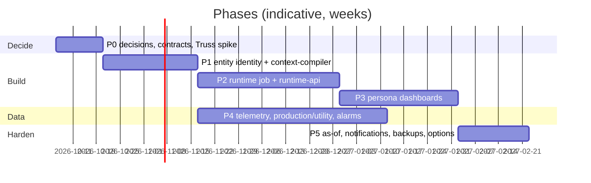

# Implementation plan: Truss-governed living assets, phased for this team's release process

Written 2026-09-30 against `10-truss-concept-map-and-gap-analysis.md` (findings F1–F10, decisions D-01…D-12)
and `11-target-architecture.md`. Every phase is a release cut with `build-release.py`, records its CHG
entry in `changes_tracker.md`, its settings in `prod_decision.md`, and its state in `checklist.md`. Effort
ranges assume the current team shape (one full-stack engineer with agent support, one control engineer
for plant data); they are estimates, not commitments.

## 1. Ordering principle

1. **Identity before everything** (F2): no dashboard, job or ledger is worth building until records carry
   `entity_id`.
2. **Reuse the control plane** (F1): the compiler ships on the gate-config pattern before any new
   evaluator exists.
3. **Prove on data the plant already has**: loop verdicts, conditions, live loop metrics and instrument
   health attributed to units and areas make a real, non-simulated living object in phase 2. Production,
   energy and availability follow their data sources (phase 4).
4. **Each phase leaves the plant runnable** with the previous release's behaviour intact (additive schema,
   new services behind `START_*` knobs, new job submitted last).

## 2. Phase 0: decisions, contracts, Truss integration spike (2 weeks, no plant change)

**Goal.** Close D-01…D-12, fix the package contract v1, prove a Truss export can be read.

| Task | Deliverable | Proof |
|---|---|---|
| 0.1 Record decisions | `MIGRATION_LOG.md` decisions #18–#22 (source-of-truth split, entity id as runtime key, control-plane reuse, SignalR-first push, no Kafka Connect); correct decision #5 text to the five-node HDPE path (F10) | reviewed section |
| 0.2 Truss export contract | `docs/truss/export-contract-v1.md`: entity, relationship, KPI, target, calendar, persona, view, drill-rule shapes; `context_revision`; effective dates | one real Truss export of the HDPE model parses in a spike (`scripts/truss/parse-export.py`) |
| 0.3 Runtime package contract | `contracts/runtime-package/v1/{manifest,entity}.schema.json` (the `contracts/instrumental-health/v1` precedent) | schema tests |
| 0.4 Telemetry envelope contract | `contracts/telemetry/v1/sample.schema.json` with `entity_id`, `uns_path`, `field`, `uom`, quality, three timestamps | schema tests |
| 0.5 Data-source inventory for the Plant Manager KPIs | table: KPI → source system → MQTT topic or none → owner → availability date (F4) | signed off by the control engineer |
| 0.6 Capacity note | rates and retention per new store, the disk budget line for `prod_decision.md` §3 | reviewed |
| 0.7 Doc corrections | `architecture_document.md` §2–3 (StreamPipes, `raw-opc-events`, fallback processor, enrichment), `docs/cplm-consumer-cutover-runbook.md` group name, `CLAUDE.md` fallback sentence | commits |

Records: `checklist.md` "Truss living assets" board opened; no CHG (no deployable change).

## 3. Phase 1: entity identity and the context compiler (3–4 weeks)

**Goal.** A Truss revision becomes a validated, signed runtime package on a compacted topic, ACKed by a
worker, with every HDPE entity carrying an `external_id` in asset-model.

**Scope**

| Area | Change |
|---|---|
| asset-model | columns `external_source TEXT`, `external_id TEXT`, `context_revision INT` (partial unique index on `(external_source, external_id) WHERE NOT is_deleted`); `POST /assets/project` (idempotent upsert by external id, returns the id map; body-limited at the gateway like `/bulk`); `GET /assets/export?site=`; publish `asset-events` for every projected change (the cache-bust trap); `AssetDto` gains the new fields |
| binding-resolver | none (the compiler calls `/resolve/batch` as-is; `provenance` is the validation signal) |
| context-compiler (new) | service skeleton from the cplm-api layout; `traverse_context` schema; import (`POST /imports` file or URL), validate (§7 of the architecture), project, package build, `ConfigStore`/`ConfigDeploymentService`/`BundleEnvelope` copied via `scripts/sync-config-plane.ps1`; ACK consumer (one member, `SingleMemberGuard` copied); `GET /packages/current`, `/packages/{id}`, `/deployments`, `/validation-reports/{id}`; audit events `CONTEXT_IMPORTED / VALIDATED / DEPLOYED / ACTIVE_VERIFIED / ROLLED_BACK`; `/health`, `/metrics` |
| Flink | `RuntimePackageBroadcastHandler` (reuse `BundleBroadcastHandler` with the new `record_kind`s) + a **stub runtime job** that only holds broadcast state, announces CAPABILITY (evaluators/reducers it supports) and ACKs (so activation is proven before evaluation exists) |
| Topics | `traverse.cpa.context.runtime-package.v1` (compact), `…acks.v1` (3 d) in `topics.txt`, `kafka-reset-lab-topics.ps1`, `CplmTopics.java` sibling `RuntimeTopics.java` |
| Auth | permissions `context.view`, `context.manage`, `context.approve` (script + catalog + `TraverseAuth.Perms`); `sync-auth-module.ps1` service list |
| Gateway | routes `api-context`; `docs/api-gateway.md` row |
| Frontend | admin tab "Plant context": imports, validation report, packages, deployments, ACK matrix (reuse `DeploymentStatus`, `ApprovalPanel` patterns from `/cpm/config`) |
| Tests | `tests/context-compiler.Tests` (validation rules, canonical hash, projection idempotency), Flink `RuntimePackageBroadcastTest`, `tests/integration` projection round-trip |

**Schema (four copies).** Lab `database/scripts/62_traverse_context_db.sql`, `63_traverse_context_schema.sql`,
`64_assets_external_id.sql`, `65_context_permissions.sql`; plant `scripts/ctx-01-context-schema.sql`,
`scripts/ctx-02-assets-external-id.sql` (online, additive); `migration/schema/06-traverse_context.sql` + edits to
`02-traverse_assets.sql`; `EnsureSchemaAsync` in context-compiler and the asset-model self-heal block.

**Scripts to run at the plant (order):** `ops/ctx-01-context-schema.sql` → `ops/ctx-02-assets-external-id.sql` →
`bash migration/02-apply-schemas.sh` → `ALLOW_CREATE_PREFIXED_TOPICS=yes bash migration/04-create-kafka-topics.sh`
→ image swap (`asset-model`, `context-compiler`, `gateway`, `auth-service`, `flink-jobmanager`, `ams-frontend`) →
`04b` (stub job) → import the HDPE export → PREPARE/APPLY → `ACTIVE_VERIFIED`.

**Acceptance.** Export → package in < 60 s for 400 entities; every HDPE entity resolves with
`provenance = asset-model`; a deliberately broken export (cycle, dangling contributor, unknown evaluator) is
refused with a report naming each error; a second import of the same export is a no-op (hash equal);
tombstone on a removed entity; rollback to the previous package. Records: CHG-034 (compiler), release
`v2.7` manifest, `prod_decision.md` §1 (new databases), §3 (package retention), §4 (signing key on JM/TM).

## 4. Phase 2: living-asset runtime job and runtime-api (5–6 weeks)

**Goal.** Real living objects for the HDPE plant, areas, units and loops from data the plant already has
(gate verdicts, conditions, live loop metrics, instrument health), served by REST and SignalR.

**Scope**

| Area | Change |
|---|---|
| Flink `com.ams.flink.runtime` | `LivingAssetRuntimeJob` (attribute → living object → roll-up); `EntityState`, `EntityFieldUpdate`, `IssueRecord` POJOs with `schemaVersion`; evaluator library (`threshold`, `target_deviation`, `stagnation`, `stale`, `rate_of_change`, `coverage`) and reducers (`sum`, `avg`, `weighted_avg`, `worst_of`, `count_where`); `ExpressionEvaluator` extended with field references; calendar timers; restore-from-compacted-topics on start; `FailLoudIoTDBSink` to `root.runtime`; DLQ for unattributed records; CAPABILITY lists evaluators/reducers |
| runtime-api (new) | `traverse_runtime` schema (`entity_state_current`, `issue` daily partitions, `issue_action`, `issue_evidence_ref`, `retention_policy`, `FeaturePartitions` copy); two single-member consumers; REST routes of architecture §8; `/hubs/runtime` with real groups; scope filtering from `X-Auth-Scope` (claim may be absent in this phase → no filter); audit `ISSUE_ACKNOWLEDGED / COMMENTED / SHELVED / EVIDENCE_PINNED` |
| Attribution | compiler emits the `attribution` section from `cpm.loop_registry.asset_id` (via asset-model), `alias_mapping`, and UNS prefixes; loop verdict/condition/live records map to loop entities; unit/area/plant fields are `derived` reducers over children (`loops.attention`, `loops.monitored`, `status`) |
| IoTDB | `iotdb-init-ttl.sh` creates database `root.runtime` (TTL 730 d) |
| Topics | `traverse.cpa.runtime.entity-state.v1` (compact), `…issues.v1` (3 d), `…unattributed-dlq.v1` (3 d) |
| Gateway | `api-runtime`, `hubs-runtime` (ordered before `/hubs/**`), cache rows |
| Auth | `runtime.view`, `runtime.act` |
| Ops | `04b` submits the runtime job after Fusion; `flink-job-supervisor.sh` / `ensure_flink_jobs.py` roster; `migration/flink/JOBS.md`; Marun overlay for runtime-api; `START_RUNTIME` knob; `pg_dump` cron for the two new databases |
| Tests | evaluator and reducer unit tests (golden), `LivingAssetRuntimeJobTest` (MiniCluster: package APPLY re-walks state; tombstone clears; roll-up converges in ≤ 4 hops; restart restores from compacted topics), runtime-api consumer idempotency, hub group tests, `scripts/test-runtime-e2e.ps1` (lab: inject loop verdicts → unit and area states → issue open/close → API and hub) |

**Schema.** Lab `66_traverse_runtime_db.sql`, `67_traverse_runtime_schema.sql`, `68_runtime_permissions.sql`; plant
`scripts/rt-01-runtime-schema.sql`; `migration/schema/07-traverse_runtime.sql`; `EnsureSchemaAsync`. Retention rows
`ISSUES 180`, `ISSUE_ACTIONS 730` inserted by the schema.

**Scripts to run at the plant (order):** `ops/rt-01-runtime-schema.sql` → `02-apply-schemas.sh` → `04-create-kafka-topics.sh`
→ `iotdb-init` re-run for `root.runtime` → image swap (`flink-jobmanager`, `runtime-api`, `gateway`, `auth-service`) →
`docker rm -f` JM+TM → `04b` (eight jobs) → verify `/api/v1/cpm/capabilities` plus `/api/context/deployments` ACK matrix
(eight workers, one jar) → `GET /api/runtime/entities/HDPE`.

**Acceptance (from the pitch's table, in our terms).** Same field via `/entities/{id}` and via a parent's
`children[]` is identical; an injected loop verdict changes the unit's `loops.attention` within 5 s and the
plant's within 15 s; a stale loop flips `freshness` without inventing a value; an issue carries
`context_revision` and resolvable evidence refs; job cancel + resubmit restores every entity's last state
and re-emits open issues without duplicates; package APPLY of a changed threshold re-evaluates without a
restart; one member per new consumer group asserted by `/health`. Records: CHG-035 (runtime), release
`v2.8`, `prod_decision.md` §3 (issue retention, IoTDB `root.runtime` TTL, topic retention), §4 (runtime
heartbeat, parallelism), §5 (entity-state upsert indexes), §6 (any lab incident).

## 5. Phase 3: persona dashboards (4–5 weeks)

**Goal.** Plant Manager and Operations views over the living objects of phase 2; Maintenance view on
instrument health and conditions; Shift Supervisor view once the calendar exists; entity and issue pages;
drill rules from the package; scope and persona claims.

**Scope**

| Area | Change |
|---|---|
| Truss / compiler | persona, view, drill-rule and responsibility definitions in the export and manifest; `GET /packages/current` serves them |
| auth-service, gateway, TraverseAuth | `scope[]` and `persona` claims from `traverse_context.responsibility_assignment` (compiler-owned table, read over REST at token issue with a short cache); `X-Auth-Scope`, `X-Auth-Persona`; runtime-api and context-compiler filter reads by scope; `docs/auth-jwt-contract.md` |
| frontend-ob `/plant/*` | `runtimeApi.ts`, `useRuntime.ts` (batch reads, hub subscription, no eager fetches), `runtimeHref.ts` (drill rules), pages `PlantHome`, `KpiBreakdown`, `EntityPage`, `IssuePage`, `TopExceptions`; `KpiTile` sparkline; entity breadcrumb; persona switch in the top bar; `SLICE_NAV` + palette entries; ≤ 500 lines per file; OpenBridge tokens and alert components only |
| Views delivered | PlantOverview (tiles: loops monitored, needing attention, instrument health, availability of monitoring; unit summary grid; top exceptions), UnitOverview, LoopEntity (links into `/cpm/explorer` with `?loop=`), MaintenanceOverview (NE107 health lanes, open conditions), ShiftOverview (shift window from the calendar; production fields appear when phase 4 lands) |
| Tests | Playwright audit script per page (the `ui-v25-audit.mjs` pattern): 0 console errors, 0 failed calls, context preserved across four drills and a persona switch, no access change on switch |

**Scripts to run at the plant:** `ops/ctx-03-responsibility.sql` → `02-apply-schemas.sh` → image swap
(`auth-service`, `gateway`, `context-compiler`, `runtime-api`, `ams-frontend`) → `set-persona-assignments.py`
(ops file) for the first users. Records: CHG-036 (personas), release `v2.9`, `prod_decision.md` §4 (claim TTLs).

**Acceptance.** Identical metric across personas; drill keeps entity, window and revision; persona switch
never widens data; every tile shows quality and freshness; a plant user outside a scope gets an empty,
explained state, not a 500.

## 6. Phase 4: the data the Plant Manager KPIs need (parallel from phase 1; 6–8 weeks elapsed, plant-dependent)

**Goal.** Production, energy, utility and availability fields with real sources; alarm attribution if the
alarm lane is deployed.

| Track | Work | Depends on |
|---|---|---|
| 4A Telemetry profile | `ingestion-service` `MQTT_TELEMETRY` subscriber: `topic_template`, parameter → `field`, `quality_protocol`, entity resolution via a cached asset-model lookup (path or alias → `external_id`), `traverse.cpa.telemetry.v1` + DLQ; admin data-source wizard fields; `traverse.live.metrics` retired from the lab list | 0.5 inventory; Truss-managed measurement entities (phase 1) |
| 4B Production / utility sources | per the 0.5 inventory: production counters, steam/power/gas meters as MQTT data sources on the OT broker (owner: the plant's OT team) or as Truss `source` bindings to existing tags; targets and plan values authored in Truss | plant OT team |
| 4C Calculated KPIs | `energy.specific`, `production.shift_total` (calendar-closed sums), `availability` (`coverage` evaluator over expected intervals) in the package; roll-up rules with `non_overlapping: true` | 4A/4B |
| 4D Alarm attribution (only if D-07 is revisited) | runtime job consumes `traverse.alarm.live.alarms`; `alias_mapping` rows tag → path for alarm sources; `alarms.active/unacked` fields; issue evidence refs to `alarm_history` | alarm lane at the plant, `ams` database |
| 4E Telemetry history | `IoTDBPersistenceJob` sibling for telemetry under the UNS tree (`root.<uns>`), or the runtime job's `history` emission | 4A |

**Scripts to run:** data-source configs through `/api/ingestion` (ops JSON), topic creation, image swap
(`ingestion-service`, `flink-jobmanager` if 4D/4E), a new Truss revision with the KPI definitions
(PREPARE/APPLY, no image). Records: CHG-037 (telemetry), CHG-038 (production KPIs), `prod_decision.md` §3
(telemetry retention, IoTDB tree), §4 (quality protocol per source, expected intervals).

**Acceptance.** The pitch's ammonia walk-through, on HDPE data: production vs plan on the plant tile, unit
breakdown, specific energy against a Truss target, an issue opened on deviation with the telemetry sample
as evidence, drill to the trend. Unit totals equal the sum of their lines within rounding; sliding CPLM
values never enter a sum.

## 7. Phase 5: hardening and options (2–3 weeks)

| Item | Work |
|---|---|
| As-of history | `history` bindings carry `valid_from/valid_to` in the package; runtime-api `/history?asOf=` picks the series in force; compiler keeps package history (10 revisions) |
| Notifications | notification-service consumes `traverse.cpa.runtime.issues.v1`; policies and subscriptions in tables; templates per issue type; CPLM episodes reach it through issues, not directly |
| Backups | `migration/cron.d/cpa-backup`: nightly `pg_dump -Fc` of `traverse_context`, `traverse_runtime`, `traverse_cplm`, `traverse_auth` to the recovery directory with a 7-day rotation and a disk-floor check; documented restore drill |
| Runtime MQTT namespace (optional) | edge-node republish of entity state to `traverse/runtime/entity/{id}/state`; EMQX ACL rows and a service credential; only if a non-browser consumer needs it |
| Flink CEP (optional) | add `flink-cep` for sequence rules only if an assessment cannot be expressed as a state machine |
| Retirements | `analysis-service` (route, compose, DB kept read-only for one release), dead topics, unused JDBC dependency, the `KpiMap` branch without a sink |
| Observability | Grafana panels for runtime lag, unattributed DLQ rate, issue open/close rates; still profile-gated at the plant until remediation item 4 |

Records: CHG-039+, release `v3.0` or `v2.10` per the team's numbering; `prod_decision.md` §7 gains the runtime
items to decide again on another server.

## 8. Work breakdown and dependencies

| ID | Work item | Phase | Depends on | Estimate |
|---|---|---|---|---|
| W-01 | Decisions #18–#22, doc corrections | 0 | – | 2 d |
| W-02 | Truss export contract + parser spike | 0 | – | 3 d |
| W-03 | Package and telemetry JSON schemas | 0 | W-02 | 2 d |
| W-04 | KPI data-source inventory | 0 | – | plant-side |
| W-05 | asset-model external id, project/export endpoints | 1 | W-03 | 3 d |
| W-06 | context-compiler skeleton, DB, import, validation | 1 | W-05 | 8 d |
| W-07 | Package build, signing, deployment state machine, ACK consumer | 1 | W-06 | 5 d |
| W-08 | Flink broadcast handler + stub job + CAPABILITY | 1 | W-07 | 3 d |
| W-09 | Admin "Plant context" tab | 1 | W-07 | 3 d |
| W-10 | Phase 1 wiring (compose, gateway, auth, topics, ops SQL, manifest, E2E) | 1 | W-05…W-09 | 3 d |
| W-11 | Evaluators, reducers, expression fields (golden tests) | 2 | W-03 | 5 d |
| W-12 | LivingAssetRuntimeJob stages 1–3, restore, DLQ, IoTDB sink | 2 | W-08, W-11 | 10 d |
| W-13 | runtime-api DB, consumers, REST, hub, audit | 2 | W-03 | 8 d |
| W-14 | Attribution from loop registry and aliases | 2 | W-06 | 2 d |
| W-15 | Phase 2 wiring, `04b`, cron backup, E2E script | 2 | W-12, W-13 | 4 d |
| W-16 | Scope and persona claims (auth, gateway, TraverseAuth) | 3 | W-07 | 4 d |
| W-17 | Persona pages, hrefs, hub client, tiles | 3 | W-13 | 12 d |
| W-18 | Playwright audits, slice wiring | 3 | W-17 | 3 d |
| W-19 | Telemetry profile + entity resolution + DLQ | 4 | W-05 | 6 d |
| W-20 | Production / utility sources (plant) | 4 | W-04 | plant-side |
| W-21 | Calculated KPIs, calendar sums, roll-up rules | 4 | W-12, W-19 | 5 d |
| W-22 | Alarm attribution (conditional) | 4 | D-07 | 5 d |
| W-23 | As-of history, notifications, backups, retirements | 5 | W-15, W-18 | 8 d |

## 9. Test strategy

- **Unit**: evaluators and reducers with golden vectors; canonical hashing (RFC 8785 parity with the
  Python-pinned HMAC used by cplm-api); validation rules one test each; `runtimeHref` drill rules.
- **Contract**: JSON schemas for package, telemetry, entity-state and issue records; `contractVersion`
  on every record; additive-only evolution checked in `tests/contract`.
- **Flink MiniCluster**: package APPLY re-walk, tombstone, roll-up convergence, restore from compacted
  topics, DLQ on unattributed input, heartbeat cadence, calendar boundary close.
- **Service**: consumer idempotency (same record twice → one row), single-member guard, scope filtering,
  hub groups.
- **Lab E2E scripts** (`scripts/test-context-e2e.ps1`, `test-runtime-e2e.ps1`, `test-plant-ui-e2e.ps1`):
  export → package → ACTIVE_VERIFIED; injected loop verdicts and telemetry → entity states → issues →
  API/hub → UI; cancel/resubmit; rollback.
- **Simulation**: the pitch's ammonia example ported to the HDPE tree as `ams-sims/sim_living_asset.py`
  (production, steam, compressor efficiency, an instrument NAMUR flip) for demos and regression.
- **Acceptance table** (pitch §11 → ours): same KPI across personas; state JSON with sources and quality;
  update within seconds; drill keeps context; issue page lists exactly its evidence; historical query
  matches known data; missing data shows stale, never 0; scope enforced; broker restart → job resumes
  and UI reconnects; Truss republish changes logic without restart; 1000 msg/s sustained on the lab.

## 10. Risks and mitigations

| Risk | Mitigation |
|---|---|
| Truss export shape unknown until the spike | Phase 0 W-02 first; the compiler's importer is one adapter class; the package contract is ours |
| Plant Manager KPIs have no source data (F4) | Phase 4 tracks the plant's data, phases 1–3 deliver on loop data; the inventory (0.5) gates promises |
| Shared plant disk (F9) | retention rows and topic retention in the schema; capacity note before each release; issue revisions only on change |
| Sixteen slots, one TaskManager | runtime job at parallelism 2; measure on the lab; a second job only if needed |
| Scope claims touch every service's auth | claim optional in phase 2, enforced in phase 3; `sync-auth-module.ps1` |
| Two sources of truth during transition | compiler owns Truss-managed rows (`external_source='truss'`); hand-edited rows keep working; `GET /assets/export` for round trips |
| Silent drops | unattributed DLQ, fail-loud IoTDB sink, single-member guards, CAPABILITY mismatch → NACK |
| Sidebar rule vs context-preserving navigation | persona module uses in-page navigation and the top-bar persona switch; the sidebar stays as it is |

## 11. Records to keep as the work lands

- `checklist.md`: a "Truss living assets" board with one row per W-item (done / pending, commit, proof).
- `changes_tracker.md`: one CHG per phase in the current template (**Scope / What was wrong / What changed /
  Schema, four copies / Release wiring / Tests / End-to-end on the lab / Migration / Risks**) plus the
  "Release vN — what to build and run" section listing updated services and the ordered plant scripts.
- `prod_decision.md`: new rows in §1 (databases, topics, job), §3 (every retention value), §4 (signing key,
  heartbeat, parallelism, quality protocol per telemetry source), §5 (indexes), §7 (what to decide again).
- `MIGRATION_LOG.md`: decisions #18–#22 from phase 0.
- `docs/api-gateway.md`, `docs/auth-jwt-contract.md`, `migration/flink/JOBS.md`, `migration/UPDATE-RUNBOOK.md`:
  rows for every new route, claim, job and post-update check.
